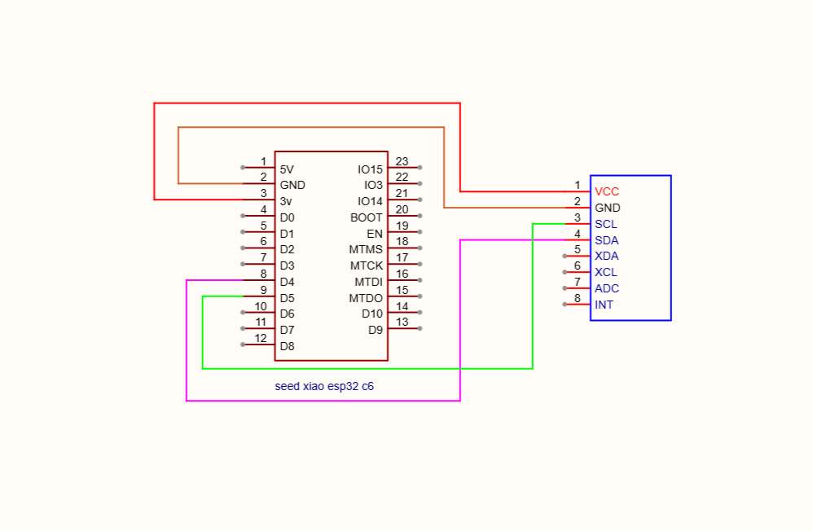
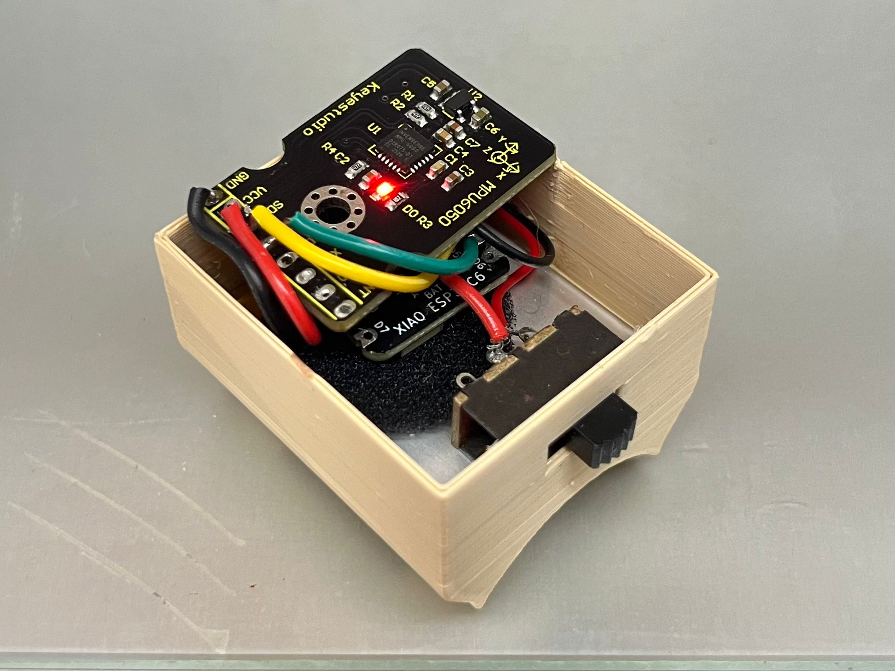
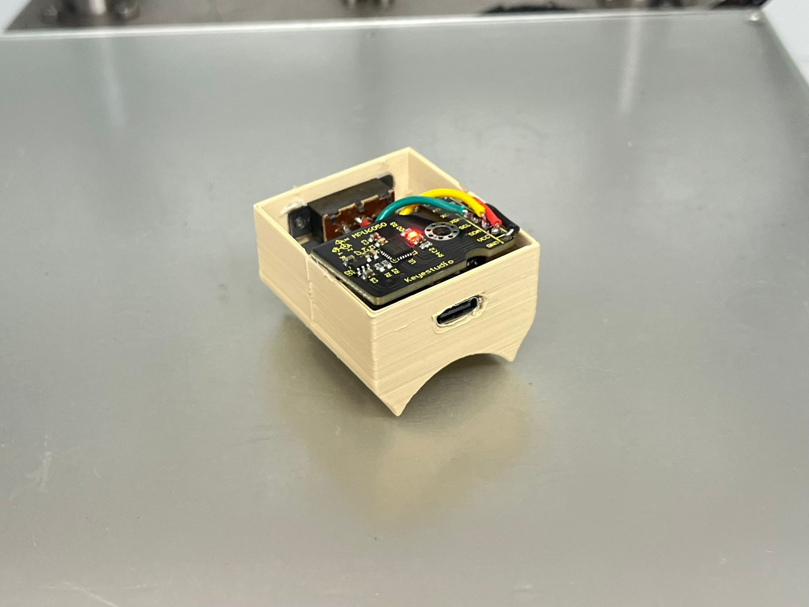
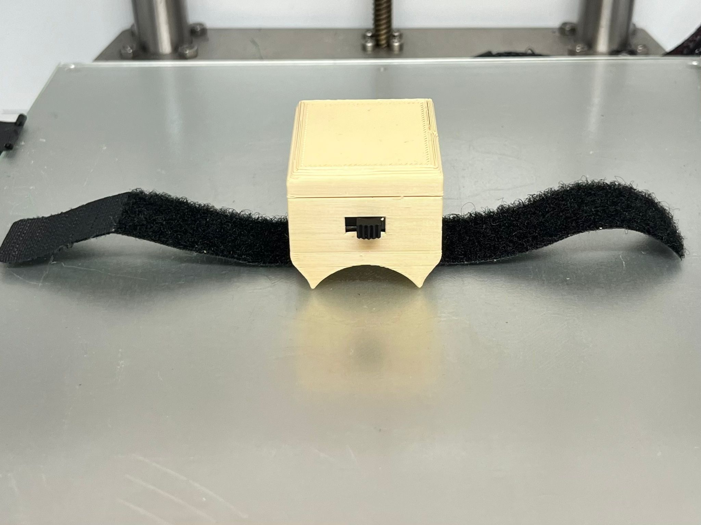

# Velocity Based Training (VBT) Sensor Tracker 🏋️‍♂️⚙️

## 📝 Overview
This repository details the design and engineering of a portable, embedded loT tracker developed to measure barbell repetition velocity and estimate RPE (Rate of Perceived Exertion).<!--[cite: 3] --> 
The project bridges mechanical enclosure design with embedded firmware to create a highly accurate, real-world sports technology tool.

## 🛠️ Hardware Architecture
The physical device was built with a focus on portability and durability during heavy lifting sessions:
* **Microcontroller:** Seeed Studio XIAO ESP32-C6<!--[cite: 3] -->
* **Sensor:** MPU6050 6-axis accelerometer and gyroscope<!--[cite: 3] -->
* **Communication:** I2C hardware connections<!--[cite: 3] -->
* **Enclosure:** Custom-designed 3D-printed housing<!--[cite: 3] -->

## 💻 Firmware Development
The logic and data processing were developed entirely from scratch:
* **Language:** C++<!--[cite: 3] -->
* **Environment:** Visual Studio Code via PlatformIO<!--[cite: 3] -->
  
## 📦 Physical Prototyping & MVP
The device is housed in a custom-engineered 3D-printed enclosure designed to withstand impact and vibration during heavy powerlifting sessions. 

  
  
  

## 📊 Project Execution & Management
The entire development lifecycle of this sensor was guided by structured project management protocols acquired during the **Santander Project Management Training**. Applied methodologies included phased prototyping, timeline execution, and hardware resource allocation to ensure a viable product delivery.

📄 **[View Santander Project Management Certificate](Santander.pdf)**

---
**Role:** Hardware & Firmware Lead<!--[cite: 3] -->  
**Date:** July 2026<!--[cite: 3] -->
