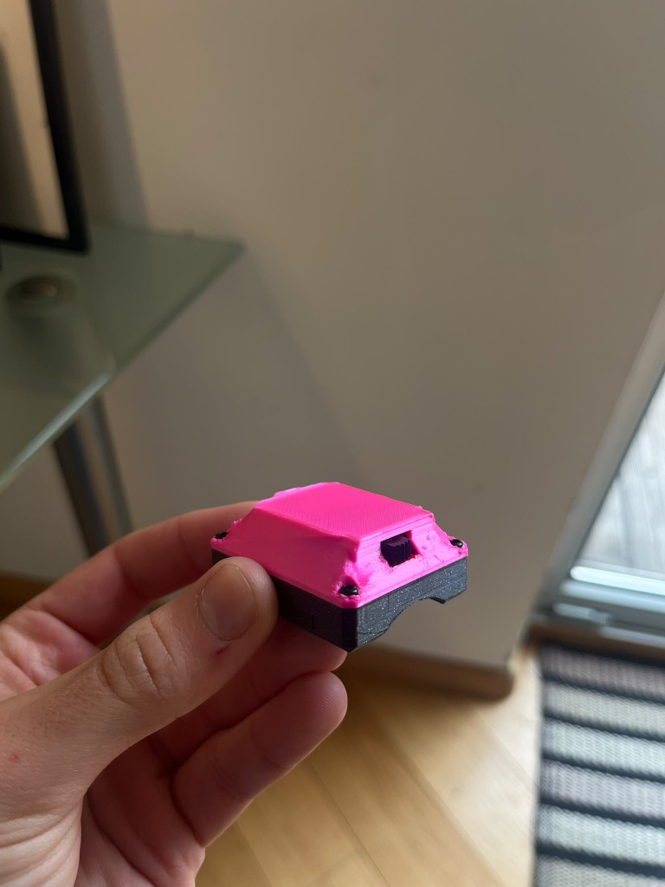
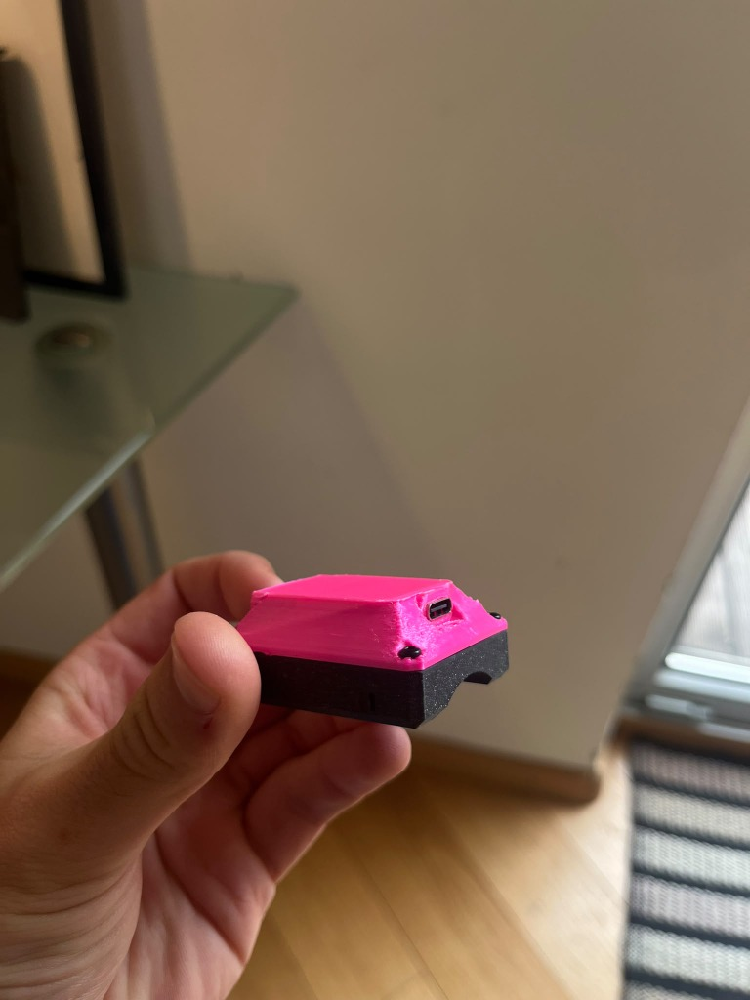
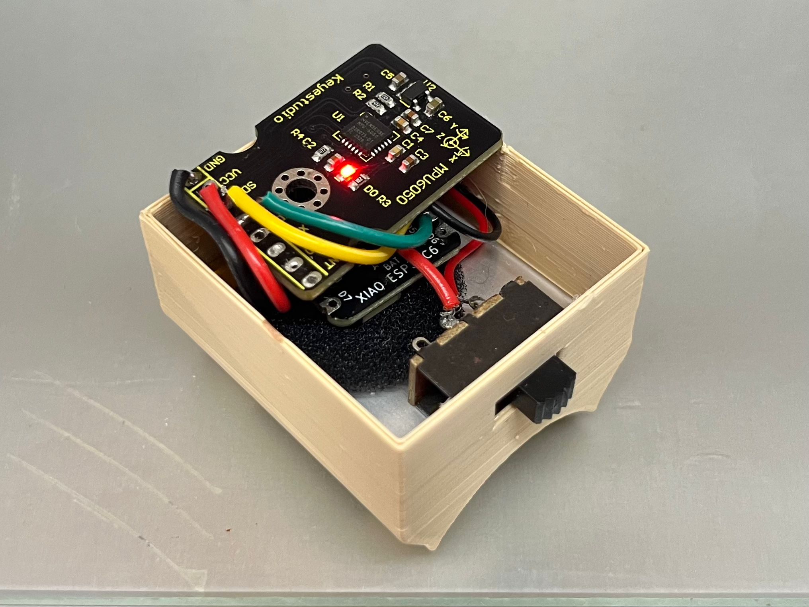
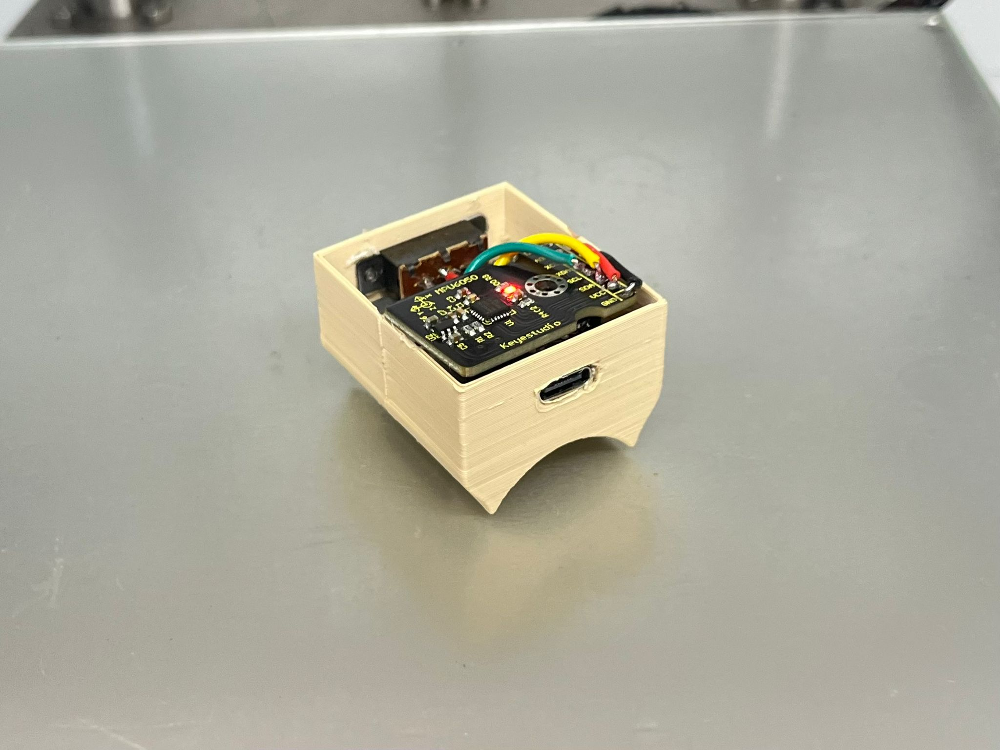
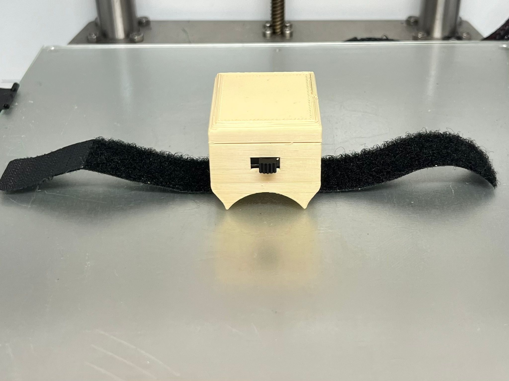
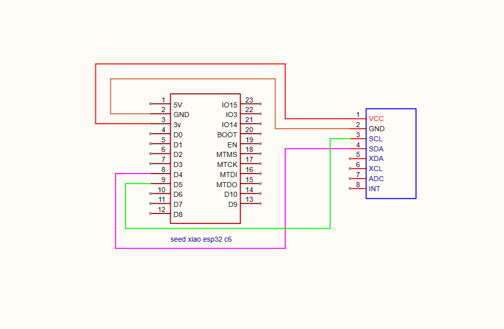

  

# Eros Sensor Mission

  <strong>High-Precision Barbell Kinematics &amp; Cloud Coaching Infrastructure</strong> 
  Pre-Startup Phase &bull; Olympos Technologies

---

## Executive Summary

Eros Sensor Mission is an integrated hardware and software biomechanics ecosystem engineered for high-performance powerlifting. Developed under the Olympos Technologies pre-startup campaign, the platform delivers objective kinematic feedback to coaches and athletes during competition preparation, replacing subjective exertion estimates with millisecond-accurate sensor fusion.

The system couples a barbell-mounted inertial sensor node with a low-latency edge physics engine, streaming repetition velocity, rate of perceived exertion, and 3D bar path deviation to an athlete cockpit and multi-rack coach console.

---

## Pre-Startup Mission & Core Accuracy Benchmarks

The primary engineering mission of Olympos Technologies is establishing clinical-grade measurement fidelity in a rugged, wireless form factor. 

### Benchmark Target: Within &plusmn;3% Velocity &amp; RPE Deviation
Our core performance directive is pushing sensor measurement accuracy to within a **&plusmn;3% deviation** from true barbell displacement velocity and exertion metrics, benchmarked directly against gold-standard optical linear transducers and high-speed motion-capture systems (e.g., GymAware, linear encoders, and dual-camera stereophotogrammetry). Achieving this level of precision on high-impact powerlifting platforms demands rigorous mathematical modeling at the edge:

* **Eliminating Impact Vibrations:** Isolating raw MEMS junction ringing caused by aggressive lockouts and metal-on-metal bar contact.
* **Thermal Zero-Rate Calibration:** Cancelling sensor drift under prolonged gym sessions where ambient temperature changes shift the accelerometer baseline.
* **True Vertical Gravity Decoupling:** Ensuring lateral barbell whip and athlete torso sway never contaminate vertical concentric velocity.

### Two-Way WebBLE as a Rapid Testing Vehicle
Rather than gating gym validation behind native mobile application store review cycles, the platform leverages the Web Bluetooth API. This architecture provides zero-install, cross-platform hardware connectivity directly inside modern web browsers. It functions as an agile testbed, allowing real-world data collection, firmware filter tuning, and UI stress testing on training floors across laptops, tablets, and smartphones.

### Roadmap to Integrated Native Application
All WebBLE transport logic, telemetry decoders, and trajectory rendering pipelines are architected as modular TypeScript and JavaScript modules. These components serve as the direct foundation for our upcoming native iOS and Android application, which will incorporate automated video synchronization, team roster scheduling, and deep historical analytics.

### Proprietary PCB Milestone
Current physical units utilize a Seeed Studio XIAO ESP32-C6 breakout board and MPU-6050 IMU to validate mechanical packaging and mathematical models. The primary ongoing hardware mission is routing and fabricating a proprietary multilayer PCB. This design integrates the ESP32 SoC, high-bandwidth 6-axis IMU, battery management system (BMS), and charging circuitry into a single ultra-compact board, significantly reducing weight, bill-of-materials cost, and assembly time.

---

## Coach-to-Athlete Cloud Architecture

Eros is built around the operational reality of elite strength coaching, supporting both shared-platform training sessions and remote competition supervision.

### Live Squad Workouts
During platform training, a coach oversees multiple athletes across different racks simultaneously. The Eros console aggregates live telemetry across all connected bars, displaying rep velocity and inter-set rest countdowns in real time. This automated density tracking allows coaches to enforce strict rest intervals and manage squad training volume without holding a stopwatch.

### High-Fidelity Remote Preparation
When an athlete trains remotely, the coach receives uncompromised kinematic resolution. Every completed repetition transmits Mean Concentric Velocity (MCV), peak velocity, lift-specific Minimum Velocity Threshold (MVT) estimated RPE, and lateral path sway. The coach can intervene mid-workout by transmitting load modifications or tactical cues directly to the athlete's screen. An offline-first sync bus buffers data locally if gym connectivity drops, ensuring zero telemetry loss.

---

## Hardware Architecture & Physical Prototyping

The physical sensor housing must survive severe bar oscillations, floor impacts, and chalk contamination typical of powerlifting environments:

| System Layer | Implementation Specification |
| :--- | :--- |
| Processing Unit | Seeed Studio XIAO ESP32-C6 (BLE 5.0, 3.3V Logic) |
| Inertial Sensing | MPU-6050 6-Axis Accelerometer and Gyroscope over 400 kHz I2C |
| Mechanical Enclosure | Generative topology modeled in CAD, 3D-printed impact-resistant chassis (40g) |
| Barbell Interface | High-force neodymium magnetic mounting with internal vibration isolation bosses |
| Active Objective | Transition to proprietary surface-mount PCB with integrated power management |

### Gen-2 Compact Enclosure Prototyping
Our latest physical revision introduces an ultra-compact two-piece chassis featuring an integrated hardware power rocker switch, recessed USB-C charging channel, and curved barbell saddle geometry for maximum contact stability under heavy acceleration:

  
  

### Initial Prototyping Milestones
Physical iterations were subjected to drop tests and barbell whip validation to optimize snap-fit tolerances and ensure sensor isolation:

  
  
  

---

## Edge Firmware & Biomechanical Modeling

Firmware running on the ESP32-C6 processes 6-axis motion data at 100 Hz, computing all physics locally before dispatching telemetry:

* **Madgwick AHRS Orientation:** Continuous quaternion fusion estimates Earth gravity and projects dynamic linear acceleration strictly along the vertical vector, eliminating false acceleration spikes from barbell whip and tilt.
* **Dual-Tier Dynamic ZUPT:** A multi-sample moving variance detector identifies motionless intervals to zero accumulated velocity error. Smooth online gyro bias calibration cancels junction thermal drift during extended sessions.
* **Horizontal Plane Deviation:** Integrates orthogonal linear acceleration with leaky high-pass filtering and turnaround clamping, preserving true horizontal displacement relative to the starting plumb line without unbounded drift.
* **Biomechanical Phase Segmentation:** A finite state machine segments repetitions into Idle, Eccentric, and Concentric regimes, incorporating sticking-point guards to protect against premature completion during maximum-effort grinds.

---

## Electrical Engineering & Bench Reference

For hardware development, debugging, and verification of initial prototypes, the edge node is wired according to the reference I2C schematic below:

  

The sensor interface communicates over 3.3V logic with pull-up resistors on the SDA and SCL lines, ensuring stable 400 kHz packet transmission during violent bar deceleration.

---

## Project Execution & Engineering Methodology

All hardware prototyping, CAD fabrication, firmware revisions, and validation protocols are executed using Scrum methodologies. Development operates in two-week sprints focused on clear vertical deliverables, risk reduction, and empirical gym testing.

Project execution frameworks and resource allocations are guided by protocols certified through the Santander Project Management Training.

[View Santander Project Management Certificate](Santander.pdf)

---

**Project Lead:** Guilherme Camilo  
**Venture:** Olympos Technologies  
**Mission:** Eros Sensor Mission  
**Timeline:** July 2026 – Present
