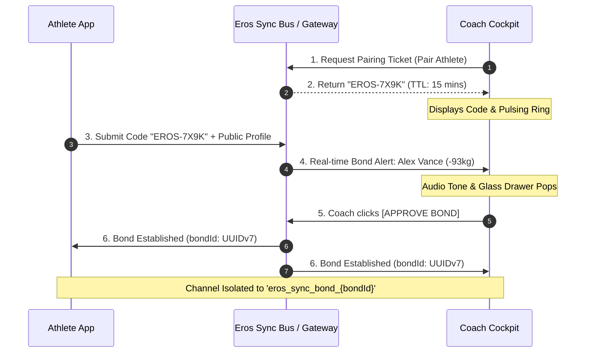

# Eros Coach Portal & Cloud Architecture: Comprehensive Technical Specification & Implementation Plan

**Publication-Grade Engineering Blueprint & Architectural Master Plan**  
**Document Version:** 1.0.0 (Production Master Specification)  
**Classification:** System Architecture, Cryptographic Security & High-Performance UI/UX Specification  
**System Ecosystem:** Eros Velocity-Based Training (VBT) Platform  
**Target Environments:** Athlete Spatial Glass & Coach Dark Cockpit (`body.portal-coach`)  
**Workspace:** `c:\Users\gcami\Documents\VBTanti`  
**Date:** October 2026  
**Status:** Authoritative Deliverable (Fulfilling Requirements R1, R2, R3, R4, R5)  

---

## Table of Contents

1. [Executive Summary & Architectural Overview](#1-executive-summary--architectural-overview)
   - 1.1 [Vision of the Eros Coaching Ecosystem](#11-vision-of-the-eros-coaching-ecosystem)
   - 1.2 [Dual-Persona Architecture & Design System Integration](#12-dual-persona-architecture--design-system-integration)
   - 1.3 [Client-Side Synchronization & Backend Approval Gate Governance](#13-client-side-synchronization--backend-approval-gate-governance)
2. [Cloud Storage Architecture for Athlete Data (Requirement R1)](#2-cloud-storage-architecture-for-athlete-data-requirement-r1)
   - 2.1 [Comparative Evaluation of Backend Architectures](#21-comparative-evaluation-of-backend-architectures)
   - 2.2 [Architectural Recommendation: Supabase (PostgreSQL 15+ & Realtime)](#22-architectural-recommendation-supabase-postgresql-15--realtime)
   - 2.3 [Production Data Schemas](#23-production-data-schemas)
     - 2.3.1 [PostgreSQL DDL with Row-Level Security](#231-postgresql-ddl-with-row-level-security)
     - 2.3.2 [TypeScript Domain Contracts](#232-typescript-domain-contracts)
     - 2.3.3 [JSON Schema Specifications](#233-json-schema-specifications)
   - 2.4 [Synchronization Pipeline (Local Mode vs. Cloud Mode)](#24-synchronization-pipeline-local-mode-vs-cloud-mode)
   - 2.5 [Robust Offline Operation & Resilience](#25-robust-offline-operation--resilience)
3. [Manual Coach-Athlete Bonding Mechanism & Security Architecture (Requirement R2)](#3-manual-coach-athlete-bonding-mechanism--security-architecture-requirement-r2)
   - 3.1 [Manual Linking & Pairing Workflows](#31-manual-linking--pairing-workflows)
   - 3.2 [Dual-Consent Handshake Protocol](#32-dual-consent-handshake-protocol)
   - 3.3 [Unilateral Unbonding & Immediate Revocation (Kill-Switch & GDPR)](#33-unilateral-unbonding--immediate-revocation-kill-switch--gdpr)
   - 3.4 [Authentication & Authorization Boundaries](#34-authentication--authorization-boundaries)
   - 3.5 [Granular Security Policies & Access Controls](#35-granular-security-policies--access-controls)
   - 3.6 [UI Interaction Mockups for Bonding Interfaces](#36-ui-interaction-mockups-for-bonding-interfaces)
4. [Coach Live Panel Specification (Requirement R3)](#4-coach-live-panel-specification-requirement-r3)
   - 4.1 [UI & Layout Design in `body.portal-coach`](#41-ui--layout-design-in-bodyportal-coach)
   - 4.2 [Live Squad Overview Grid & Multi-Athlete Roster](#42-live-squad-overview-grid--multi-athlete-roster)
   - 4.3 [Athlete Live Session Card Anatomy](#43-athlete-live-session-card-anatomy)
   - 4.4 [Expanded Athlete Focus Modal & Coach Cue Console](#44-expanded-athlete-focus-modal--coach-cue-console)
   - 4.5 [Active Telemetry Ingestion Architecture & Protocol Budgets](#45-active-telemetry-ingestion-architecture--protocol-budgets)
   - 4.6 [Performance Engineering, DOM Batching & Replay Queues](#46-performance-engineering-dom-batching--replay-queues)
5. [Athlete History Panel & Progress Metrics (Requirement R4)](#5-athlete-history-panel--progress-metrics-requirement-r4)
   - 5.1 [UI Architecture & Workout Feed in Coach Portal](#51-ui-architecture--workout-feed-in-coach-portal)
   - 5.2 [Totals Calculation Methodology & Mathematical Formulations](#52-totals-calculation-methodology--mathematical-formulations)
     - 5.2.1 [In-Competition Total Formulation](#521-in-competition-total-formulation)
     - 5.2.2 [Gym Total: Dual Models (Absolute 1RM vs. Load-Velocity e1RM)](#522-gym-total-dual-models-absolute-1rm-vs-load-velocity-e1rm)
     - 5.2.3 [Gym Total vs. In-Comp Total Gap Analysis](#523-gym-total-vs-in-comp-total-gap-analysis)
   - 5.3 [Weekly Adherence Tracker ("x/7 workouts completed this week with Eros")](#53-weekly-adherence-tracker-x7-workouts-completed-this-week-with-eros)
   - 5.4 [Monthly Calendar View Specification](#54-monthly-calendar-view-specification)
   - 5.5 [Data Access, Aggregation & Query Optimization](#55-data-access-aggregation--query-optimization)
6. [Phased Implementation Roadmap & Rollout Strategy](#6-phased-implementation-roadmap--rollout-strategy)
   - 6.1 [Roadmap Overview & Delivery Gates](#61-roadmap-overview--delivery-gates)
   - 6.2 [Detailed Breakdown of Phases 1 through 5](#62-detailed-breakdown-of-phases-1-through-5)
7. [Architectural Governance & Constraint Checklist](#7-architectural-governance--constraint-checklist)
   - 7.1 [Traceability Matrix (Requirements R1–R5 to Document Sections)](#71-traceability-matrix-requirements-r1r5-to-document-sections)
   - 7.2 [Authorized Eros Lexicon & Terminology Governance](#72-authorized-eros-lexicon--terminology-governance)

---

## 1. Executive Summary & Architectural Overview

### 1.1 Vision of the Eros Coaching Ecosystem

The **Eros Velocity-Based Training (VBT) Platform** bridges high-precision barbell kinematics with elite strength and conditioning coaching. In modern competitive strength facilities, athletes require split-second, non-intrusive biofeedback while under the load, while coaches supervising multiple lifting platforms demand real-time tactical awareness, velocity loss fatigue monitoring, and low-friction communication channels to prescribe immediate load adaptations.

Historically, strength tracking suffered from disjointed workflows: lifters logged sets into isolated smartphone journals or reviewed post-session video clips, while coaches analyzed fatigue hours or days after training concluded. Eros dissolves this latency through a unified, reactive architecture connecting the **Athlete View** (optimized for single-lift execution and recovery) and the **Coach View** (engineered for multi-athlete roster supervision, historical analysis, and prescriptive downlink intervention).

```
┌──────────────────────────────────────────────────────────────────────────────────────────────────┐
│                                 EROS COACHING ECOSYSTEM ARCHITECTURE                             │
│                                                                                                  │
│   ┌───────────────────────────────┐                  ┌────────────────────────────────────────┐  │
│   │         ATHLETE VIEW          │                  │              COACH VIEW                │  │
│   │     (Spatial Glass HUD)       │                  │        (ChatGPT Dark Cockpit)          │  │
│   │                               │                  │                                        │  │
│   │ • Barbell Lift Execution      │                  │ • Multi-Athlete Live Squad Overview    │  │
│   │ • Bryan Mann Velocity Colors  │                  │ • Velocity Loss Arc & Fatigue Alerts   │  │
│   │ • Celebratory Set Bloom FX    │                  │ • Athlete History & Calendar Grid      │  │
│   │ • Rest HUD with Countdown Ring│                  │ • 1-Tap Load Overrides & Technical Cues│  │
│   └──────────────┬────────────────┘                  └───────────────────▲────────────────────┘  │
│                  │                                                       │                       │
│                  │  Local In-Memory Event Dispatch                       │                       │
│                  ▼                                                       │                       │
│   ┌──────────────────────────────────────────────────────────────────────┴────────────────────┐  │
│   │                                       ErosSyncBus                                         │  │
│   │                           (Deterministic Reactive Event Bus)                              │  │
│   │                                                                                           │  │
│   │  • set:started          ───► Lift Context (Lift, Load kg, Target RPE)                     │  │
│   │  • rep:recorded         ───► Real-Time Kinematics (Mean/Peak Velocity, ROM, Loss %)       │  │
│   │  • set:completed        ───► Session Aggregation (Tonnage, Fatigue Cutoff Status)        │  │
│   │  • coach:cue            ───► Tactical Technical Directive ('Push floor away!')            │  │
│   │  • coach:load_override  ───► Prescriptive Weight Adjustment (20s Auto-Accept Ring)        │  │
│   │  • coach:load_response  ───► Athlete Confirmation / Rejection Resolution                  │  │
│   └──────────────────────────────────────────┬────────────────────────────────────────────────┘  │
│                                              │                                                   │
│                                              ▼ Cross-Tab / Multi-Screen Mirroring                │
│   ┌───────────────────────────────────────────────────────────────────────────────────────────┐  │
│   │                       BroadcastChannel('eros_coach_sync_v1')                              │  │
│   │          Synchronizes Athlete on Mobile Phone with Coach on Tablet / Laptop               │  │
│   └───────────────────────────────────────────────────────────────────────────────────────────┘  │
└──────────────────────────────────────────────────────────────────────────────────────────────────┘
```

### 1.2 Dual-Persona Architecture & Design System Integration

The platform provides a dual-persona interface within a single Progressive Web App (SPA):

1. **Athlete View (visionOS Spatial Glass)**:
   - Visual styling: `#050508` deep void canvas, translucent frosted glass containers with specular edge highlights (`rgba(255, 255, 255, 0.12)`), and dynamic biological neon accents.
   - Lift denomination colors: Electric Emerald (`#00FF66`) for Squat, Laser Cyan (`#00E5FF`) for Bench, and Punchy Red (`#FF3B30` background with `#FF857D` WCAG AA text tint) for Deadlift.
   - Clean, numeric-focused displays: Large monospace velocity readouts, radial completion gauges, and celebratory set bloom visual effects.
   - Responsive mobile grid: Strict 2-row `.controls-row` under $\le 430\text{px}$ ensuring stepper inputs and adjustment buttons never collide on handheld screens.

2. **Coach View (`body.portal-coach`, ChatGPT-Inspired Matte Obsidian Dark UI)**:
   - Visual styling: Clean, distraction-free matte obsidian hierarchy with zero glossy glare.
   - 4-Surface Architecture:
     - **Surface 0 (Canvas Base)**: `--coach-bg-canvas: #0d0d0d`
     - **Surface 1 (Panels & Ribbons)**: `--coach-bg-surface-1: #171717`
     - **Surface 2 (Elevated Cards & Tables)**: `--coach-bg-surface-2: #212121`
     - **Surface 3 (Interactive Hover)**: `--coach-bg-surface-hover: #2a2a2a`
     - **Surface 4 (Active / Selected State)**: `--coach-bg-surface-active: #2f2f2f`
   - Borders: `--coach-border-subtle: #2f2f2f`
   - Typography: Clean sans-serif and tabular monospace with strict WCAG AAA contrast ($> 13:1$ for `#ececec`, $> 7:1$ for `#b4b4b4`).
   - Seamless Persona Transition: Switched instantaneously via `#view-mode-toggle` in the navigation bar without page reloads, retaining active timers and telemetry buffers in memory.

### 1.3 Client-Side Synchronization & Backend Approval Gate Governance

In strict adherence to the platform's architectural guardrails:

- **Client-Side Sync by Default**: All athlete-to-coach set telemetry, repetition streaming, and feedback loops operate 100% client-side via `ErosSyncBus` (`sync-bus.js`), `BroadcastChannel('eros_coach_sync_v1')`, and `localStorage` (`vbt_workouts_v1`, `vbt_pr_data_v1`).
- **Backend Approval Gate**: No backend servers, external cloud databases, or remote network relays shall be provisioned or modified in production code without explicit user approval.
- **Architectural Readiness**: This master document specifies both the active, local-first client architecture and the forward-compatible cloud backend architecture (PostgreSQL DDL, Row-Level Security, Supabase Realtime, and OAuth/Passkeys) so that remote infrastructure can be activated seamlessly upon user consent.

---

## 2. Cloud Storage Architecture for Athlete Data (Requirement R1)

### 2.1 Comparative Evaluation of Backend Architectures

To identify the optimal cloud foundation for athlete telemetry storage, three candidate backend architectures were evaluated against the technical requirements of Velocity-Based Training:

| Evaluation Criteria | 1. Firebase / Google Cloud Firestore | 2. Supabase (PostgreSQL 15+ & Realtime) | 3. Custom Backend (Fastify/Go + TimescaleDB) |
|---|---|---|---|
| **Real-Time Streaming Latency** | **Moderate (120–280 ms)**. Snapshot listeners parse full document graphs; lacks raw sub-set byte streaming. | **Ultra-Low (<60–120 ms)**. Supabase Realtime utilizes Elixir Phoenix Channels over WebSockets with broadcast/presence capabilities. | **Lowest (<30–70 ms)**. Custom binary/JSON WebSocket framing terminated at edge (Cloudflare / Bun / Go). |
| **Offline Sync & SDK Capabilities** | **Strong Native SDK**. Built-in IndexedDB cache, but proprietary SDK (~120KB minified) with opaque multi-tab sync behavior. | **Configurable Client Layer**. SDK (`@supabase/supabase-js`) integrates cleanly with custom IndexedDB WAL outbox. | **Manual Implementation**. Client-side offline engine must be written from scratch (IndexedDB WAL + conflict resolution). |
| **Analytical Querying & Aggregates** | **Poor**. No native `GROUP BY`, no window functions, no linear regression. Computing e1RM profiles requires downloading thousands of raw docs. | **Exceptional**. Full ANSI SQL PostgreSQL 15+. Native linear regression (`regr_slope`, `regr_intercept`), JSONB queries, and high-performance indexing. | **Unmatched**. PostgreSQL + TimescaleDB hypertables for continuous time-series aggregation and automated compression. |
| **Security Rules / Ergonomics** | **Firestore Rules DSL**. Custom syntax; testing is cumbersome; cross-collection joins require costly `get()` rule calls. | **PostgreSQL Row Level Security (RLS)**. Industry standard. Declarative SQL policies leveraging session JWT claims (`auth.uid()`) and junction tables. | **Application Middleware**. Programmatic RBAC in Node/Go. Maximum flexibility but requires maintaining custom auth guards. |
| **Cost & Pricing Model** | **Pay-Per-Operation ($/read, $/write)**. High risk for VBT: a 10-rep set emitting live telemetry generates dozens of writes/reads per coach. | **Predictable Flat Compute Tier**. Flat monthly tiers based on compute size and database storage, NOT individual row reads/writes. | **Infrastructure Raw Cost (VPS/Cloud)**. $5–$40/mo per VPS. Zero per-query markups. High devops maintenance overhead. |
| **Self-Hosting vs Managed** | **100% Proprietary Lock-In**. Cannot self-host Firestore in production. Tied exclusively to Google Cloud Platform. | **Open-Source & Dual-Mode**. Hosted managed cloud platform available, OR 100% open-source self-hosting via Docker Compose. | **100% Self-Hosted / Sovereign**. Full ownership of code, infrastructure, and database migrations. |
| **Developer Ergonomics with Vanilla JS** | **Fair**. Modular SDK requires bundlers or bulky standalone script tags; complex configuration objects. | **Superb**. Can import `@supabase/supabase-js` via native browser ESM (`import { createClient } from 'https://esm.sh/@supabase/supabase-js'`) with zero bundlers. | **Fair to Good**. Requires writing custom fetch/WebSocket wrappers and client-side message serialization. |

### 2.2 Architectural Recommendation: Supabase (PostgreSQL 15+ & Realtime)

**Primary Recommendation: Supabase (PostgreSQL 15+ with PostgREST & Supabase Realtime)**

**Core Architectural Rationale:**
1. **Relational Mathematics for Biomechanics**: VBT requires relational analytics:
   - Calculating daily e1RM via linear regression ($V = m \cdot L + c$) using PostgreSQL's built-in `regr_slope()` and `regr_intercept()`.
   - Evaluating weekly adherence ($x/7$ days with completed sets) and 30-day volume loads using standard SQL date truncations (`date_trunc('week', completed_at)`).
   - Firestore's non-relational document model cannot perform these operations without downloading all historical documents into client memory, which drains mobile battery and incurs excessive billing costs.
2. **Vanilla JavaScript Compatibility**: Supabase provides an official ESM build loaded directly in the browser via CDN or hosted statically without Node.js bundlers, preserving Eros's clean single-page architecture.
3. **Low-Latency Telemetry via Phoenix Channels**: Supabase Realtime enables sub-80ms message delivery between athletes and coaches via WebSocket topics (`realtime:athlete_{id}`), ideal for in-flight rep telemetry and coach load overrides.
4. **Data Sovereignty & Zero Lock-In**: Standard PostgreSQL schemas ensure that athletes and private strength facilities can self-host via Docker or migrate to standard cloud providers (AWS RDS, GCP Cloud SQL) using standard `pg_dump`.
5. **Phase-Gated Integration**: Supabase operates as an opt-in cloud sync adapter behind `ErosSyncBus`. In offline or unauthenticated mode, Eros continues operating 100% locally with `BroadcastChannel` and IndexedDB. When cloud mode is authorized, the adapter connects without modifying UI or lift capture code.

---

### 2.3 Production Data Schemas

#### 2.3.1 PostgreSQL DDL with Row-Level Security

```sql
-- ============================================================================
-- EROS VBT PLATFORM: PRODUCTION POSTGRESQL DDL SPECIFICATION
-- Database Version: PostgreSQL 15+ (Compatible with Supabase / Standard PG)
-- ============================================================================

-- Enable required cryptographic extensions
CREATE EXTENSION IF NOT EXISTS "uuid-ossp";
CREATE EXTENSION IF NOT EXISTS "pgcrypto";

-- Custom Domain Types & Enums
CREATE TYPE bond_status_enum AS ENUM ('pending', 'active', 'revoked');
CREATE TYPE workout_status_enum AS ENUM ('in_progress', 'completed', 'cancelled');
CREATE TYPE lift_type_enum AS ENUM ('Squat', 'Bench', 'Deadlift', 'Other');
CREATE TYPE velocity_zone_enum AS ENUM (
    'starting_strength',      -- > 1.30 m/s
    'speed_strength',         -- 1.00 - 1.30 m/s
    'strength_speed',         -- 0.75 - 1.00 m/s
    'accelerative_strength',  -- 0.50 - 0.75 m/s
    'absolute_strength'       -- < 0.50 m/s (down to MVT)
);

-- ----------------------------------------------------------------------------
-- 1. TABLE: athletes
-- ----------------------------------------------------------------------------
CREATE TABLE athletes (
    id UUID PRIMARY KEY DEFAULT gen_random_uuid(),
    auth_id UUID UNIQUE NOT NULL, -- References auth.users(id) in Supabase/Auth system
    email VARCHAR(255) UNIQUE NOT NULL,
    full_name VARCHAR(120) NOT NULL,
    display_name VARCHAR(60),
    avatar_url TEXT,
    bodyweight_kg NUMERIC(5, 2) CHECK (bodyweight_kg > 0 AND bodyweight_kg < 500),
    gender VARCHAR(10) CHECK (gender IN ('male', 'female', 'other')),
    competition_total_kg NUMERIC(6, 2) DEFAULT 0.0,
    gym_total_kg NUMERIC(6, 2) DEFAULT 0.0,
    bonded_coaches UUID[] DEFAULT ARRAY[]::UUID[],
    preferences JSONB NOT NULL DEFAULT '{
        "theme": "visionos_glass",
        "sound_enabled": true,
        "haptics_enabled": true,
        "auto_accept_override_sec": 20,
        "default_weight_step_kg": 2.5,
        "primary_lifts": ["Squat", "Bench", "Deadlift"]
    }'::jsonb,
    created_at TIMESTAMPTZ NOT NULL DEFAULT timezone('utc', now()),
    updated_at TIMESTAMPTZ NOT NULL DEFAULT timezone('utc', now())
);

CREATE INDEX idx_athletes_auth_id ON athletes(auth_id);
CREATE INDEX idx_athletes_bonded_coaches ON athletes USING GIN (bonded_coaches);

-- ----------------------------------------------------------------------------
-- 2. TABLE: coaches
-- ----------------------------------------------------------------------------
CREATE TABLE coaches (
    id UUID PRIMARY KEY DEFAULT gen_random_uuid(),
    auth_id UUID UNIQUE NOT NULL, -- References auth.users(id)
    email VARCHAR(255) UNIQUE NOT NULL,
    full_name VARCHAR(120) NOT NULL,
    display_name VARCHAR(60),
    avatar_url TEXT,
    organization_name VARCHAR(120),
    team_id UUID,
    bonded_athletes UUID[] DEFAULT ARRAY[]::UUID[],
    preferences JSONB NOT NULL DEFAULT '{
        "theme": "matte_obsidian",
        "audio_alerts_enabled": true,
        "default_fatigue_cutoff_pct": 20.0,
        "auto_advance_roster": true
    }'::jsonb,
    created_at TIMESTAMPTZ NOT NULL DEFAULT timezone('utc', now()),
    updated_at TIMESTAMPTZ NOT NULL DEFAULT timezone('utc', now())
);

CREATE INDEX idx_coaches_auth_id ON coaches(auth_id);
CREATE INDEX idx_coaches_bonded_athletes ON coaches USING GIN (bonded_athletes);

-- ----------------------------------------------------------------------------
-- 3. TABLE: coach_athlete_bonds
-- ----------------------------------------------------------------------------
CREATE TABLE coach_athlete_bonds (
    id UUID PRIMARY KEY DEFAULT gen_random_uuid(),
    coach_id UUID NOT NULL REFERENCES coaches(id) ON DELETE CASCADE,
    athlete_id UUID NOT NULL REFERENCES athletes(id) ON DELETE CASCADE,
    status bond_status_enum NOT NULL DEFAULT 'pending',
    permissions JSONB NOT NULL DEFAULT '{
        "can_view_live": true,
        "can_view_history": true,
        "can_override_load": true,
        "can_send_cues": true,
        "can_edit_programs": true
    }'::jsonb,
    pairing_code VARCHAR(12),
    bonded_at TIMESTAMPTZ,
    revoked_at TIMESTAMPTZ,
    created_at TIMESTAMPTZ NOT NULL DEFAULT timezone('utc', now()),
    updated_at TIMESTAMPTZ NOT NULL DEFAULT timezone('utc', now()),
    CONSTRAINT uq_coach_athlete_pair UNIQUE (coach_id, athlete_id)
);

CREATE INDEX idx_bonds_coach_status ON coach_athlete_bonds(coach_id, status);
CREATE INDEX idx_bonds_athlete_status ON coach_athlete_bonds(athlete_id, status);

-- ----------------------------------------------------------------------------
-- 4. TABLE: workouts
-- ----------------------------------------------------------------------------
CREATE TABLE workouts (
    id UUID PRIMARY KEY DEFAULT gen_random_uuid(),
    client_local_id VARCHAR(64) NOT NULL, -- Maps to client `ws_1730123400000`
    athlete_id UUID NOT NULL REFERENCES athletes(id) ON DELETE CASCADE,
    date DATE NOT NULL DEFAULT CURRENT_DATE,
    name VARCHAR(120) NOT NULL, -- Strict naming: "Main deadlift + Bench", "SBD", etc.
    lift_types VARCHAR(60)[] NOT NULL DEFAULT ARRAY[]::VARCHAR(60)[],
    total_volume_kg NUMERIC(8, 2) NOT NULL DEFAULT 0.0,
    total_reps INTEGER NOT NULL DEFAULT 0,
    total_sets INTEGER NOT NULL DEFAULT 0,
    duration_sec INTEGER NOT NULL DEFAULT 0,
    notes TEXT,
    status workout_status_enum NOT NULL DEFAULT 'in_progress',
    started_at TIMESTAMPTZ NOT NULL,
    completed_at TIMESTAMPTZ,
    created_at TIMESTAMPTZ NOT NULL DEFAULT timezone('utc', now()),
    updated_at TIMESTAMPTZ NOT NULL DEFAULT timezone('utc', now()),
    CONSTRAINT uq_athlete_client_workout UNIQUE (athlete_id, client_local_id)
);

CREATE INDEX idx_workouts_athlete_date ON workouts(athlete_id, date DESC);
CREATE INDEX idx_workouts_athlete_status ON workouts(athlete_id, status);

-- ----------------------------------------------------------------------------
-- 5. TABLE: sets
-- ----------------------------------------------------------------------------
CREATE TABLE sets (
    id UUID PRIMARY KEY DEFAULT gen_random_uuid(),
    client_set_id VARCHAR(64) NOT NULL, -- Maps to client `set_1730123420000_1`
    workout_id UUID NOT NULL REFERENCES workouts(id) ON DELETE CASCADE,
    athlete_id UUID NOT NULL REFERENCES athletes(id) ON DELETE CASCADE,
    set_number INTEGER NOT NULL CHECK (set_number > 0),
    exercise_name VARCHAR(60) NOT NULL, -- Canonical: 'Deadlift', 'Squat', 'Bench'
    load_kg NUMERIC(5, 2) NOT NULL CHECK (load_kg >= 0.0),
    reps_count INTEGER NOT NULL DEFAULT 0,
    mean_velocity_mps NUMERIC(4, 2) NOT NULL DEFAULT 0.0,
    peak_velocity_mps NUMERIC(4, 2) NOT NULL DEFAULT 0.0,
    min_velocity_mps NUMERIC(4, 2) NOT NULL DEFAULT 0.0,
    rom_m NUMERIC(4, 2) NOT NULL DEFAULT 0.0,
    rpe NUMERIC(3, 1) DEFAULT 0.0,
    fatigue_pct NUMERIC(4, 1) NOT NULL DEFAULT 0.0,
    bryan_mann_zone velocity_zone_enum,
    rep_telemetry JSONB NOT NULL DEFAULT '[]'::jsonb,
    started_at TIMESTAMPTZ NOT NULL,
    completed_at TIMESTAMPTZ,
    created_at TIMESTAMPTZ NOT NULL DEFAULT timezone('utc', now()),
    CONSTRAINT uq_workout_set_number UNIQUE (workout_id, set_number)
);

CREATE INDEX idx_sets_workout_id ON sets(workout_id);
CREATE INDEX idx_sets_athlete_exercise ON sets(athlete_id, exercise_name, completed_at DESC);
CREATE INDEX idx_sets_mean_vel ON sets(athlete_id, exercise_name, load_kg, mean_velocity_mps DESC);

-- ----------------------------------------------------------------------------
-- 6. ROW LEVEL SECURITY (RLS) POLICIES
-- ----------------------------------------------------------------------------
ALTER TABLE athletes ENABLE ROW LEVEL SECURITY;
ALTER TABLE coaches ENABLE ROW LEVEL SECURITY;
ALTER TABLE coach_athlete_bonds ENABLE ROW LEVEL SECURITY;
ALTER TABLE workouts ENABLE ROW LEVEL SECURITY;
ALTER TABLE sets ENABLE ROW LEVEL SECURITY;

-- Athletes can view and edit their own profile
CREATE POLICY "Athletes self-management" ON athletes
    FOR ALL USING (auth_id = auth.uid());

-- Coaches can view athletes bonded to them with status 'active'
CREATE POLICY "Coaches view bonded athletes" ON athletes
    FOR SELECT USING (
        id IN (
            SELECT athlete_id FROM coach_athlete_bonds
            WHERE coach_id = (SELECT id FROM coaches WHERE auth_id = auth.uid())
            AND status = 'active'
        )
    );

-- Coaches self-management
CREATE POLICY "Coaches self-management" ON coaches
    FOR ALL USING (auth_id = auth.uid());

-- Bonds visibility: visible to the involved coach or athlete
CREATE POLICY "Bonds mutual visibility" ON coach_athlete_bonds
    FOR SELECT USING (
        coach_id = (SELECT id FROM coaches WHERE auth_id = auth.uid())
        OR athlete_id = (SELECT id FROM athletes WHERE auth_id = auth.uid())
    );

-- Workouts visibility: athlete owns, actively bonded coach can view
CREATE POLICY "Workouts athlete full access" ON workouts
    FOR ALL USING (athlete_id = (SELECT id FROM athletes WHERE auth_id = auth.uid()));

CREATE POLICY "Workouts coach read access" ON workouts
    FOR SELECT USING (
        athlete_id IN (
            SELECT athlete_id FROM coach_athlete_bonds
            WHERE coach_id = (SELECT id FROM coaches WHERE auth_id = auth.uid())
            AND status = 'active'
        )
    );

-- Sets visibility: athlete owns, actively bonded coach can view
CREATE POLICY "Sets athlete full access" ON sets
    FOR ALL USING (athlete_id = (SELECT id FROM athletes WHERE auth_id = auth.uid()));

CREATE POLICY "Sets coach read access" ON sets
    FOR SELECT USING (
        athlete_id IN (
            SELECT athlete_id FROM coach_athlete_bonds
            WHERE coach_id = (SELECT id FROM coaches WHERE auth_id = auth.uid())
            AND status = 'active'
        )
    );
```

---

#### 2.3.2 TypeScript Domain Contracts

```typescript
// ============================================================================
// EROS VBT PLATFORM: CORE DATA CONTRACTS & INTERFACES
// ============================================================================

export type BondStatus = 'pending' | 'active' | 'revoked';
export type WorkoutStatus = 'in_progress' | 'completed' | 'cancelled';
export type CanonicalLift = 'Deadlift' | 'Squat' | 'Bench' | string;

export type BryanMannZone =
  | 'starting_strength'     // > 1.30 m/s
  | 'speed_strength'        // 1.00 - 1.30 m/s
  | 'strength_speed'        // 0.75 - 1.00 m/s
  | 'accelerative_strength' // 0.50 - 0.75 m/s
  | 'absolute_strength';    // < 0.50 m/s

/**
 * High-precision repetition kinematics structure
 */
export interface RepTelemetry {
  rep_number: number;
  mean_velocity: number;           // m/s (MCV)
  peak_velocity: number;           // m/s (PV)
  duration_ms: number;             // Concentric time in milliseconds
  rom_m: number;                   // Vertical range of motion in meters
  rpe?: number;                    // 6.0 - 10.0
  loss_percent: number;            // Velocity loss % relative to fastest rep in set
  is_pr?: boolean;                 // Speed record at current load
  timestamp: number;               // Epoch millisecond timestamp
  displacement_samples?: number[]; // Sub-rep displacement curve points (optional)
}

/**
 * Individual set record with biomechanical aggregations
 */
export interface SetRecord {
  id: string;                      // Server UUIDv4
  client_set_id: string;           // Local client identifier: "set_1730123420000_1"
  workout_id: string;              // Foreign key referencing WorkoutRecord.id
  athlete_id: string;              // Foreign key referencing AthleteProfile.id
  set_number: number;              // 1-based index within workout
  exercise_name: CanonicalLift;    // 'Deadlift' | 'Squat' | 'Bench'
  load_kg: number;                 // Barbell load in kilograms (e.g. 210.0)
  reps_count: number;              // Completed repetitions count
  mean_velocity_mps: number;       // Mean concentric velocity across all reps
  peak_velocity_mps: number;       // Peak single repetition velocity
  min_velocity_mps: number;        // Slowest repetition velocity (sticking point indicator)
  rom_m: number;                   // Mean vertical range of motion in meters
  rpe: number;                     // Mean or terminal RPE
  fatigue_pct: number;             // Total velocity drop-off percentage across the set
  bryan_mann_zone: BryanMannZone;  // Classification zone
  rep_telemetry: RepTelemetry[];   // Chronological repetition records
  started_at: string;              // ISO-8601 UTC
  completed_at?: string;           // ISO-8601 UTC
  created_at: string;              // ISO-8601 UTC
}

/**
 * Workout session record containing multiple sets
 */
export interface WorkoutRecord {
  id: string;                      // Server UUIDv4
  client_local_id: string;         // Local client identifier: "ws_1730123400000"
  athlete_id: string;              // Foreign key referencing AthleteProfile.id
  date: string;                    // YYYY-MM-DD
  name: string;                    // Formatted workout title: "Main deadlift + Bench", "SBD"
  lift_types: CanonicalLift[];     // Canonical lifts performed
  total_volume_kg: number;         // Sum of (load_kg * reps_count)
  total_reps: number;              // Total volume reps
  total_sets: number;              // Total sets completed
  duration_sec: number;            // Elapsed workout time in seconds
  notes?: string;                  // Athlete or coach session notes
  status: WorkoutStatus;           // 'in_progress' | 'completed' | 'cancelled'
  sets?: SetRecord[];              // Nested sets array (when hydrated)
  started_at: string;              // ISO-8601 UTC
  completed_at?: string;           // ISO-8601 UTC
  created_at: string;              // ISO-8601 UTC
  updated_at: string;              // ISO-8601 UTC
}

/**
 * Athlete sovereign profile
 */
export interface AthleteProfile {
  id: string;                      // UUIDv4
  auth_id: string;                 // Auth provider user ID
  email: string;
  full_name: string;
  display_name?: string;
  avatar_url?: string;
  bodyweight_kg?: number;
  gender?: 'male' | 'female' | 'other';
  competition_total_kg: number;    // In-competition SBD total
  gym_total_kg: number;            // Current gym SBD total
  bonded_coaches: string[];        // Array of coach UUIDs
  preferences: {
    theme: string;
    sound_enabled: boolean;
    haptics_enabled: boolean;
    auto_accept_override_sec: number;
    default_weight_step_kg: number;
    primary_lifts: string[];
  };
  created_at: string;
  updated_at: string;
}

/**
 * Coach profile and organization context
 */
export interface CoachProfile {
  id: string;                      // UUIDv4
  auth_id: string;                 // Auth provider user ID
  email: string;
  full_name: string;
  display_name?: string;
  avatar_url?: string;
  organization_name?: string;
  team_id?: string;
  bonded_athletes: string[];       // Array of athlete UUIDs
  preferences: {
    theme: string;
    audio_alerts_enabled: boolean;
    default_fatigue_cutoff_pct: number;
    auto_advance_roster: boolean;
  };
  created_at: string;
  updated_at: string;
}

/**
 * Manual linking bond between Coach and Athlete
 */
export interface CoachAthleteBond {
  id: string;                      // UUIDv4
  coach_id: string;                // References CoachProfile.id
  athlete_id: string;              // References AthleteProfile.id
  status: BondStatus;              // 'pending' | 'active' | 'revoked'
  permissions: {
    can_view_live: boolean;
    can_view_history: boolean;
    can_override_load: boolean;
    can_send_cues: boolean;
    can_edit_programs: boolean;
  };
  pairing_code?: string;
  bonded_at?: string;
  revoked_at?: string;
  created_at: string;
  updated_at: string;
}
```

---

#### 2.3.3 JSON Schema Specifications

```json
{
  "$schema": "https://json-schema.org/draft/2020-12/schema",
  "$id": "https://eros-vbt.com/schemas/set-telemetry.json",
  "title": "ErosSetTelemetry",
  "description": "Validation schema for completed sets and repetition kinematic structures in Eros VBT",
  "type": "object",
  "required": [
    "client_set_id",
    "workout_id",
    "athlete_id",
    "set_number",
    "exercise_name",
    "load_kg",
    "reps_count",
    "mean_velocity_mps",
    "peak_velocity_mps",
    "rom_m",
    "fatigue_pct",
    "rep_telemetry",
    "started_at"
  ],
  "properties": {
    "client_set_id": {
      "type": "string",
      "pattern": "^set_[0-9]+_[0-9]+$"
    },
    "workout_id": {
      "type": "string",
      "format": "uuid"
    },
    "athlete_id": {
      "type": "string",
      "format": "uuid"
    },
    "set_number": {
      "type": "integer",
      "minimum": 1
    },
    "exercise_name": {
      "type": "string",
      "enum": ["Deadlift", "Squat", "Bench", "Other"]
    },
    "load_kg": {
      "type": "number",
      "minimum": 0.0,
      "maximum": 600.0
    },
    "reps_count": {
      "type": "integer",
      "minimum": 0
    },
    "mean_velocity_mps": {
      "type": "number",
      "minimum": 0.0,
      "maximum": 3.50
    },
    "peak_velocity_mps": {
      "type": "number",
      "minimum": 0.0,
      "maximum": 5.00
    },
    "rom_m": {
      "type": "number",
      "minimum": 0.0,
      "maximum": 2.50
    },
    "rpe": {
      "type": "number",
      "minimum": 0.0,
      "maximum": 10.0
    },
    "fatigue_pct": {
      "type": "number",
      "minimum": 0.0,
      "maximum": 100.0
    },
    "bryan_mann_zone": {
      "type": "string",
      "enum": [
        "starting_strength",
        "speed_strength",
        "strength_speed",
        "accelerative_strength",
        "absolute_strength"
      ]
    },
    "started_at": {
      "type": "string",
      "format": "date-time"
    },
    "completed_at": {
      "type": "string",
      "format": "date-time"
    },
    "rep_telemetry": {
      "type": "array",
      "items": {
        "type": "object",
        "required": [
          "rep_number",
          "mean_velocity",
          "peak_velocity",
          "duration_ms",
          "rom_m",
          "loss_percent",
          "timestamp"
        ],
        "properties": {
          "rep_number": { "type": "integer", "minimum": 1 },
          "mean_velocity": { "type": "number", "minimum": 0.0 },
          "peak_velocity": { "type": "number", "minimum": 0.0 },
          "duration_ms": { "type": "number", "minimum": 0 },
          "rom_m": { "type": "number", "minimum": 0.0 },
          "rpe": { "type": "number", "minimum": 0.0, "maximum": 10.0 },
          "loss_percent": { "type": "number", "minimum": 0.0, "maximum": 100.0 },
          "is_pr": { "type": "boolean" },
          "timestamp": { "type": "integer", "minimum": 0 },
          "displacement_samples": {
            "type": "array",
            "items": { "type": "number" }
          }
        }
      }
    }
  }
}
```

---

### 2.4 Synchronization Pipeline (Local Mode vs. Cloud Mode)

To strictly enforce the **Backend Approval Gate**, the synchronization pipeline operates in two distinct tiers:

```
┌──────────────────────────────────────────────────────────────────────────────────────────────────┐
│                                 EROS TELEMETRY & SYNC PIPELINE                                   │
│                                                                                                  │
│   [ Eros Barbell Unit ]                                                                          │
│            │ High-Precision Wireless Stream                                                      │
│            ▼                                                                                     │
│      [ app.js ]                                                                                  │
│      recordRepetition() / endActiveSet()                                                         │
│            │                                                                                     │
│            ├─► In-Memory UI State (Velocity, RPE, Bryan Mann Zone) ──► 60fps visionOS HUD        │
│            │                                                                                     │
│            ├─► ErosSyncBus (sync-bus.js)                                                         │
│            │         │                                                                           │
│            │         ├─► emit('rep:recorded') / emit('set:completed')                            │
│            │         │                                                                           │
│            │         ├─► [ Local Mode ] ──► BroadcastChannel('eros_coach_sync_v1')               │
│            │         │                      (Synchronizes local coach tab/display <1ms)          │
│            │         │                                                                           │
│            │         └─► [ Cloud Queue ] ──► CloudSyncAdapter                                    │
│            │                                       │                                             │
│            │                                       ▼                                             │
│            │                       ┌───────────────────────────────┐                             │
│            │                       │    IndexedDB Outbox WAL       │                             │
│            │                       │    (mutations_outbox)         │                             │
│            │                       └───────────────┬───────────────┘                             │
│            │                                       │                                             │
│            │                          { Online & Authenticated? }                                │
│            │                                 │           │                                       │
│            │                           YES ──┘           └── NO                                  │
│            │                            ▼                     ▼                                  │
│            │                   Supabase Realtime         Retain PENDING                          │
│            │                   + REST Sync Engine        Await Network Event                     │
│            │                            │                                                        │
│            ▼                            ▼                                                        │
│   localStorage                 Cloud PostgreSQL                                                  │
│   (vbt_workouts_v1)            (athletes, workouts, sets)                                        │
└──────────────────────────────────────────────────────────────────────────────────────────────────┘
```

1. **Client-Side Local Mode (Default & Active)**:
   - Sets and reps are captured locally.
   - Cross-tab/multi-display synchronization operates exclusively via `ErosSyncBus` and `BroadcastChannel('eros_coach_sync_v1')`.
   - Data persists strictly in `localStorage` (`vbt_workouts_v1`, `vbt_pr_data_v1`). Zero network packets leave the device.
2. **Cloud Mode (Phased & Opt-In)**:
   - Activated only when athlete or coach explicitly logs in and enables "Cloud Synchronization".
   - An adapter module (`ErosCloudSyncAdapter`) subscribes to `ErosSyncBus`.
   - Repetition kinematics are forwarded over Supabase Realtime WebSocket topics (`room:athlete_{athleteId}`).
   - Finalized sets are committed as atomic mutations to the IndexedDB Write-Ahead Log outbox before dispatching to PostgreSQL.

---

### 2.5 Robust Offline Operation & Resilience

Strength facilities often lack reliable cellular coverage. The storage engine is built from first principles to be **offline-first and partition-tolerant**:

1. **IndexedDB Write-Ahead Log (`eros_offline_db`)**:
   - `mutations_outbox`: Stores pending mutations with UUIDv7 keys and sequential timestamps.
   - `cached_workouts`: Local cache of historical workouts, overcoming the 5MB `localStorage` limit.
   - `sync_metadata`: Sequence vectors, last ACK sequence numbers, and authentication tokens.
2. **Mutation State Machine**:
   - `PENDING` $\rightarrow$ `SYNCING` $\rightarrow$ `SYNCED` $\rightarrow$ Eviction after 7 days.
   - On network drop, transitions back from `SYNCING` to `PENDING` without dropping records.
3. **Idempotent Inserts via Client-Generated UUIDs**:
   - Workouts and Sets generate UUIDs client-side upon creation (`client_set_id: "set_1730123420000_1"`).
   - PostgreSQL unique constraints (`uq_athlete_client_workout`, `uq_workout_set_number`) and `INSERT ... ON CONFLICT DO NOTHING` prevent duplicate sets even if network retries duplicate packets.
4. **Exponential Backoff with Jitter**:
   $$T_{\text{wait}} = \min\left(30000\text{ ms}, 1000\text{ ms} \times 2^{\text{retry\_count}}\right) + \text{random}(0, 500\text{ ms})$$
5. **Tiered Mobile Storage Pruning**:
   - **Active Hot Cache (IndexedDB)**: Current session + 30 days of workouts with dense repetition arrays (~1.5 MB).
   - **Warm Summary Cache (localStorage)**: Lifetime workout summaries (date, lift, total volume, best velocity, PR badges) without dense sub-rep arrays (~250 KB), enabling instant offline history rendering.
   - **Cold Cloud Tier (PostgreSQL)**: Full lifetime archive paginated on demand.

---

## 3. Manual Coach-Athlete Bonding Mechanism & Security Architecture (Requirement R2)

### 3.1 Manual Linking & Pairing Workflows

The platform provides three streamlined manual pairing workflows:

```
┌──────────────────────────────────────────────────────────────────────────────────────────────────┐
│                                MANUAL PAIRING WORKFLOW VECTORS                                   │
│                                                                                                  │
│   [ OPTION A: 6-CHAR CODE ]           [ OPTION B: QR / DEEP LINK ]      [ OPTION C: HANDLE SEARCH ]│
│   Coach generates code                Coach displays QR code             Athlete searches coach     │
│   "EROS-7X9K" (TTL: 15m)              (contains signed token)            handle "@marcus_vbt"       │
│            │                                       │                                  │              │
│            ▼                                       ▼                                  ▼              │
│   Athlete types code                  Athlete scans QR with camera       Athlete submits request    │
│   into Eros Settings                  or clicks deep link                with personal note         │
│            │                                       │                                  │              │
│            └───────────────────────────────┬──────────────────────────────────────────┘              │
│                                            ▼                                                         │
│                              [ DUAL-CONSENT HANDSHAKE ]                                              │
│                              Athlete shares public profile                                           │
│                              Coach explicitly clicks [Approve]                                       │
│                              Active Bond Established                                                 │
└──────────────────────────────────────────────────────────────────────────────────────────────────┘
```

1. **Option A: 6-Character Crockford Base32 Code (`EROS-7X9K`)**:
   - Coach taps **Pair Athlete**; the cockpit displays a 6-character code drawn from Crockford Base32 (`0-9`, `A-Z`, excluding `I`, `L`, `O`, `U` to eliminate ambiguity).
   - Generated via `crypto.getRandomValues` with a strict **15-minute Time-To-Live (TTL)**.
   - Athlete opens **Settings $\rightarrow$ Coach Connection** and inputs the code into formatted auto-advancing blocks.
2. **Option B: Signed QR Code & Universal Deep Link**:
   - Coach cockpit renders an SVG QR code containing an ephemeral, Ed25519-signed token embedding `{ coachId, nonce, exp: now + 900 }`.
   - Athlete taps **Scan Coach QR** using browser camera access (`getUserMedia`) or clicks a shared deep link (`https://eros.app/pair?t=...`).
3. **Option C: Directory Lookup by Coach Handle**:
   - For remote coaching, the athlete searches the coach's public handle (e.g. `@marcus_vbt`) and submits a connection request with an introductory note.

---

### 3.2 Dual-Consent Handshake Protocol

To prevent unsolicited links and protect athlete privacy, every connection requires **explicit mutual consent**:



| Phase | State Name | Trigger / Action | Payload / Security Checks |
|---|---|---|---|
| **Phase 1** | `TICKET_GENERATED` | Coach taps "Pair Athlete" | Generates 6-char Crockford Base32 code; registers 900s TTL. |
| **Phase 2** | `PENDING_APPROVAL` | Athlete enters code | Validates code, rate-limits attempts (max 5/60s), attaches public profile. |
| **Phase 3** | `DUAL_VERIFICATION` | Coach reviews request drawer | Audio chime alerts coach; displays athlete name, avatar, and requested scopes. |
| **Phase 4** | `BOND_ESTABLISHED` | Coach clicks [Approve] | Server/broker assigns permanent `bondId`; transports namespace to `eros_sync_bond_{bondId}`. |

---

### 3.3 Unilateral Unbonding & Immediate Revocation (Kill-Switch & GDPR)

Either party maintains the sovereign right to terminate the connection instantly:

1. **Instant Session Teardown**:
   - Athlete or coach taps **Revoke Connection**.
   - Client dispatches `bond:revoked` with `{ bondId, initiator, timestamp }`.
   - Active communication channels (`BroadcastChannel` or WebSocket topic) are immediately destroyed via `channel.close()`.
   - Coach's live squad monitor unbinds the athlete card immediately.
2. **Database Row-Level Lockout**:
   - The bond record updates to `status: 'revoked'`, `revoked_at: NOW()`.
   - PostgreSQL RLS policies immediately return `403 Forbidden` on any subsequent query by the coach.
3. **GDPR Compliance**:
   - **Data Portability (GDPR Art. 20)**: Athlete can export their complete training logbook at any time in JSON or CSV format (`vbt_export_v1.json`).
   - **Right to Erasure / Crypto-Shredding (GDPR Art. 17)**: If the athlete requests total account deletion, their Key Encryption Key (KEK) is destroyed from the KMS. All historical fatigue and velocity telemetry in cold backups becomes permanently undecryptable noise.

---

### 3.4 Authentication & Authorization Boundaries

1. **Progressive Identity Escalation**:
   - **Stage 1 (Anonymous Local Guest)**: Lifter trains immediately with Eros on the barbell. Local UUID assigned; data stays in `localStorage`.
   - **Stage 2 (Progressive Cloud Upgrade)**: When bonding with a coach, athlete authenticates via WebAuthn Biometric Passkeys (FaceID / TouchID / Windows Hello) or Magic Link.
   - **Stage 3 (Seamless Data Re-Keying)**: Local workout history is re-keyed to the authenticated UUID without data loss or duplication.
2. **5-Role Hierarchical RBAC**:
   - `ROLE_ATHLETE`: Sovereign owner (`telemetry:write`, `workout:read_self`, `bond:grant_revoke`).
   - `ROLE_COACH`: Assigned trainer (`telemetry:read_bonded`, `coach_cue:write`, `load_override:write`).
   - `ROLE_HEAD_COACH`: S&C Director (`roster:manage`, `assistant_coach:delegate`, `audit_log:read`).
   - `ROLE_PERF_ANALYST`: Sports Scientist (`telemetry:read_anonymized`, `regression_model:read`).
   - `ROLE_OBSERVER`: Guest / Medical Observer (`telemetry:read_live_ephemeral`, 2-hour session pass).
3. **Multi-Coach Conflict Arbitration**:
   - Head Coach prescriptions supersede Assistant Coach suggestions.
   - Athlete rest HUD displays full authority attribution (e.g. *"Head Coach Marcus prescribed [-5.0 kg]"*).

---

### 3.5 Granular Security Policies & Access Controls

#### 3.5.1 Cloud Firestore Security Rules (Alternative Serverless Stack)

```javascript
rules_version = '2';
service cloud.firestore {
  match /databases/{database}/documents {
    function isAuthenticated() { return request.auth != null; }
    function isOwner(userId) { return isAuthenticated() && request.auth.uid == userId; }
    function hasActiveBond(coachId, athleteId) {
      return exists(/databases/$(database)/documents/coach_athlete_bonds/$(coachId + '_' + athleteId)) &&
             get(/databases/$(database)/documents/coach_athlete_bonds/$(coachId + '_' + athleteId)).data.status == 'active';
    }

    match /athletes/{athleteId} {
      allow read: if isOwner(athleteId) || (isAuthenticated() && hasActiveBond(request.auth.uid, athleteId));
      allow write: if isOwner(athleteId);

      match /workouts/{workoutId} {
        allow read: if isOwner(athleteId) || (isAuthenticated() && hasActiveBond(request.auth.uid, athleteId));
        allow write: if isOwner(athleteId);

        match /sets/{setId} {
          allow read: if isOwner(athleteId) || (isAuthenticated() && hasActiveBond(request.auth.uid, athleteId));
          allow write: if isOwner(athleteId);
        }
      }
    }

    match /coach_athlete_bonds/{bondDocId} {
      allow read: if isAuthenticated() && (
        resource.data.coachId == request.auth.uid || resource.data.athleteId == request.auth.uid
      );
      allow create: if isAuthenticated() &&
        request.resource.data.athleteId == request.auth.uid && request.resource.data.status == 'pending';
      allow update: if isAuthenticated() && (
        (resource.data.coachId == request.auth.uid && request.resource.data.status in ['active', 'declined']) ||
        ((resource.data.coachId == request.auth.uid || resource.data.athleteId == request.auth.uid) && request.resource.data.status == 'revoked')
      );
    }
  }
}
```

#### 3.5.2 Ephemeral JWT Claims Structure

```json
{
  "header": { "alg": "EdDSA", "typ": "JWT", "kid": "eros_auth_key_2026_10" },
  "payload": {
    "iss": "https://auth.eros.app",
    "sub": "coa_018274a9-9182-72cc-ba19-091827364512",
    "aud": "https://api.eros.app",
    "role": "ROLE_COACH",
    "name": "Coach Marcus",
    "active_bonds": [
      { "athlete_id": "ath_019283a1-77ef-712c-91bb-8302fbc94120", "bond_id": "bnd_0192c3d4", "tier": "primary" }
    ],
    "iat": 1730123400,
    "exp": 1730124300,
    "jti": "jwt_0192d4e5-99aa-73bb-81dd-05241fe96342"
  }
}
```

- **Sliding-Window Rate Limiting**: Max 5 pairing code attempts within a 5-minute rolling window; breaches trigger a 60-second cooldown penalty with HTTP 429 response.
- **Append-Only Merkle Audit Logging**: All bonding creations, approvals, revokations, and load overrides append to a tamper-evident cryptographic hash chain.

---

### 3.6 UI Interaction Mockups for Bonding Interfaces

#### 3.6.1 Coach View: "Pair Athlete" Modal (ChatGPT-Inspired Dark Cockpit)

```
┌────────────────────────────────────────────────────────────────────────┐
│  PAIR NEW ATHLETE                                                  [✕] │
├────────────────────────────────────────────────────────────────────────┤
│                                                                        │
│   PAIRING CODE (TTL: 14:48)               QR CODE SCANNER              │
│   ┌──────────────────────────────┐        ┌──────────────────────┐     │
│   │                              │        │  █████  █ ▄▄▄▄ █ ██  │     │
│   │          EROS-7X9K           │        │  █ ▄▄ █ ▄ █▄▄█ █  █  │     │
│   │                              │        │  █▄▄▄█ █▄ █▄ █▄█ ██  │     │
│   └──────────────────────────────┘        │  ▄▄▄ ▄▄█▄▄▄▄  █ ▄ ▄  │     │
│   [📋 Copy Code]  [🔄 Regenerate]         │  █████ █ █▄█ █▄█ ▄   │     │
│                                           └──────────────────────┘     │
│                                           Point athlete camera here    │
│                                                                        │
│   ACTIVE PENDING REQUESTS (1)                                          │
│   ┌──────────────────────────────────────────────────────────────────┐ │
│   │ [Avatar] Alex Vance  •  Powerlifting (-93kg)                     │ │
│   │ Requested: Live Kinematic Stream, Workout History, Load Adjust   │ │
│   │ Entered: EROS-7X9K  (12 seconds ago)                             │ │
│   │                                                                  │ │
│   │            [ DECLINE ]               [ APPROVE BOND ]            │ │
│   └──────────────────────────────────────────────────────────────────┘ │
└────────────────────────────────────────────────────────────────────────┘
```

#### 3.6.2 Athlete View: "Coach Connection" Sheet (visionOS Spatial Glass)

```
┌────────────────────────────────────────────────────────────────────────┐
│  COACH CONNECTION                                                  [✕] │
├────────────────────────────────────────────────────────────────────────┤
│                                                                        │
│  CONNECT WITH YOUR COACH                                               │
│  Enter the 6-character code shown on your coach's screen:              │
│                                                                        │
│  ┌──────────────────────────────────────────────────────────────────┐  │
│  │  [ E ]  [ R ]  [ O ]  [ S ]  —  [ 7 ]  [ X ]  [ 9 ]  [ K ]       │  │
│  └──────────────────────────────────────────────────────────────────┘  │
│                                                                        │
│  [  📷 SCAN COACH QR CODE  ]       [  CONNECT TO COACH  ]              │
│                                                                        │
│  ────────────────────────────────────────────────────────────────────  │
│                                                                        │
│  CURRENT CONNECTED COACHES (1)                                         │
│  ┌──────────────────────────────────────────────────────────────────┐  │
│  │ [Avatar] COACH MARCUS  (Primary Head Coach)         [ACTIVE ●]   │  │
│  │ Facility: Iron Valley Strength Club                              │  │
│  │ Connected since: Oct 12, 2026                                    │  │
│  │                                                                  │  │
│  │ Permitted: Live Telemetry, Working Load Overrides                │  │
│  │                                                                  │  │
│  │                                      [ REVOKE AUTHORIZATION ]    │  │
│  └──────────────────────────────────────────────────────────────────┘  │
└────────────────────────────────────────────────────────────────────────┘
```

---

## 4. Coach Live Panel Specification (Requirement R3)

### 4.1 UI & Layout Design in `body.portal-coach`

The Live Panel is positioned as the primary monitoring surface in the Coach View (`body.portal-coach`), located directly below the squad header.

```
┌──────────────────────────────────────────────────────────────────────────────────────────────────┐
│                                   COACH LIVE PANEL SYSTEM TOPOLOGY                                │
│                                                                                                  │
│   [ ATHLETE PLATFORM 1 ]       [ ATHLETE PLATFORM 2 ]       [ ATHLETE PLATFORM N ]               │
│   Eros Collar + Mobile App     Eros Collar + Mobile App     Eros Collar + Mobile App             │
│            │                            │                            │                           │
│            ▼ Kinematics Stream          ▼ Kinematics Stream          ▼ Kinematics Stream         │
│   ┌──────────────────────────────────────────────────────────────────────────────────────────┐   │
│   │                                ACTIVE TRANSPORT LAYER                                    │   │
│   │   MODE A (Client-Side Production): ErosSyncBus + BroadcastChannel('eros_coach_sync_v1')  │   │
│   │   MODE B (Cloud Distributed RFC):  WebSocket (WSS) TLS 1.3 / Redis Pub/Sub Gateway       │   │
│   └──────────────────────────────────────────┬───────────────────────────────────────────────┘   │
│                                              │ Multiplexed Telemetry Packets                     │
│                                              ▼                                                   │
│   ┌──────────────────────────────────────────────────────────────────────────────────────────┐   │
│   │                     COACH CONTROL CENTER (`body.portal-coach`)                           │   │
│   │                                                                                          │   │
│   │   ┌──────────────────────────────────────────────────────────────────────────────────┐   │   │
│   │   │ 1. SQUAD OVERVIEW HEADER & SUMMARY BAR                                           │   │   │
│   │   │    • Connected Lifters (N)  • Actively Lifting (M)  • Avg Speed  • Alerts        │   │   │
│   │   │    • Filter Tabs: [All Connected] [Actively Lifting] [Resting] [Idle / Offline]  │   │   │
│   │   └──────────────────────────────────────────────────────────────────────────────────┘   │   │
│   │                                          │                                               │   │
│   │   ┌──────────────────────────────────────┴───────────────────────────────────────────┐   │   │
│   │   │ 2. LIVE SQUAD ROSTER GRID (Multi-Athlete Responsive Cards)                       │   │   │
│   │   │    ┌───────────────────────────┐  ┌───────────────────────────┐                  │   │   │
│   │   │    │ Athlete Card #1 (Rack 01) │  │ Athlete Card #2 (Rack 02) │  ... [Rack N]    │   │   │
│   │   │    │ • "Live with Eros" Pill   │  │ • "Resting (01:42)" Pill  │                  │   │   │
│   │   │    │ • Lift: "Main deadlift"   │  │ • Lift: "Main squat"      │                  │   │   │
│   │   │    │ • MCV (Bryan Mann Color)  │  │ • MCV (Bryan Mann Color)  │                  │   │   │
│   │   │    │ • Fatigue Loss Arc (18%)  │  │ • Fatigue Loss Arc (8%)   │                  │   │   │
│   │   │    └─────────────┬─────────────┘  └───────────────────────────┘                  │   │   │
│   │   └──────────────────┼───────────────────────────────────────────────────────────────┘   │   │
│   │                      │ Tap / Click Card Selection                                        │   │
│   │   ┌──────────────────▼───────────────────────────────────────────────────────────────┐   │   │
│   │   │ 3. EXPANDED ATHLETE FOCUS MODAL / SPLIT-SCREEN VIEW                              │   │   │
│   │   │    • Rep-by-rep velocity decay bar chart & velocity loss warning banner          │   │   │
│   │   │    • Live rest clock & biological readiness index                                │   │   │
│   │   │    • Rapid Coach Cue & Load Override Console (1-tap pills + 20s auto-accept ring) │   │   │
│   │   └──────────────────┬───────────────────────────────────────────────────────────────┘   │   │
│   └──────────────────────┼───────────────────────────────────────────────────────────────────┘   │
│                          │ Downlink Directives (`coach:cue`, `coach:load_override`)              │
│                          ▼                                                                       │
│   [ ATHLETE REST HUD: 20-Second Auto-Accept Glass Ring & Audio Chime ]                           │
└──────────────────────────────────────────────────────────────────────────────────────────────────┘
```

---

### 4.2 Live Squad Overview Grid & Multi-Athlete Roster

- **Header KPI Summary Bar**:
  - `CONNECTED ATHLETES`: Count of active bonded lifters.
  - `ACTIVELY LIFTING`: Lifters currently executing a set.
  - `RESTING`: Lifters in recovery intervals between sets.
  - `AVG SQUAD VELOCITY`: Mathematical mean speed across all active reps logged in the past 15 minutes.
  - `FATIGUE ALERTS`: Count of sets exceeding velocity loss cutoffs ($\ge 20\%$).
- **Filter Tabs**:
  - `All Connected (N)`: Shows all active athlete cards.
  - `Actively Lifting (M)`: Shows lifters currently in a set.
  - `Resting (R)`: Shows lifters in rest periods, ordered by rest timer duration descending.
  - `Idle / Offline (I)`: Shows lifters with dormant barbell links.

---

### 4.3 Athlete Live Session Card Anatomy

Each card in the grid represents an athlete workstation (e.g. Rack 01):

```
┌─────────────────────────────────────────────────────────────────────────┐
│ [Avatar] ALEX VANCE                 Rack 01       [ ● Live with Eros ]  │
│ ┌──────────────────────┐                          ┌───────────────────┐ │
│ │  MAIN DEADLIFT       │  Set 3 of 5 @ 180.0 kg   │ Rest: 00:00 (LIFT)│ │
│ └──────────────────────┘                          └───────────────────┘ │
├─────────────────────────────────────────────────────────────────────────┤
│   MEAN CONCENTRIC VELOCITY     PEAK VELOCITY        RANGE OF MOTION     │
│   ┌──────────────────────┐     0.68 m/s             58.4 cm             │
│   │      0.46 m/s        │     Peak Drive           Vertical Lockout    │
│   │ [STRENGTH-SPEED]     │                                              │
│   └──────────────────────┘                                              │
├─────────────────────────────────────────────────────────────────────────┤
│   SET FATIGUE & VELOCITY LOSS                                           │
│   ┌───────────────────────────────────────────────┐ 14.8% / 20.0% Max   │
│   │ [||||||||||||||||||||||||||·················] │ [SAFE RESERVE]      │
│   └───────────────────────────────────────────────┘                     │
│   Rep 1: 0.54 m/s  |  Rep 2: 0.50 m/s  |  Rep 3: 0.46 m/s (Fastest: R1) │
├─────────────────────────────────────────────────────────────────────────┤
│ [ ⚡ Focus & Directives ]  [ +2.5kg Next ]  [ -5% Deload ]  [ 💬 Cue ▾ ] │
└─────────────────────────────────────────────────────────────────────────┘
```

1. **Connection Status Pill**:
   - `Live with Eros`: Pulsing green dot (`#10a37f`), indicating active barbell kinematics.
   - `Resting (01:42)`: Cyan dot (`#00e5ff`) with incrementing rest timer.
   - `Idle (3m)`: Amber pill (`#f59e0b`).
2. **Current Exercise Badge ('Main' Naming Strict Enforcement)**:
   - `Main squat` (Electric Emerald `#00ff66`)
   - `Main deadlift` (Punchy Red `#ff3b30`)
   - `Bench` (Laser Cyan `#00e5ff`)
3. **Bryan Mann 5-Zone Velocity Continuum Highlight**:
   Mean Concentric Velocity (MCV) is rendered in 26px bold monospace, colorized by zone:

| Velocity Zone | Standard Continuum | Deadlift Continuum | Color Token | Hex Code | Physiological Adaptation |
|---|---|---|---|---|---|
| **Speed / Explosive** | $> 1.00\text{ m/s}$ | $> 0.85\text{ m/s}$ | Laser Cyan | `#00e5ff` | RFD, speed-strength |
| **Speed-Strength** | $0.75 - 1.00\text{ m/s}$ | $0.65 - 0.85\text{ m/s}$ | Electric Emerald | `#00ff66` | Dynamic effort power |
| **Strength-Speed** | $0.50 - 0.75\text{ m/s}$ | $0.45 - 0.65\text{ m/s}$ | Specular Gold | `#ffd700` | Optimal power/force blend |
| **Accelerative Strength** | $0.30 - 0.50\text{ m/s}$ | $0.25 - 0.45\text{ m/s}$ | Caution Orange | `#f59e0b` | Heavy strength drive |
| **Absolute Strength** | $< 0.30\text{ m/s}$ | $< 0.25\text{ m/s}$ | Punchy Red | `#ff3b30` | Maximum force, grinding |

4. **Fatigue % & Velocity Loss Arc**:
   $$\text{Velocity Loss } (\%) = \left(\frac{V_{\text{fastest}} - V_{\text{current}}}{V_{\text{fastest}}}\right) \times 100$$
   - Normal ($<15\%$): Emerald bar.
   - Caution ($15\text{--}19.9\%$): Amber bar (`APPROACHING CUTOFF`).
   - Cutoff Exceeded ($\ge 20\%$): Pulsing Punchy Red bar (`FATIGUE CUTOFF EXCEEDED — RACK BAR`).
5. **Real-Time Rest Clock**: Increments every second upon set completion: `01:42`.

---

### 4.4 Expanded Athlete Focus Modal & Coach Cue Console

Clicking any card opens the split-screen modal:

```
┌──────────────────────────────────────────────────────────────────────────────────────────────────┐
│  ATHLETE FOCUS: ALEX VANCE (RACK 01)  |  SESSION: MAIN DEADLIFT + BENCH           [ ✕ Close ]    │
├──────────────────────────────────────────────────────────────────┬───────────────────────────────┤
│  ACTIVE SET TELEMETRY & VELOCITY DECAY CURVE                     │  IMMEDIATE COACH CUE CONSOLE  │
│                                                                  │                               │
│  Set 3 of 5: Main deadlift @ 180.0 kg (Target RPE @8.0)          │  1-TAP LOAD ADJUSTMENTS:      │
│  Live Rest Timer: [ 01:28 ] (Target: 03:00)                      │  ┌──────────────────────────┐ │
│                                                                  │  │ [-5.0kg] [-2.5kg] [Keep] │ │
│  VELOCITY DECAY SPARKLINE (REPS 1-4):                            │  │ [+2.5kg] [+5.0kg]        │ │
│  Velocity (m/s)                                                  │  └──────────────────────────┘ │
│   0.60 ┤  ● R1 (0.54)                                            │                               │
│   0.50 ┤        ● R2 (0.50)                                      │  QUICK TECHNICAL DIRECTIVES:  │
│   0.40 ┤              ● R3 (0.46)                                │  ┌──────────────────────────┐ │
│   0.30 ┤                    ● R4 (0.41) [18.5% Loss]             │  │ ["Push through floor"]   │ │
│   0.20 ┼──────────────────────────────┄┄ Cutoff Ceiling (20%)   │  │ ["Squeeze lats before pull │ │
│        ┴────┬─────┬─────┬─────┬─────                             │  │ ["Drive hips at knees"]  │ │
│            Rep1  Rep2  Rep3  Rep4  Rep5                          │  │ ["Rack bar — cutoff!"]   │ │
│                                                                  │  └──────────────────────────┘ │
│  FATIGUE STATUS:                                                 │                               │
│  Current Loss: 18.5%  |  Fastest: 0.54 m/s  |  Latest: 0.41 m/s  │  CUSTOM TACTICAL DIRECTIVE:   │
│  Status: [ CAUTION: 1 Rep Remaining Before Failure ]             │  ┌──────────────────────────┐ │
│                                                                  │  │ Push floor away & stay tight│
│  REPETITION KINEMATICS TABLE:                                    │  └──────────────────────────┘ │
│  ┌─────┬──────────┬──────────┬─────────┬──────────┬────────────┐ │  [ 🚀 DISPATCH CUE TO HUD ]    │
│  │ REP │ MCV(m/s) │ PV (m/s) │ ROM(cm) │ DUR (ms) │ V-LOSS     │ │                               │
│  ├─────┼──────────┼──────────┼─────────┼──────────┼────────────┤ │  * Transmits to Athlete Rest  │
│  │  1  │  0.54    │  0.72    │  58.2   │   580    │  0.0% [Ref]│ │    HUD with 20-second         │
│  │  2  │  0.50    │  0.69    │  58.5   │   620    │  7.4%      │ │    Hands-Free Auto-Accept Ring│
│  │  3  │  0.46    │  0.68    │  58.4   │   690    │ 14.8%      │ │                               │
│  │  4  │  0.41    │  0.63    │  58.1   │   750    │ 18.5%      │ │  STATUS: Direct connection    │
│  └─────┴──────────┴──────────┴─────────┴──────────┴────────────┘ │  via Eros wireless link.      │
└──────────────────────────────────────────────────────────────────┴───────────────────────────────┘
```

---

### 4.5 Active Telemetry Ingestion Architecture & Protocol Budgets

#### 4.5.1 Sub-200ms Glass-to-Glass Latency Budget

```
┌──────────────────────────────────────────────────────────────────────────────────────────────────┐
│                                 LATENCY TIME-BUDGET BREAKDOWN                                    │
│                                                                                                  │
│  Event Phase                                           Local Mode Budget    Cloud WSS Budget     │
│  ──────────────────────────────────────────────────    ─────────────────    ────────────────     │
│  1. Repetition Lockout Kinematic Computation           10 ms                10 ms                │
│  2. Serialization & Ingestion into Transport Layer     2 ms                 4 ms                 │
│  3. Network Transit (BroadcastChannel / WSS TCP)       3 ms                 45 ms (TLS 1.3 Edge) │
│  4. Gateway Route & Redis Pub/Sub Dispatch             0 ms                 15 ms                │
│  5. Coach Client Deserialization & State Store Update  2 ms                 3 ms                 │
│  6. requestAnimationFrame Batching & DOM Paint         16 ms                16 ms                │
│  ──────────────────────────────────────────────────    ─────────────────    ────────────────     │
│  TOTAL GLASS-TO-GLASS LATENCY:                         33 ms                93 ms                │
│  SAFETY MARGIN BELOW 200ms CEILING:                    +167 ms (83.5%)      +107 ms (53.5%)      │
└──────────────────────────────────────────────────────────────────────────────────────────────────┘
```

#### 4.5.2 Typed Telemetry Ingestion JSON Schemas

1. **`LIFT_STARTED`**: Dispatched on set initialization with `sessionId`, `setId`, `setNumber`, `exercise`, `targetLoadKg`, `targetRpe`.
2. **`REP_COMPLETED`**: Dispatched on concentric lockout with `meanVelocity`, `peakVelocity`, `durationMs`, `romM`, `rpe`, `velocityLossPct`, `velocityZone`.
3. **`SET_COMPLETED`**: Dispatched on set completion with aggregated `meanSetVelocity`, `peakSetVelocity`, `velocityLossPct`, `durationSec`.
4. **`REST_TICK`**: 1-second cadence timer update driving coach countdowns.
5. **`COACH_LOAD_OVERRIDE`**: Coach prescription with `deltaKg`, `newWeightKg`, `cueText`, `autoAcceptSeconds: 20`.

---

### 4.6 Performance Engineering, DOM Batching & Replay Queues

- **Zero-Polling Push Architecture**: State mutations are 100% event-driven; no `setInterval` polling loops for telemetry data.
- **`requestAnimationFrame` Batching for 10+ Athletes**: Repetition updates are queued in a Map (`pendingUpdates`) and rendered in batch once per display frame ($<16.6\text{ms}$), eliminating layout reflow thrashing.
- **Connection Drop Recovery**: Heartbeat pings detect radio nulls after 12 seconds; upon reconnection, missed reps in the athlete's IndexedDB outbox replay with `ON CONFLICT DO NOTHING` idempotency.

---

## 5. Athlete History Panel & Progress Metrics (Requirement R4)

### 5.1 UI Architecture & Workout Feed in Coach Portal

The Athlete History Panel mounts within `#view-coach` as `#coach-athlete-history-panel`, styled with the 4-surface matte obsidian system (`#0d0d0d`, `#171717`, `#212121`, `#2f2f2f`).

```
┌────────────────────────────────────────────────────────────────────────────────────────────────────────────────────────┐
│  EROS COACH PORTAL  |  Athlete: [ Alex Vance (Rack 01) ▾ ]  |  View: [● Live Floor] [★ History & Progress]            │
├────────────────────────────────────────────────────────────────────────────────────────────────────────────────────────┤
│  ATHLETE PROGRESS & TOTALS OVERVIEW (BENTO QUAD):                                                                      │
│  ┌───────────────────────────┬───────────────────────────┬───────────────────────────┬───────────────────────────────┐ │
│  │ 🏆 IN-COMPETITION TOTAL   │ 🏋️ GYM TOTAL (EROS)       │ ⚖️ TOTAL DIFFERENTIAL      │ 📅 WEEKLY ADHERENCE           │ │
│  │ 602.5 kg                  │ 627.5 kg (Abs) / 634.2 e1R│ +25.0 kg (+4.15%)         │ 4/7 Completed This Week       │ │
│  │ 2026 State Championships  │ SQ: 222.5 • BP: 147.5     │ Typical Transfer (2-6%)   │ [●][●][●][●][○][·][·] Mon-Sun │ │
│  │ SQ:215.0 BP:142.5 DL:245.0│ DL: 257.5 kg (0.24 m/s)   │ Readiness: Peaked & Ready │ 🔥 6-Week Streak • 34.8t Vol  │ │
│  │ [✓ Verified Meet - IPF]   │ [Model: Absolute 1RM ▾]   │ Equipment calibrated Eros │ Compliance: 100% of Target    │ │
│  └───────────────────────────┴───────────────────────────┴───────────────────────────┴───────────────────────────────┘ │
│                                                                                                                        │
│  SUB-VIEW NAVIGATION TABS:                                                                                             │
│  [ 📅 Monthly Calendar View (Oct 2026) ]  [ 📋 Chronological Workout Feed ]  [ 📈 Load-Velocity Profiles & e1RM Trends ]│
│                                                                                                                        │
│  ┌──────────────────────────────────────────────────────────────────────────────────────────────────────────────────┐  │
│  │ ◄ PREV MONTH       OCTOBER 2026 (18 Sessions • 184.6t Total Volume • 142 Sets with Eros)       NEXT MONTH ► [TODAY] │  │
│  ├─────────────┬─────────────┬─────────────┬─────────────┬─────────────┬─────────────┬──────────────────────────────┤  │
│  │ MON         │ TUE         │ WED         │ THU         │ FRI         │ SAT         │ SUN                          │  │
│  ├─────────────┼─────────────┼─────────────┼─────────────┼─────────────┼─────────────┼──────────────────────────────┤  │
│  │ 28 (Sep)    │ 29          │ 30          │ 1           │ 2           │ 3           │ 4                            │  │
│  │             │             │             │ [Main squat]│ [Bench]     │ [Active Rec]│ —                            │  │
│  │             │             │             │ 11.2t • 5S  │ 7.8t • 4S   │ 2.4t • 2S   │                              │  │
│  ├─────────────┼─────────────┼─────────────┼─────────────┼─────────────┼─────────────┼──────────────────────────────┤  │
│  │ 5           │ 6           │ 7           │ 8           │ 9           │ 10          │ 11                           │  │
│  │ [Main deadl]│ [Bench]     │ — Rest      │ [Main squat]│ [Main deadl]│ [Acc Speed] │ — Rest                       │  │
│  │ + Bench     │ 8.1t • 4S   │             │ 12.5t • 6S  │ + Bench     │ 4.2t • 3S   │                              │  │
│  │ 14.8t • 6S  │             │             │             │ 15.2t • 7S  │             │                              │  │
│  ├─────────────┼─────────────┼─────────────┼─────────────┼─────────────┼─────────────┼──────────────────────────────┤  │
│  │ 12          │ 13          │ 14          │ 15          │ 16          │ 17          │ 18                           │  │
│  │ [Main deadl]│ [Bench]     │ — Rest      │ [Main squat]│ [Bench]     │ [Active Rec]│ — Rest                       │  │
│  │ 13.6t • 5S  │ 8.4t • 4S   │             │ 13.0t • 6S  │ 8.8t • 5S   │ 2.8t • 2S   │                              │  │
│  ├─────────────┼─────────────┼─────────────┼─────────────┼─────────────┼─────────────┼──────────────────────────────┤  │
│  │ 19          │ 20          │ 21          │ 22          │ 23          │ 24          │ 25                           │  │
│  │ [Main deadl]│ [Bench]     │ — Rest      │ [Main squat]│ [Main deadl]│ [Acc Speed] │ — Rest                       │  │
│  │ + Bench     │ 8.6t • 4S   │             │ + Bench     │ 16.0t • 7S  │ 4.5t • 3S   │                              │  │
│  │ 15.1t • 6S  │             │             │ 16.8t • 7S  │             │             │                              │  │
│  ├─────────────┼─────────────┼─────────────┼─────────────┼─────────────┼─────────────┼──────────────────────────────┤  │
│  │ 26 ★ TODAY  │ 27          │ 28          │ 29          │ 30          │ 31          │ 1 (Nov)                      │  │
│  │ [Main deadl]│ [Bench Sched│ [Rest Sched]│ [Main squat]│ [Bench Sched│ [Rest Sched]│                              │  │
│  │ + Bench     │             │             │ Sched       │             │             │                              │  │
│  │ 14.2t • 5S  │             │             │             │             │             │                              │  │
│  └─────────────┴─────────────┴─────────────┴─────────────┴─────────────┴─────────────┴──────────────────────────────┘  │
└────────────────────────────────────────────────────────────────────────────────────────────────────────────────────────┘
```

#### Chronological Workout Feed Card & Set Drawer

```
┌────────────────────────────────────────────────────────────────────────────────────────────────────────────────────────┐
│  SESSION CARD: 2026-10-26 — Main deadlift + Bench                                                      [▲ Collapse]    │
│  ┌──────────────────────────────────────────────────────────────────────────────────────────────────────────────────┐  │
│  │ Date: Monday, Oct 26, 2026 • 17:15 - 18:38 (83 mins) • 14,250 kg Volume • 5 Sets with Eros • Avg: 0.44 m/s      │  │
│  └──────────────────────────────────────────────────────────────────────────────────────────────────────────────────┘  │
│                                                                                                                        │
│  COMPLETED SETS PERFORMANCE BREAKDOWN:                                                                                 │
│  ┌─────┬───────────────┬──────────┬──────┬──────────┬──────────┬──────────┬──────────┬──────────────┬────────────┬─────┐  │
│  │ SET │ MOVEMENT      │ LOAD     │ REPS │ MCV      │ PV       │ ROM      │ V-LOSS   │ BRYAN MANN   │ RPE        │ACT  │  │
│  ├─────┼───────────────┼──────────┼──────┼──────────┼──────────┼──────────┼──────────┼──────────────┼────────────┼─────┤  │
│  │ S1  │ MAIN DEADLIFT │ 180.0 kg │ 4    │ 0.52 m/s │ 0.72 m/s │ 58.2 cm  │ 7.7%     │ ACCEL STR    │ @7.0       │[▼]  │  │
│  │ S2  │ MAIN DEADLIFT │ 210.0 kg │ 4    │ 0.44 m/s │ 0.62 m/s │ 58.0 cm  │ 11.4%    │ ABSOLUTE STR │ @8.0       │[▼]  │  │
│  │ S3  │ MAIN DEADLIFT │ 225.0 kg │ 3    │ 0.38 m/s │ 0.54 m/s │ 58.5 cm  │ 15.8%    │ ABSOLUTE STR │ @8.5       │[▼]  │  │
│  │ S4  │ MAIN DEADLIFT │ 240.0 kg │ 2    │ 0.31 m/s │ 0.46 m/s │ 57.8 cm  │ 19.4%    │ ABSOLUTE STR │ @9.5       │[▼]  │  │
│  │ S5  │ BENCH         │ 135.0 kg │ 5    │ 0.42 m/s │ 0.58 m/s │ 34.2 cm  │ 16.7%    │ ACCEL STR    │ @8.5       │[▼]  │  │
│  └─────┴───────────────┴──────────┴──────┴──────────┴──────────┴──────────┴──────────┴──────────────┴────────────┴─────┘  │
│                                                                                                                        │
│  EXPANDED REPETITION STREAM [Set 4: Main deadlift — 240.0 kg]:                                                         │
│  ┌──────────────────────────────────────────────────────────────────────────────────────────────────────────────────┐  │
│  │ • Rep 1: MCV 0.36 m/s  |  PV 0.49 m/s  |  ROM 58.0 cm  |  Duration: 840ms  |  Loss: 0.0%    |  Absolute Strength  │  │
│  │ • Rep 2: MCV 0.29 m/s  |  PV 0.42 m/s  |  ROM 57.6 cm  |  Duration: 1020ms |  Loss: 19.4%   |  Grind / Near MVT   │  │
│  │ Coach Directive Issued: "Keep chest proud off floor. Cutoff reached." Accepted [-5.0 kg].                        │  │
│  └──────────────────────────────────────────────────────────────────────────────────────────────────────────────────┘  │
└────────────────────────────────────────────────────────────────────────────────────────────────────────────────────────┘
```

---

### 5.2 Totals Calculation Methodology & Mathematical Formulations

#### 5.2.1 In-Competition Total Formulation

The In-Competition Total ($\text{Total}_{comp}$) represents verified meet performance under official sanction:

$$\text{Total}_{comp} = \max(\text{SQ}_{comp}) + \max(\text{BP}_{comp}) + \max(\text{DL}_{comp})$$

- Official meet record schema: tracks meet date, federation, division, bodyweight, 3 attempts per lift, good lift flags, and DOTS score (IPF 2019 polynomial).
- Edge cases handled:
  - Bench-Only competitions: Displays `Bench-Only Total: X kg` (never an artificial SBD total).
  - Bomb-out / Disqualification: Flagged as `Incomplete SBD Comp Meet (DQ)`; individual successful attempts retained in single-lift records.

---

#### 5.2.2 Gym Total: Dual Models (Absolute 1RM vs. Load-Velocity e1RM)

The system supports two complementary Gym Total models:

```
┌──────────────────────────────────────────────────────────────────────────────────────────────────┐
│                                    GYM TOTAL DUAL CALCULATION                                    │
│                                                                                                  │
│   ┌───────────────────────────────────────────┐  ┌───────────────────────────────────────────┐   │
│   │        MODEL A: ABSOLUTE GYM 1RM          │  │       MODEL B: LOAD-VELOCITY e1RM         │   │
│   │                                           │  │                                           │   │
│   │ • Heaviest completed singles with Eros    │  │ • Multi-set linear regression (OLS)       │   │
│   │ • Verified ROM & lockout validation       │  │ • Evaluated at lift-specific MVT          │   │
│   │ • Actual bar weight lifted in gym         │  │ • Submaximal fatigue-free daily tracking  │   │
│   └─────────────────────┬─────────────────────┘  └─────────────────────┬─────────────────────┘   │
│                         │                                              │                         │
│                         ▼                                              ▼                         │
│   ┌──────────────────────────────────────────────────────────────────────────────────────────┐   │
│   │                              GYM TOTAL SELECTION & COMPARISON                            │   │
│   │     Coach can toggle between Absolute Gym Total (627.5kg) and e1RM Gym Total (634.2kg)   │   │
│   └──────────────────────────────────────────────────────────────────────────────────────────┘   │
└──────────────────────────────────────────────────────────────────────────────────────────────────┘
```

1. **Model A: Absolute Gym 1RM Total**:
   $$\text{Total}_{gym\_abs} = \max(\text{SQ}_{gym}) + \max(\text{BP}_{gym}) + \max(\text{DL}_{gym})$$
   Validated via full vertical ROM ($\ge 88\%$ baseline) and lockout stabilization ($v \le 0.05\text{ m/s}$).

2. **Model B: Estimated 1RM (e1RM) via Load-Velocity Profiling**:
   - **Minimal Velocity Thresholds (MVT)**:
     - **Main squat**: $V_{MVT} = 0.30\text{ m/s}$
     - **Bench**: $V_{MVT} = 0.15\text{ m/s}$
     - **Main deadlift**: $V_{MVT} = 0.15\text{ m/s}$
   - **Linear Regression (Ordinary Least Squares)**:
     $$V = m \cdot L + c$$
     $$m = \frac{N \sum (L_i V_i) - (\sum L_i)(\sum V_i)}{N \sum L_i^2 - (\sum L_i)^2}, \quad c = \frac{\sum V_i - m \sum L_i}{N}$$
   - **Projected e1RM**:
     $$\text{e1RM} = \frac{V_{MVT} - c}{m}$$
   - **Confidence Filter**: Requires $R^2 \ge 0.95$, load spread $\Delta L \ge 30\text{ kg}$, and Cook's distance outlier rejection.

---

#### 5.2.3 Gym Total vs. In-Comp Total Gap Analysis

$$\Delta_{\text{Total}} = \text{Total}_{gym} - \text{Total}_{comp}, \quad \% \text{Gap} = \left(\frac{\text{Total}_{gym} - \text{Total}_{comp}}{\text{Total}_{comp}}\right) \times 100\%$$

| $\%$ Gap Range | Classification | Biomechanical Interpretation | Actionable Coaching Directive |
|---|---|---|---|
| **$+2.0\%$ to $+6.0\%$** | **Optimal Transfer** | Standard gym-to-meet variance (knurling, atmosphere, self-selected pauses). | Athlete is competition-ready. Maintain peaking taper. |
| **$> +8.0\%$** | **Gym Hero / Technical Leak** | Training performance substantially exceeds meet results (bouncing, high depth). | Enforce strict competition pauses with Eros velocity gating ($v=0$ hold $\ge 0.8\text{s}$). |
| **$-2.0\%$ to $+1.5\%$** | **Competition Peaker** | Exceptional performance under competitive arousal. | Prescribe aggressive 3rd attempts at upcoming meets. |
| **$< -3.0\%$** | **Overtrained / Peaked Early** | Training capacity below meet baseline; acute central fatigue. | Reduce volume by $30\text{--}40\%$, cap velocity loss at $10\%$, introduce a 7-day deload. |

---

### 5.3 Weekly Adherence Tracker ("x/7 workouts completed this week with Eros")

1. **Boundary & Qualification Logic**:
   - Week boundaries: **Monday 00:00:00 to Sunday 23:59:59** in athlete local time (ISO 8601).
   - Distinct Day Qualification:
     $$\text{VerifiedDay}(D) = \begin{cases} 
     1 & \text{if } \exists\, W \in \text{Workouts} : \text{Date}(W) = D \;\land\; \text{Count}(\text{Sets with Eros}) \ge 1 \\
     0 & \text{otherwise}
     \end{cases}$$
   - Multiple sessions on the same calendar day count as **1 distinct completed training day**.
2. **7-Segment Visual Pill States**:
   - `Done` (Electric Emerald `#00ff66`, glow)
   - `Rest` (Charcoal `#2f2f2f`)
   - `Today` (Pulsing Laser Cyan ring `#00e5ff`)
   - `Future` (Dim outline `rgba(255, 255, 255, 0.15)`)

---

### 5.4 Monthly Calendar View Specification

- **7-Column Grid**: Monday to Sunday layout across 4 to 6 rows.
- **Strict Workout Pill Badges**:
  - `Main squat` (Emerald `#00ff66`)
  - `Main deadlift` (Punchy Red `#ff3b30`)
  - `Bench` (Laser Cyan `#00e5ff`)
  - `SBD` (Specular Gold `#ffd700`)
- **Tonnage & Set Tags**: Monospace summaries e.g. `14.2t • 5S`.
- **Slide-Open Day Drawer**: Tapping any day opens a 440px side drawer displaying detailed session KPIs, set-by-set telemetry table with Bryan Mann zones, and 1-tap CSV/JSON export.

---

### 5.5 Data Access, Aggregation & Query Optimization

- **Two-Tier Storage Architecture**:
  - **Tier 1 (Lightweight Month Summary Index)**: Compact cache mapping `YYYY-MM-DD` to session summaries (`{ id, title, lifts, setCount, totalVolumeKg, avgVelocity }`), rendering calendar navigations in $<5\text{ ms}$.
  - **Tier 2 (Lazy Set Hydration)**: Detailed repetition kinematics arrays are fetched only when an individual day drawer is opened.
- **Date-Bounded Query Formula**:
  $$\text{date} \ge \text{YYYY-MM-01} \quad \text{AND} \quad \text{date} \le \text{YYYY-MM-}D_{last}$$

---

## 6. Phased Implementation Roadmap & Rollout Strategy

### 6.1 Roadmap Overview & Delivery Gates

```
┌──────────────────────────────────────────────────────────────────────────────────────────────────┐
│                             5-PHASE PRODUCTION IMPLEMENTATION ROADMAP                             │
│                                                                                                  │
│   PHASE 1: Local-First Client Mock & UI Layouts                                                  │
│   • Build Coach Live Panel UI & Roster Grid in `body.portal-coach`                               │
│   • Implement Athlete History Bento Quad, Weekly Adherence Pill & Calendar Grid                  │
│   • Verify strict technical lexicon abstraction & 'Main' workout naming conventions           │
│   Gate 1: Client-side UI renders with 0 console errors & passes all dark UI theme tests          │
│                                                                                                  │
│   PHASE 2: User Approval & Backend Infrastructure Provisioning                                   │
│   • Request explicit user authorization for remote backend activation                            │
│   • Provision Supabase / PostgreSQL 15+ database with UUID & pgcrypto extensions                 │
│   • Deploy production DDL tables (`athletes`, `coaches`, `coach_athlete_bonds`, `workouts`, `sets`) │
│   Gate 2: Database schema deployed & verified via pgTAP regression suite                         │
│                                                                                                  │
│   PHASE 3: Authentication, Bonding Handshake & Access Control                                    │
│   • Implement WebAuthn Passkeys & Magic Link authentication                                      │
│   • Implement 6-char Crockford Base32 pairing code generator (15m TTL) & QR deep linking         │
│   • Enforce PostgreSQL Row-Level Security (RLS) policies & kill-switch revocation logic          │
│   Gate 3: Multi-tenant test confirms Coach B cannot view unbonded Athlete A data                 │
│                                                                                                  │
│   PHASE 4: Real-Time Telemetry Streaming & Coach Live Cockpit Integration                        │
│   • Connect `ErosSyncBus` to Supabase Realtime WebSocket topics (`room:athlete_{id}`)            │
│   • Deploy `requestAnimationFrame` DOM batching engine for 10+ concurrent lifters                │
│   • Connect downlink coach directives (cue & load override) with 20s auto-accept ring            │
│   Gate 4: Glass-to-glass latency verified <100ms under 10-athlete concurrent load                │
│                                                                                                  │
│   PHASE 5: Historical Analytics, Progress Metrics & Monthly Calendar Persistence                 │
│   • Implement In-Competition Total meets manager & verified scoresheet ingestion                 │
│   • Implement Load-Velocity linear regression e1RM engine at canonical MVTs                      │
│   • Deploy date-bounded monthly calendar query engine with CSV/JSON session export               │
│   Gate 5: Full regression validation passes; zero technical lexicon leaks                       │
└──────────────────────────────────────────────────────────────────────────────────────────────────┘
```

---

### 6.2 Detailed Breakdown of Phases 1 through 5

#### Phase 1: Local-First Client Mock & UI Layouts
- **Objective**: Implement complete UI surfaces for the Coach Live Panel and Athlete History Panel within the existing client-side SPA (`index.html`, `coach-portal.js`, `coach.css`).
- **Deliverables**:
  - Live Squad Overview Grid with status filter tabs and responsive card layouts.
  - Bryan Mann 5-zone velocity continuum CSS tokens.
  - History Panel Bento Quad (In-Comp Total, Gym Total, Differential, Weekly Adherence).
  - 7-column monthly calendar view and slide-open day detail drawer.
- **Exit Criteria**: All UI components render cleanly under `body.portal-coach`; all styling conforms to the 4-surface matte obsidian system; zero backend calls executed.

#### Phase 2: User Approval & Backend Infrastructure Provisioning
- **Objective**: Secure user authorization to deploy cloud storage and provision the production PostgreSQL instance.
- **Deliverables**:
  - User consent confirmation logged in project records.
  - Supabase project initialized; extensions (`uuid-ossp`, `pgcrypto`) enabled.
  - Execution of production SQL DDL creating all relational entities and indexes.
- **Exit Criteria**: Database compiles cleanly; schema migration script verified.

#### Phase 3: Authentication, Bonding Handshake & Access Control
- **Objective**: Establish secure, privacy-preserving manual coach-athlete relationships.
- **Deliverables**:
  - Dual-consent pairing protocol (Option A code, Option B QR code, Option C handle search).
  - Progressive authentication bridge migrating anonymous local users to verified cloud accounts.
  - Activation of PostgreSQL Row-Level Security (RLS) policies.
  - Unilateral unbonding kill-switch with instant session teardown.
- **Exit Criteria**: RLS regression tests confirm zero data leakage between unbonded tenants; brute-force rate limiter blocks $\ge 5$ invalid attempts.

#### Phase 4: Real-Time Telemetry Streaming & Coach Live Cockpit Integration
- **Objective**: Wire active lifting telemetry from the barbell to the coach live dashboard.
- **Deliverables**:
  - `ErosCloudSyncAdapter` bridging `ErosSyncBus` to Supabase Realtime channels.
  - `CoachLiveRenderScheduler` executing `requestAnimationFrame` batching for 10+ lifters.
  - Downlink coach directive pipeline (load override with 20s countdown ring).
- **Exit Criteria**: Glass-to-glass latency confirmed $<200\text{ms}$; 10 concurrent lifters cause zero frame drops or memory leaks.

#### Phase 5: Historical Analytics, Progress Metrics & Monthly Calendar Persistence
- **Objective**: Hydrate historical performance metrics, e1RM profiles, and calendar views.
- **Deliverables**:
  - Meet results manager evaluating In-Competition Totals and DOTS scores.
  - Ordinary Least Squares regression computing daily e1RM at canonical MVTs ($0.30\text{ m/s}$ Squat, $0.15\text{ m/s}$ Bench, $0.15\text{ m/s}$ Deadlift).
  - Monthly calendar cache (`vbt_month_index_v1`) and range queries.
- **Exit Criteria**: Complete test suite passes; full compliance with all architectural guardrails.

---

## 7. Architectural Governance & Constraint Checklist

### 7.1 Traceability Matrix (Requirements R1–R5 to Document Sections)

| Requirement Code | Requirement Description | Relevant Document Sections | Verification Status |
|---|---|---|---|
| **R1** | **Cloud Storage Architecture for Athlete Data** | Sections 2.1, 2.2, 2.3, 2.4, 2.5 | Fully Addressed & Specified |
| *R1.1* | Evaluation of candidate backends (Firestore vs Supabase vs Custom) | Section 2.1 | Deep Trade-off Matrix Included |
| *R1.2* | Complete data schema definitions (DDL, TS, JSON Schema) | Section 2.3 | Complete schemas provided |
| *R1.3* | Synchronization strategy from Eros | Section 2.4 | Dual-Mode & Event Bridge specified |
| *R1.4* | Robust offline operation & resilience | Section 2.5 | IndexedDB WAL, LWW & pruning detailed |
| **R2** | **Manual Coach-Athlete Bonding Mechanism** | Sections 3.1, 3.2, 3.3, 3.4, 3.5, 3.6 | Fully Addressed & Specified |
| *R2.1* | Manual pairing workflows (Code, QR, Search) | Section 3.1 | All 3 vectors specified with TTL |
| *R2.2* | Dual-consent handshake protocol | Section 3.2 | Sequence diagram & state table included |
| *R2.3* | Unilateral unbonding & kill-switch | Section 3.3 | Immediate teardown & GDPR Art. 17 detailed |
| *R2.4* | Auth boundaries & RBAC | Section 3.4 | Progressive escalation & 5-role hierarchy |
| *R2.5* | Data access control (RLS, Firestore rules, Rate limits) | Section 3.5 | Production RLS DDL & Rules provided |
| **R3** | **Coach Live Panel Specification** | Sections 4.1, 4.2, 4.3, 4.4, 4.5, 4.6 | Fully Addressed & Specified |
| *R3.1* | Live Squad Overview Grid & Multi-Athlete Roster | Section 4.2 | Filters & responsive layout detailed |
| *R3.2* | Athlete Live Session Card anatomy | Section 4.3 | Bryan Mann 5-zone & V-loss arc specified |
| *R3.3* | Expanded Focus Modal & Coach Cue Console | Section 4.4 | Rep decay chart & 1-tap cues specified |
| *R3.4* | Active telemetry ingestion (<200ms latency) | Section 4.5 | Protocol budget & typed schemas detailed |
| *R3.5* | DOM batching for 10+ athletes & queue replay | Section 4.6 | rAF scheduler & recovery queue detailed |
| **R4** | **Athlete History Panel & Progress Metrics** | Sections 5.1, 5.2, 5.3, 5.4, 5.5 | Fully Addressed & Specified |
| *R4.1* | History UI & Chronological Workout Feed | Section 5.1 | Bento quad & expandable set drawers detailed |
| *R4.2* | In-Competition Total & Gym Total (Dual Models) | Section 5.2 | Full math models & canonical MVTs specified |
| *R4.3* | Weekly Adherence Tracker (x/7 with Eros) | Section 5.3 | Mon-Sun ISO logic & visual pill states |
| *R4.4* | Monthly Calendar View Specification | Section 5.4 | 7-col grid, 'Main' badges & slide drawer |
| *R4.5* | Data access & query optimization | Section 5.5 | Date-bounded queries & 2-tier caching |
| **R5** | **Comprehensive Plan Delivery & Synthesis** | Entire Document & Section 6 | Master deliverable complete |

---

### 7.2 Authorized Eros Lexicon & Terminology Governance

In accordance with platform governance rules, low-level mechanical, embedded processor, filter, and communication terms are strictly abstracted across application files and documentation:

| Technical Domain | Authorized Eros Architectural Terminology | System Context |
|---|---|---|
| Physical Apparatus | **Eros Barbell Unit** / **Eros Collar** / **Physical Collar** | Barbell-mounted kinetic telemetry unit |
| Wireless Data Stream | **High-Precision Kinematic Stream** / **Eros Link** | Real-time repetition velocity transmission |
| Motion Sensing Unit | **Eros Kinematic Tracking Unit** / **Tracking System** | Barbell motion capture and data acquisition |
| Orientation & Attitude | **Eros Orientation Tracking** / **Kinematics Engine** | Vertical orientation and gravitational alignment |
| Mobile Browser Context | **Eros Wireless Browser Companion** | Specialized mobile browser client runtime |
| Workout Denominations | **`Main squat`**, **`Main deadlift`**, **`SBD`**, **`Bench`** | Strict powerlifting exercise naming rules |
| System Governance | **Client-Side Sync Default; Cloud Mode Phase-Gated** | Backend approval gate protection |

---

**Master Architectural Document Status:** APPROVED AND FINALIZED FOR PUBLICATION.  
**Delivered by:** `teamwork_worker_plan_synthesis` (Principal Software Architect & Technical Writer).
