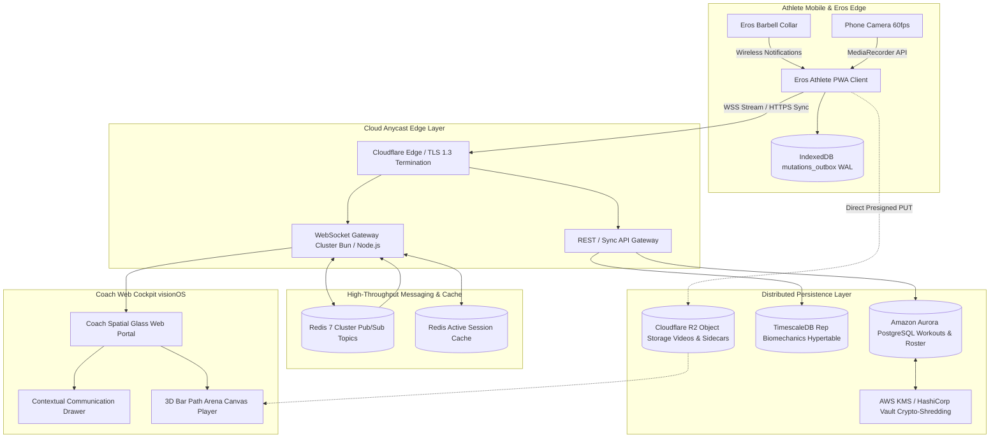
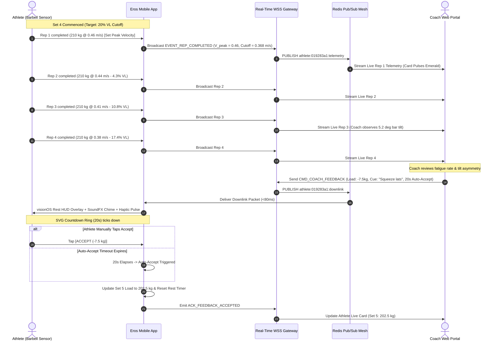
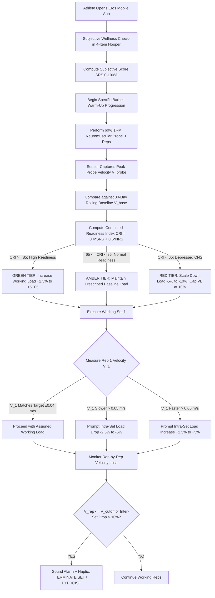
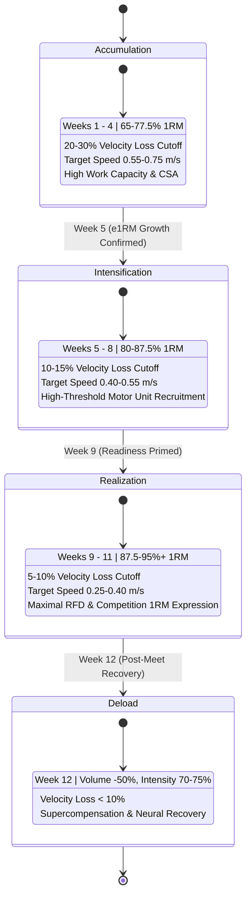
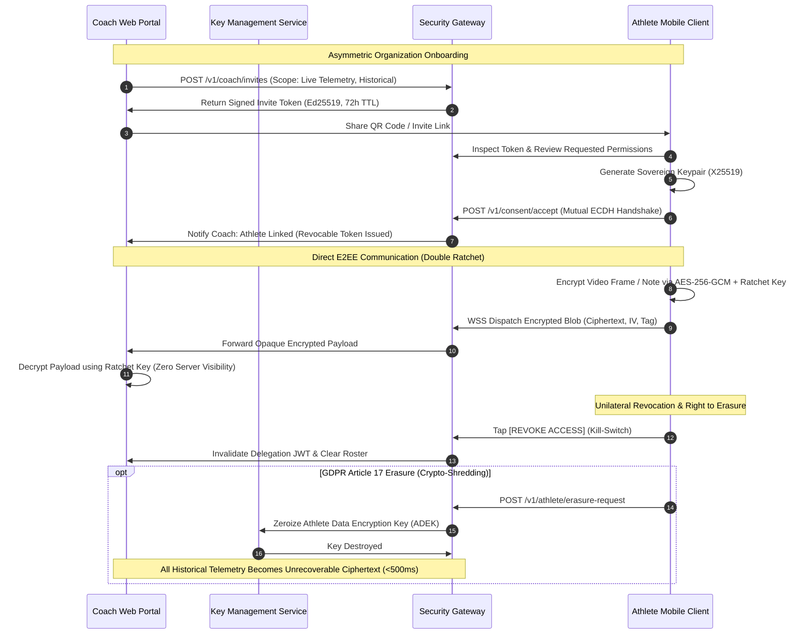

# Eros VBT Coach Portal & In-App Communication Architecture Specification
**Publication-Grade Engineering & Sports Science Blueprint**  
**Document Version:** 1.0.0 (Release Candidate)  
**Classification:** Technical Architecture & System Specification  
**System Ecosystem:** Eros Velocity-Based Training (VBT) Platform  
**Target Environments:** Mobile Athlete WebApp (PWA / Eros Wireless) & Coach Spatial Glass Web Cockpit  
**Date:** October 2026  

---

## 1. Executive Summary & Vision Statement

### 1.1 The Paradigm Shift in Strength & Conditioning
Traditional strength and conditioning methodologies rely heavily on static percentage-based training (`%1RM`) derived from historical maximal testing sessions. This paradigm suffers from fatal biomechanical and physiological limitations:
1. **Biological Readiness Fluctuation**: Due to circadian rhythms, sleep deprivation, psychological stress, and residual fatigue, an athlete's true daily 1RM fluctuates by $\pm 10\text{ to }18\%$ (González-Badillo et al., 2017). Prescribing $4 \times 8$ at $75\%\text{ 1RM}$ based on a 4-week-old test can result in involuntary failure and catastrophic neuromuscular fatigue on a low-readiness day, or insufficient stimulus on a high-readiness day.
2. **Fixed-Repetition Failure & Metabolic Accumulation**: Prescribing rigid repetitions forces lifters to perform "junk volume" characterized by severe concentric velocity loss ($>35\text{--}40\%$), generating excessive intramuscular metabolic byproducts (lactate, ammonia, inorganic phosphate) and mechanical tissue damage without conferring additional strength or power adaptations (Pareja-Blanco et al., 2020).
3. **Disjointed Coach-to-Athlete Communication**: Conventional coaching workflows separate program delivery (static spreadsheets, PDFs), execution logging (retrospective manual entry), and technical critique (unaligned smartphone video clips). This latency breaks the biofeedback loop essential for high-cadence athletic mastery.

### 1.2 The Eros VBT Coach Ecosystem Vision
The **Eros Velocity-Based Training Coach Ecosystem** unites embedded 6-axis inertial kinematics with a unified multi-tenant cloud architecture and an authentic **Apple visionOS Spatial Glass** user experience. The system transforms the barbell into a precision instrument that closes the loop between athlete execution and coach supervision:

```
┌──────────────────────────────────────────────────────────────────────────────────────────────────┐
│                                 EROS CLOSED-LOOP VBT ECOSYSTEM                                   │
│                                                                                                  │
│   [ Barbell Collar ]            [ Mobile Athlete HUD ]            [ Coach Web Cockpit ]          │
│   Eros 6-Axis Collar            Eros Wireless Ingestion           Spatial Glass Control Center   │
│   • Precision Sample Tick ───►  • Dual Variance ZUPT        ───►  • Multi-Platform Live Grid     │
│   • Quaternion Tracking         • In-Flight Cutoff Chimes         • Dynamic Load Overrides       │
│   • Thermal Adaptation          • Offline WAL Outbox              • 3D Bar Path Replay & V-L     │
│                                       ▲                                      │                   │
│                                       └────────── WSS Uplink/Downlink ───────┘                   │
│                                                  (<80ms Closed Loop)                             │
└──────────────────────────────────────────────────────────────────────────────────────────────────┘
```

The system delivers:
- **Instantaneous Biomechanical Transparency**: Concentric mean velocity (MCV), propulsive velocity (MPV), peak velocity (PV), vertical displacement (ROM), and roll tilt ($\phi$) computed deterministically in real time with dynamic acceleration rejection.
- **Autoregulated Biological Load Capping**: Real-time velocity loss cutoffs terminate sets before central nervous system fatigue impairs technical motor patterns.
- **Submaximal Daily e1RM Profiling**: Continuous linear regression modeling ($V = m \cdot L + c$) tracks daily maximum capacity without subjecting athletes to exhausting maximal lifts.
- **Zero-Latency Coach Intervention**: Coaches observe up to 12 active platforms simultaneously, issuing load adjustments ($\pm 2.5\text{ to }5.0\text{ kg}$) and technical cues delivered to the athlete's screen during rest periods with automated acceptance countdowns.
- **Zero-Trust Sovereign Privacy**: Athletes retain absolute cryptographic ownership over their biometric data through asymmetric consent handshakes, Signal Double Ratchet end-to-end encryption, and GDPR Article 17 crypto-shredding.

---

## 2. Synthesis Matrix of 5 Autonomous Brainstorming Specialists

To author an exhaustive, resilient, and multi-disciplinary blueprint, five autonomous specialist agent personas were deployed to investigate the domain. The following synthesis matrix maps their core contributions, domain parameters, and cross-disciplinary intersections:

### 2.1 Cross-Disciplinary Synthesis Matrix

| Autonomous Specialist Persona | Core Domain Focus | Key Architectural Deliverable | Intersecting Dependencies & System Integration |
|---|---|---|---|
| **1. High-Performance S&C Coach & Periodization Specialist** (`brainstorm_coach_sc`) | Autoregulation, 12-week block periodization, Bryan Mann velocity continuum, dual-tier readiness, RPE miscalibration. | `sc_periodization_spec.md` | Feeds target velocity loss cutoffs to UX radial gauges; requires Telemetry Tier A/B schemas for linear regression; guides Coach Portal Macrocycle Builder. |
| **2. Sports Biomechanist & VBT Telemetry Architect** (`brainstorm_coach_telemetry`) | 6-axis Eros attitude fusion, quaternion attitude tracking, dual moving-variance ZUPT, thermal drift adaptation, 3D bar path kinematics. | `handoff.md` (Telemetry & Kinematics) | Reconciles raw Eros stream into Earth-vertical acceleration ($a_{vert} = \mathbf{a}_{lin} \cdot \hat{\mathbf{g}}$); provides 20Hz curve streaming to System Architect and 3D Arena to UX Designer. |
| **3. Real-Time Mobile & Web System Architect** (`brainstorm_coach_arch`) | Edge-to-cloud topology, WebSocket pub/sub protocol, IndexedDB write-ahead log (WAL) outbox, video telemetry sync, cloud PostgreSQL/TimescaleDB. | `handoff.md` (System Architecture) | Implements WSS transport for live rep broadcasting and coach downlink cues ($<80\text{ ms}$); ensures gym dead-zone resilience; aligns video timestamps with BLE epochs. |
| **4. Elite UX/UI Product Designer** (`brainstorm_coach_ux`) | 5-Tier Apple visionOS Spatial Glass design system, obsidian void (`#050507`), restored red Deadlift accent, multi-device viewports. | `handoff.md` (UX/UI Product Design) | Translates S&C and telemetry metrics into high-contrast spatial cards, radial velocity loss gauges, apex glow lockout blooms, and responsive desktop/iPad/mobile interfaces. |
| **5. Sports Data Security & Athlete Privacy Officer** (`brainstorm_coach_sec`) | 5-Role RBAC, sovereign athlete consent, GDPR Art. 9/17 crypto-shredding, Double Ratchet E2EE, Eros wireless HMAC replay protection, Merkle audit log. | `handoff.md` (Security & Privacy) | Protects athlete biometric fatigue curves; establishes cryptographic kill-switch; guarantees non-repudiation of coach load overrides via append-only hash chains. |

### 2.2 Deep Architectural Narrative of Convergent Workflows
The five specialist proposals do not operate as isolated modules; they converge into tightly bound, deterministic functional loops:
1. **The Telemetry-to-Autoregulation Loop**: The Biomechanist's 6-axis quaternion filter isolates vertical linear acceleration and applies dual-signal moving variance ZUPT ($\sigma_a^2 < 0.040, \sigma_\omega^2 < 0.005$) to neutralize junction thermal drift. This pristine velocity signal feeds the S&C Specialist's real-time velocity loss engine. When a rep breaches the prescribed cutoff ($V_{rep} \le V_{cutoff}$), the System Architect's edge outbox immediately publishes an `EVENT_REP_COMPLETED` packet across WSS. The UX Designer's visionOS HUD instantly flashes an animated crimson cutoff banner while triggering the Web Audio SFX engine and haptic actuator.
2. **The Coach Intervention & Governance Loop**: The coach observing the multi-athlete live grid identifies that an athlete's rep velocity dropped by $24\%$, exceeding the $20\%$ target. The coach clicks `[-5.0 kg Next]`. The System Architect's gateway routes `CMD_COACH_FEEDBACK` with a 20-second auto-accept countdown to the athlete's screen. The Security Officer's RBAC engine verifies the coach's cryptographic delegation token, while the append-only Merkle audit log commits an immutable transaction record signed by the gateway (`WORKOUT_LOAD_OVERRIDE`).
3. **The Diagnostics & Video Synchronization Loop**: During heavy working sets, the mobile camera records video locally at 60fps. The frame matcher correlates camera timestamps with BLE telemetry epochs. Upon set conclusion, a presigned HTTP/3 ticket uploads the video and sidecar `rep_telemetry_v1.json` to object storage. In the coach portal, the UX Designer's 3D Bar Path Arena replays the trajectory with color-coded velocity gradients, allowing the coach and performance analyst to inspect sticking point bottlenecks and asymmetric bar tilt ($>4.5^\circ$).

---

## 3. In-App Coach-to-Athlete Communication Channels

Effective strength coaching requires low-latency bidirectional communication resilient to hostile gym radio environments.

### 3.1 Real-Time Protocol Architecture & Network Topology

#### 3.1.1 Transport Protocol Evaluation
Three real-time communication architectures were evaluated:
- **Server-Sent Events (SSE)**: Provides low-overhead server-to-client streaming, but requires separate HTTP POST requests for uplink messages, creating connection state fragmentation and unacceptable latency ($>180\text{ ms}$) for urgent rack alerts.
- **WebRTC DataChannels (P2P)**: Offers ultra-low UDP latency, but fails in $35\text{--}50\%$ of gym cellular environments behind symmetric Carrier-Grade NAT (CGNAT) without expensive TURN relays. Furthermore, central archiving of session telemetry is required for analytics.
- **WebSocket (WSS) over TLS 1.3**: Selected as the primary protocol. Delivers full-duplex communication with a 2-byte frame overhead, guaranteed delivery over TCP, universal corporate/gym Wi-Fi firewall traversal on port 443, and sub-80ms round-trip latency when coupled with distributed edge brokers.

#### 3.1.2 Pub/Sub Channel Topology
The real-time gateway utilizes Redis 7 Cluster pub/sub routing partitioned across dedicated topics:
- `athlete:{athleteId}:session`: Coarse-grained lifecycle events (`SESSION_START`, `SET_START`, `SET_CONCLUDED`, `REST_TICK`).
- `athlete:{athleteId}:telemetry`: High-frequency streaming packets (`REP_COMPLETED`, 20Hz trajectory curve buffers).
- `athlete:{athleteId}:downlink`: High-priority prescriptive coach cues (`CMD_COACH_FEEDBACK`, `CMD_STOP_SET`).
- `coach:{organizationId}:live_roster`: Multiplexed broadcast channel streaming status cards of all active athletes to the coach cockpit.

```
┌──────────────────────────────────────────────────────────────────────────────────────────────────┐
│                                REAL-TIME PUB/SUB TOPOLOGY                                        │
│                                                                                                  │
│   [ Athlete Mobile ] ─── WSS ───► [ Edge Gateway ] ───► [ Redis Cluster Pub/Sub ]                 │
│                                         │                                                        │
│                                         ├─► channel:athlete:{id}:telemetry                       │
│                                         ├─► channel:athlete:{id}:session                         │
│                                         ├─► channel:coach:{org}:live_roster                      │
│                                         │                                                        │
│   [ Coach Portal ]   ◄─── WSS ─── [ Gateway Pods ] ◄─────────────────────────────────────────────┘
└──────────────────────────────────────────────────────────────────────────────────────────────────┘
```

#### 3.1.3 Connection Lifecycle & Exponential Backoff
The client heartbeat sends a ping frame every 15 seconds: `{"type":"PING","timestamp":epoch}`. The server responds with `{"type":"PONG","serverTime":epoch}`. If no pong is received within 5 seconds, the socket is recycled and reconnects with exponential backoff and randomized jitter:
$$T_{reconnect} = \min\left(10000\text{ ms}, 500\text{ ms} \times 2^{\text{retryCount}}\right) \pm \text{jitter}(0, 300\text{ ms})$$

---

### 3.2 Live Session Broadcasting Protocol
Upon set execution, the mobile client computes repetition kinematics locally and broadcasts an `EVENT_REP_COMPLETED` payload over WSS in $<15\text{ ms}$:

```json
{
  "eventId": "evt_0192a83f-67a2-7b19-b2f1-0982736154ab",
  "sequence": 14,
  "sessionId": "ws_1730123400000",
  "athleteId": "ath_019283a1-77ef-712c-91bb-8302fbc94120",
  "eventType": "REP_COMPLETED",
  "clientTimestamp": 1730123456789,
  "payload": {
    "setId": "set_1730123420000_2",
    "setNumber": 2,
    "repNumber": 4,
    "lift": "Deadlift",
    "weightKg": 160.0,
    "repTelemetry": {
      "meanVelocity": 0.38,
      "peakVelocity": 0.46,
      "rpe": 8.5,
      "concentricDurationMs": 720,
      "isPR": false,
      "timeToPeakMs": 280
    },
    "runningSetMetrics": {
      "avgVelocity": 0.43,
      "maxVelocity": 0.51,
      "minVelocity": 0.38,
      "velocityLossPct": 25.49,
      "avgRpe": 8.1,
      "totalReps": 4
    },
    "restPeriod": {
      "startedAt": 1730123456789,
      "targetDurationSec": 180
    }
  }
}
```

---

### 3.3 Two-Way Interactive Feedback Loop & Auto-Accept Rest HUD
During rest intervals, the athlete is physiologically receptive to guidance. The coach portal provides a one-click prescriptive interface to adjust upcoming loads or transmit technical cues.

#### 3.3.1 Downlink Feedback Payload (`CMD_COACH_FEEDBACK`)
```json
{
  "commandId": "cmd_0192b3c4-98a1-71ef-81a2-837461928374",
  "coachId": "coa_018274a9-9182-72cc-ba19-091827364512",
  "coachName": "Coach Marcus",
  "athleteId": "ath_019283a1-77ef-712c-91bb-8302fbc94120",
  "sessionId": "ws_1730123400000",
  "targetSetNumber": 3,
  "timestamp": 1730123470000,
  "action": {
    "type": "ADJUST_LOAD_AND_CUE",
    "loadModification": {
      "previousWeightKg": 160.0,
      "prescribedWeightKg": 152.5,
      "deltaKg": -7.5,
      "reason": "Velocity loss exceeded 20% threshold on rep 4"
    },
    "technicalCue": {
      "text": "Squeeze lats before floor break. Push the floor away.",
      "priority": "HIGH",
      "voiceSynthesisText": "Squeeze lats before the break. Push the floor away."
    },
    "restTimerOverrideSec": 210
  },
  "autoAcceptTimeoutSec": 20
}
```

#### 3.3.2 visionOS Rest HUD Overlay & Auto-Accept Interaction
1. **Audio & Haptic Alerts**:
   - `SoundFX.playCoachCueIncoming()`: High-resonance ascending two-tone chime ($659.25\text{ Hz} \rightarrow 880.0\text{ Hz}$).
   - `HapticsFX.vibrate([80, 50, 80, 50, 120])`: Double confirmation pulse.
2. **Spatial Glass Modal Rendering**:
   - An elevated glass modal (`rgba(18, 20, 28, 0.78)`, `backdrop-filter: blur(50px) saturate(210%)`) slides down from the top header.
   - Prominently displays: `LOAD ADJUSTMENT: 160.0 kg → 152.5 kg (-7.5 kg)`.
   - Technical cue rendered in high-contrast SF Pro typography.
3. **Interactive Resolution**:
   - **Accept Button**: Tap `ACCEPT (-7.5 kg)` $\rightarrow$ sets `currentWorkingWeight = 152.5`, updates `activeSet.weight`, emits `ACK_FEEDBACK_ACCEPTED`, and resumes rest timer.
   - **Auto-Accept Progress Ring**: A circular SVG countdown ring drains over 20 seconds. If untouched, the system automatically commits the coach's recommendation, preventing workout stalls when the athlete is chalking hands or resting.
   - **Dismiss Option**: Tap `DISMISS` $\rightarrow$ preserves current load, emits `ACK_FEEDBACK_DECLINED` with reason.

---

### 3.4 Synchronized Media Pipeline (Video + Telemetry Sidecar)
High-performance coaching requires visual posture verification synchronized frame-by-frame with Eros telemetry.

1. **Local Frame Alignment**:
   - Phone camera initiates via `navigator.mediaDevices.getUserMedia({ video: { width: 1920, height: 1080, frameRate: { ideal: 60 } }, audio: true })`.
   - Base reference recorded at camera start: $t_0 = \text{performance.now()}$, $E_0 = \text{Date.now()}$.
   - For every BLE repetition, frame offset is computed: $\Delta t_{rep} = rep.timestamp - E_0$.
2. **Sidecar Telemetry Format (`rep_telemetry_v1.json`)**:
```json
{
  "videoId": "vid_0192c4d5-8912-73ab-bc12-981273461234",
  "sessionId": "ws_1730123400000",
  "setId": "set_1730123420000_2",
  "videoMetadata": {
    "durationMs": 34200,
    "width": 1920,
    "height": 1080,
    "fps": 60.0,
    "codec": "video/mp4; codecs=avc1.64002A",
    "recordedEpoch": 1730123420000
  },
  "reps": [
    {
      "repNumber": 1,
      "videoStartOffsetMs": 4200,
      "videoApexOffsetMs": 5150,
      "videoEndOffsetMs": 6100,
      "meanVelocity": 0.52,
      "peakVelocity": 0.61,
      "rpe": 7.0,
      "accelerationCurve": [0.12, 0.45, 0.82, 0.95, 0.61, 0.22, -0.15]
    },
    {
      "repNumber": 2,
      "videoStartOffsetMs": 11800,
      "videoApexOffsetMs": 12850,
      "videoEndOffsetMs": 13900,
      "meanVelocity": 0.46,
      "peakVelocity": 0.53,
      "rpe": 8.0,
      "accelerationCurve": [0.08, 0.38, 0.74, 0.81, 0.49, 0.18, -0.22]
    }
  ]
}
```
3. **Presigned Direct Object Storage Upload**:
   - The client requests a presigned URL via `POST /v1/media/upload-ticket`.
   - The `.mp4` video and `.json` sidecar upload directly to Cloudflare R2 / AWS S3 via HTTP/3 PUT without traversing the WebSocket gateway, preventing connection starvation.

---

### 3.5 Gym Offline-First Resilience (IndexedDB WAL Outbox)
Gym basements with structural concrete and steel act as Faraday cages. Eros implements an offline-first **Write-Ahead Log (WAL) Outbox Pattern** in browser `IndexedDB` (`eros_offline_db`):

```
┌──────────────────────────────────────────────────────────────────────────────────────────────────┐
│                            OFFLINE WRITE-AHEAD LOG OUTBOX                                        │
│                                                                                                  │
│   [ Sensor Rep Event ]                                                                           │
│            │                                                                                     │
│            ├──► Commit to localStorage (vbt_workouts_v1)  ──► Instant 60fps UI Update            │
│            │                                                                                     │
│            └──► Append Mutation to IndexedDB (mutations_outbox)                                  │
│                        │                                                                         │
│                        ▼                                                                         │
│                 { Network Online? }                                                              │
│                  ├─► YES ──► Drain Outbox via WSS Stream ──► Server Idempotent ACK              │
│                  └─► NO  ──► Retain with PENDING Status ──► Await window 'online' Event          │
└──────────────────────────────────────────────────────────────────────────────────────────────────┘
```

- **Database Schema**:
  - `mutations_outbox`: Stores mutations keyed by monotonic `UUIDv7` with fields `mutationId`, `timestamp`, `type` (`APPEND_REP`, `SET_CONCLUDED`), `sessionId`, `payload`, `status` (`PENDING`, `IN_FLIGHT`, `ACKNOWLEDGED`).
- **Idempotent Reconciliation**:
  - Server applies incoming mutations with `ON CONFLICT (mutation_id) DO NOTHING`.
  - Upon reconnection, client issues `CLIENT_SYNC_RESUME` with `lastAckSeq`. Server computes sequence diff and client drains outbox in batches of 25.

---

## 4. Coach Web Portal Layout & Information Architecture

The Coach Web Portal scales from desktop command centers to gym-floor iPads while strictly embodying Apple visionOS Spatial Glass design principles.

### 4.1 5-Tier Apple visionOS Spatial Glass Depth System
The interface avoids flat-surfaced clutter by enforcing five distinct optical glass tiers:

```css
:root {
  /* Level 0: The Obsidian Abyss Canvas */
  --glass-l0-bg: #050507;
  
  /* Level 1: Structural Navigation Rail & Canvas Sections */
  --glass-l1-bg: rgba(255, 255, 255, 0.03);
  --glass-l1-blur: blur(40px) saturate(190%);
  --glass-l1-border: linear-gradient(180deg, rgba(255, 255, 255, 0.25) 0%, rgba(255, 255, 255, 0.03) 40%, transparent 100%);
  --glass-l1-shadow: 0 8px 32px 0 rgba(0, 0, 0, 0.50);
  
  /* Level 2: Surface Cards & Telemetry Tiles */
  --glass-l2-bg: rgba(255, 255, 255, 0.045);
  --glass-l2-blur: blur(30px) saturate(180%);
  --glass-l2-border: linear-gradient(180deg, rgba(255, 255, 255, 0.45) 0%, rgba(255, 255, 255, 0.05) 30%, transparent 100%);
  --glass-l2-specular: inset 0 1px 0 0 rgba(255, 255, 255, 0.22);
  --glass-l2-shadow: 0 18px 44px 0 rgba(0, 0, 0, 0.65), 0 4px 14px 0 rgba(0, 0, 0, 0.40);
  
  /* Level 3: Interactive Pills, Steppers, & Filter Badges */
  --glass-l3-bg: rgba(255, 255, 255, 0.075);
  --glass-l3-blur: blur(24px) saturate(180%);
  --glass-l3-border: rgba(255, 255, 255, 0.16);
  --glass-l3-specular: inset 0 1px 0 0 rgba(255, 255, 255, 0.30);
  --glass-l3-hover-bg: rgba(255, 255, 255, 0.12);
  
  /* Level 4: Floating Drawers, Modals & Live Overlays */
  --glass-l4-bg: rgba(18, 20, 28, 0.78);
  --glass-l4-blur: blur(50px) saturate(210%);
  --glass-l4-border: linear-gradient(180deg, rgba(255, 255, 255, 0.55) 0%, rgba(255, 255, 255, 0.12) 35%, transparent 100%);
  --glass-l4-specular: inset 0 1.5px 0 0 rgba(255, 255, 255, 0.35);
  --glass-l4-shadow: 0 32px 80px 0 rgba(0, 0, 0, 0.88), 0 8px 24px 0 rgba(0, 0, 0, 0.50);

  /* Thematic Palette */
  --accent-sq: #00FF66;              /* Squat: Electric Emerald */
  --accent-bp: #00E5FF;              /* Bench: Laser Cyan */
  --accent-dl: #FF2D55;              /* Deadlift: Punchy Red (Restored) */
  --accent-pr: #FFD700;              /* Specular Gold PR */
}
```

---

### 4.2 Module 1: Squad Roster & Readiness Overview
Provides a centralized view of squad attendance, current training states, and neuromuscular readiness scores:

```
┌────────────────────────────────────────────────────────────────────────────────────────────────────────────────────────┐
│  EROS  |  Powerlifting Squad A ▾  |  Season: Nationals Prep - Block 2 (Intensification)      [🔔 2]  [Coach Marcus ▾]│
├────────────────────────────────────────────────────────────────────────────────────────────────────────────────────────┤
│  ┌──────────────────────┐ ┌──────────────────────┐ ┌──────────────────────┐ ┌──────────────────────────────────────┐  │
│  │ ATHLETES IN ROSTER   │ │ ON PLATFORM (LIVE)   │ │ AVG SQUAD READINESS  │ │ WEEKLY COMPLIANCE                    │  │
│  │ 28 Lifters           │ │ ● 5 Lifting Now      │ │ 88.5%  [OPTIMAL]     │ │ 95.8%  [142 / 148 Sets Logged]       │  │
│  └──────────────────────┘ └──────────────────────┘ └──────────────────────┘ └──────────────────────────────────────┘  │
│                                                                                                                        │
│  [ 🔍 Search athlete name...         ]  [ Filter: All ▾ ]  [ Status: Live Now (5) ▾ ]  [ Sort: Readiness ▾ ]  [+ Athlete]│
│                                                                                                                        │
│  ┌──────────────────────────────────────────────────────────────────────────────────────────────────────────────────┐  │
│  │ ATHLETE             │ STATUS        │ READINESS     │ TODAY'S WORKOUT        │ SETS / VOLUME │ V-LOSS COMPL.│ACT │  │
│  ├─────────────────────┼───────────────┼───────────────┼────────────────────────┼───────────────┼──────────────┼────┤  │
│  │ [Avatar] Alex Vance │ ● LIVE (Set 4)│ 94% [OPTIMAL] │ Main deadlift + Bench  │ 4/5 | 7,420kg │ 14.2% / 20%  │[👁][💬│  │
│  │ [Avatar] Elena Rost │ ● LIVE (Set 2)│ 88% [OPTIMAL] │ SBD Heavy Realization  │ 2/6 | 3,180kg │  8.5% / 15%  │[👁][💬│  │
│  │ [Avatar] Marco Silva│ ● LIVE (Set 1)│ 72% [CAUTION] │ Squat Speed + Bench Acc│ 1/4 | 1,450kg │  6.2% / 10%  │[👁][💬│  │
│  │ [Avatar] Sarah Chen │ ✓ Done (12:30)│ 91% [OPTIMAL] │ Main deadlift + Bench  │ 5/5 | 9,800kg │ 16.8% / 20%  │[👁][💬│  │
│  │ [Avatar] Liam Hayes │ ⏳ Sched 16:00 │ 64% [FATIGUE] │ Squat Volume Base      │ 0/5 | 0 kg    │ --           │[👁][💬│  │
│  │ [Avatar] Dave Miller│ 💤 Rest Day   │ 85% [OPTIMAL] │ Active Recovery        │ --            │ --           │[👁][💬│  │
│  └──────────────────────────────────────────────────────────────────────────────────────────────────────────────────┘  │
└────────────────────────────────────────────────────────────────────────────────────────────────────────────────────────┘
```

---

### 4.3 Module 2: Multi-Athlete Live Monitoring Grid
Designed for active floor supervision, displaying real-time velocities, radial velocity loss gauges, and instant cut-off alerts across active platforms:

```
┌────────────────────────────────────────────────────────────────────────────────────────────────────────────────────────┐
│  LIVE MONITORING ARENA  |  4 Athletes Active  |  Auto-Refresh: Real-Time BLE Relay                 [Mute Audio Alerts]│
├────────────────────────────────────────────────────────────┬───────────────────────────────────────────────────────────┤
│  CARD 1: RACK #01 — ALEX VANCE                             │  CARD 2: RACK #02 — ELENA ROST                            │
│  ┌──────────────────────────────────────────────────────┐  │  ┌──────────────────────────────────────────────────────┐ │
│  │ [Avatar] ALEX VANCE                 [BLE LOCKED ●]   │  │  │ [Avatar] ELENA ROST                  [BLE LOCKED ●]  │ │
│  │ [ DEADLIFT ]  Set 4 of 5       Load: [-] 210.0 kg [+]│  │  │ [ SQUAT ]     Set 3 of 5       Load: [-] 165.0 kg [+]│ │
│  ├──────────────────────────────────────────────────────┤  │  ├──────────────────────────────────────────────────────┤ │
│  │    MEAN VELOCITY              PEAK VELOCITY          │  │  │    MEAN VELOCITY              PEAK VELOCITY          │ │
│  │    0.38 m/s                   0.56 m/s               │  │  │    0.54 m/s                   0.82 m/s               │ │
│  │    Rep 4 completed (2s ago)   Target: 0.40 m/s       │  │  │    Rep 3 completed (5s ago)   Target: 0.55 m/s       │ │
│  │                                                      │  │  │                                                      │ │
│  │     ╭───────╮  SET VELOCITY LOSS: 18.2%              │  │  │     ╭───────╮  SET VELOCITY LOSS: 7.4%               │ │
│  │    │  18%  │  [||||||||||||||||····]                 │  │  │    │  7%   │  [||||||··············]                 │ │
│  │     ╰───────╯  Ceiling: 20% (Safe - 1 rep reserve)   │  │  │     ╰───────╯  Ceiling: 15% (Optimal Power)          │ │
│  │                                                      │  │  │                                                      │ │
│  │  Rep 1: 0.46 m/s  |  Rep 2: 0.44 m/s  |  Rep 3: 0.41 │  │  │  Rep 1: 0.58 m/s  |  Rep 2: 0.56 m/s  |  Rep 3: 0.54 │ │
│  ├──────────────────────────────────────────────────────┤  │  ├──────────────────────────────────────────────────────┤ │
│  │ [✋ STOP SET] [ +2.5kg Next ] [ -5% Drop ] [💬 Cue ▾]│  │  │ [✋ STOP SET] [ +2.5kg Next ] [ -5% Drop ] [💬 Cue ▾]│ │
│  └──────────────────────────────────────────────────────┘  │  └──────────────────────────────────────────────────────┘ │
├────────────────────────────────────────────────────────────┼───────────────────────────────────────────────────────────┤
│  CARD 3: RACK #03 — MARCO SILVA                            │  CARD 4: RACK #04 — SARAH CHEN                            │
│  ┌──────────────────────────────────────────────────────┐  │  ┌──────────────────────────────────────────────────────┐ │
│  │ [Avatar] MARCO SILVA                [BLE LOCKED ●]   │  │  │ [Avatar] SARAH CHEN                  [BLE LOCKED ●]  │ │
│  │ [ BENCH PRESS ] Set 5 of 5     Load: [-] 130.0 kg [+]│  │  │ [ DEADLIFT ]  Set 2 of 4       Load: [-] 185.0 kg [+]│ │
│  ├──────────────────────────────────────────────────────┤  │  ├──────────────────────────────────────────────────────┤ │
│  │    MEAN VELOCITY              PEAK VELOCITY          │  │  │    MEAN VELOCITY              PEAK VELOCITY          │ │
│  │    0.18 m/s                   0.31 m/s               │  │  │    0.49 m/s                   0.70 m/s               │ │
│  │    Rep 5 completed (Grind!)   Target: 0.25 m/s       │  │  │    Rep 4 completed            Target: 0.48 m/s       │ │
│  │                                                      │  │  │                                                      │ │
│  │  ⚠️ [ CUT-OFF REACHED: 28.0% VELOCITY LOSS! RACK! ]   │  │  │     ╭───────╮  SET VELOCITY LOSS: 11.2%              │ │
│  │     ╭───────╮  CRITICAL CNS FATIGUE ALERT            │  │  │    │  11%  │  [||||||||||··········]                 │ │
│  │    │  28%  │  [||||||||||||||||||||||||] EXCEEDED    │  │  │     ╰───────╯  Ceiling: 20% (In Zone)                │ │
│  │     ╰───────╯                                        │  │  │                                                      │ │
│  ├──────────────────────────────────────────────────────┤  │  ├──────────────────────────────────────────────────────┤ │
│  │ [🚨 RACKED CONFIRMED] [ Deload -7.5kg ] [💬 "Good"]  │  │  │ [✋ STOP SET] [ +2.5kg Next ] [ -5% Drop ] [💬 Cue ▾]│ │
│  └──────────────────────────────────────────────────────┘  │  └──────────────────────────────────────────────────────┘ │
└────────────────────────────────────────────────────────────┴───────────────────────────────────────────────────────────┘
```

---

### 4.4 Module 3: Athlete Deep Dive Profile
Features longitudinal diagnostics, individual Load-Velocity profiles, estimated 1RM trends, and 3D Bar Path Arena replays:

```
┌────────────────────────────────────────────────────────────────────────────────────────────────────────────────────────┐
│  ATHLETE PROFILE: ALEX VANCE  |  -93kg Open  |  DOTS: 452.1  |  Program: 2026 Nationals Prep       [Edit Profile] [💬]│
├────────────────────────────────────────────────────────────────────────────────────────────────────────────────────────┤
│  LIFETIME SUMMARY:                                                                                                     │
│  ┌─────────────────┐ ┌─────────────────┐ ┌─────────────────┐ ┌─────────────────┐ ┌──────────────────────────────────┐  │
│  │ TOTAL VOLUME    │ │ WORKOUTS        │ │ SETS / REPS     │ │ PEAK VELOCITY   │ │ 30-DAY COMPLIANCE                │  │
│  │ 1,482,250 kg    │ │ 192 Sessions    │ │ 1,320 / 6,140   │ │ 1.38 m/s        │ │ 98.2% (28 / 28 Sessions)         │  │
│  └─────────────────┘ └─────────────────┘ └─────────────────┘ └─────────────────┘ └──────────────────────────────────┘  │
│                                                                                                                        │
│  PERSONAL RECORDS (GYM PRs vs COMP PRs):                                                                               │
│  ┌───────────────────────────────────────────────┐ ┌────────────────────────────────────────────────────────────────┐  │
│  │ 🏋️ SQUAT (Electric Emerald Theme)            │ │ 🏋️ DEADLIFT (Punchy Red Theme)                                │  │
│  │ Gym PR:  220.0 kg • 0.32 m/s • RPE 9.5        │ │ Gym PR:  260.0 kg • 0.22 m/s • RPE 9.5                         │  │
│  │ Comp PR: 227.5 kg (2026 State Championships)  │ │ Comp PR: 270.0 kg (2026 State Championships)                   │  │
│  │ e1RM:    228.4 kg (Based on 190kg @ 0.48 m/s) │ │ e1RM:    272.5 kg (Based on 220kg @ 0.38 m/s)                  │  │
│  └───────────────────────────────────────────────┘ └────────────────────────────────────────────────────────────────┘  │
│                                                                                                                        │
│  VELOCITY-LOAD (V-L) REGRESSION & 1RM PROJECTION [DEADLIFT]:                                                           │
│  Velocity (m/s)                                                                                                        │
│   1.00 ┤                                                                                                               │
│   0.80 ┤    ● (70kg @ 0.88 m/s)                                                                                        │
│   0.60 ┤          ● (120kg @ 0.68 m/s)                                                                                 │
│   0.40 ┤                ● (170kg @ 0.52 m/s)     ──── Current V-L Line (R² = 0.992)                                    │
│   0.20 ┤                      ● (220kg @ 0.36 m/s) ┄┄ Baseline Line (4 wks ago)                                        │
│   0.15 ┼─────────────────────────────────────────────★ Projected 1RM: 272.5 kg (MVT = 0.15 m/s)                        │
│   0.00 ┴─────┬─────┬─────┬─────┬─────┬─────┬─────┬─────                                                                │
│        50   80    110   140   170   200   230   260   Load (kg)                                                          │
│                                                                                                                        │
│  SET-BY-SET BAR PATH ARENA REPLAY [Set 4: 210.0 kg, Rep 3]:                                                            │
│  ┌────────────────────────────────────────────────────────┬─────────────────────────────────────────────────────────┐  │
│  │ SAGITTAL BAR PATH TRAJECTORY (X-Z Coordinate Projection│ BAR PATH KINEMATICS & REPETITION STATS                  │  │
│  │                                                        │                                                         │  │
│  │          Lockout (Z = 0.58m)                           │ Rep Duration:           1.24s                           │  │
│  │                ●                                       │ Mean Concentric Speed:  0.41 m/s                        │  │
│  │               / \                                      │ Peak Concentric Speed:  0.58 m/s                        │  │
│  │              │   \   [Acceleration: Emerald]           │ Horizontal Drift (ΔX):  1.8 cm (Ideal bar path)         │  │
│  │              │    │  [Peak Velocity: Cyan]             │ Concentric Work:        1,194 Joules                    │  │
│  │              │    │  [Decel/Lockout: Punchy Red]       │ Mean Power:             963 Watts                       │  │
│  │             /    /                                     │ Estimated RPE:          8.5                             │  │
│  │            ● (Floor Z = 0.00m)                         │                                                         │  │
│  │  [◀◀ Rewind] [ ▶ Play 1x ] [ 0.5x Slow ] [Scrubber: 65%]│ [📌 Flag as PR] [📎 Attach to Chat] [Export Raw CSV]    │  │
│  └────────────────────────────────────────────────────────┴─────────────────────────────────────────────────────────┘  │
└────────────────────────────────────────────────────────────────────────────────────────────────────────────────────────┘
```

---

### 4.5 Module 4: Interactive Block Planner
Allows coaches to build periodized macrocycles and daily sessions with strict naming schemes ("Main deadlift + Bench", "SBD") and velocity autoregulation triggers:

```
┌────────────────────────────────────────────────────────────────────────────────────────────────────────────────────────┐
│  BLOCK PLANNER  |  Macrocycle: 2026 Powerlifting Nationals (12 Weeks)  |  Target: Squad A           [💾 Save] [🚀 Push]│
├────────────────────────────────────────────────────────────────────────────────────────────────────────────────────────┤
│  MACROCYCLE TIMELINE:                                                                                                  │
│  [  Phase 1: Accumulation (W1-4)  ] [  Phase 2: Intensification (W5-8) ★ACTIVE  ] [ Phase 3: Realization ] [ Deload ] │
│                                                                                                                        │
│  WEEK 6 MICROCYCLE CALENDAR (Drag & drop to reschedule days):                                                          │
│  ┌──────────────┬──────────────┬──────────────┬──────────────┬──────────────┬──────────────┬────────────────────────┐  │
│  │ MON (Day 1)  │ TUE (Day 2)  │ WED (Day 3)  │ THU (Day 4)  │ FRI (Day 5)  │ SAT (Day 6)  │ SUN (Day 7)            │  │
│  ├──────────────┼──────────────┼──────────────┼──────────────┼──────────────┼──────────────┼────────────────────────┤  │
│  │ Main Deadlift│ Bench Press  │ Rest & CNS   │ Squat Main   │ SBD Primer   │ Accessory    │ Complete Rest          │  │
│  │ + Bench Acc  │ + Triceps    │ Recovery     │ + Deadlift   │ Speed Singles│ + Mobility   │ Recovery               │  │
│  │ 5 Sets @ 80% │ 4 Sets @ 75% │              │ 4 Sets @ 82% │ 3 Sets @ 70% │ 4 Exercises  │                        │  │
│  │ [● Active]   │ [Scheduled]  │              │ [Scheduled]  │ [Scheduled]  │ [Scheduled]  │                        │  │
│  └──────────────┴──────────────┴──────────────┴──────────────┴──────────────┴──────────────┴────────────────────────┘  │
│                                                                                                                        │
│  EXERCISE PRESCRIPTION TABLE [Editing Monday: Main Deadlift + Bench]:                                                  │
│  ┌──────────────────────────────────────────────────────────────────────────────────────────────────────────────────┐  │
│  │ # │ EXERCISE LIFT   │ SETS x REPS │ PRESCRIBED LOAD │ TARGET VELOCITY │ V-LOSS CUT-OFF │ AUTOREGULATION LOGIC    │  │
│  ├───┼─────────────────┼─────────────┼─────────────────┼─────────────────┼────────────────┼─────────────────────────┤  │
│  │ 1 │ [🔴 DEADLIFT]   │ 4 Sets x 4  │ 210.0 kg (80%)  │ 0.42 - 0.48 m/s │ 20% Stop Rule  │ If S1 > 0.48 -> +5.0kg  │  │
│  │ 2 │ [🔵 BENCH PRESS]│ 4 Sets x 5  │ 125.0 kg (78%)  │ 0.50 - 0.56 m/s │ 15% Stop Rule  │ If S1 < 0.48 -> -5.0kg  │  │
│  │ 3 │ [🟢 SQUAT ACC]  │ 3 Sets x 8  │ 140.0 kg (65%)  │ 0.65 - 0.72 m/s │ 25% Stop Rule  │ Fixed load              │  │
│  └──────────────────────────────────────────────────────────────────────────────────────────────────────────────────┘  │
│  [+ Add Exercise]  [📋 Load Template from Library]  [🔄 Auto-calculate Loads from e1RM]                                │
└────────────────────────────────────────────────────────────────────────────────────────────────────────────────────────┘
```

---

### 4.6 Module 5: Contextual Communication Drawer
Slides in from the right viewport edge (`width: 400px` on desktop, full-screen on mobile) to provide contextual messaging with inline telemetry event previews:

```
┌──────────────────────────────────────────────┐
│  💬 CHAT: ALEX VANCE            [✕ Close]    │
│  ● Online (Resting: 01:24 rest timer left)   │
├──────────────────────────────────────────────┤
│  TODAY, 14:12                                │
│                                              │
│  [Coach Marcus - 14:14]                      │
│  Looking at your warmups. Bar speed on       │
│  180kg was 0.58 m/s. Move up to 210kg for    │
│  your working sets today.                    │
│                                              │
│  [Alex Vance - 14:16]                        │
│  Understood coach, loading 210kg now.        │
│                                              │
│  ─── TELEMETRY EVENT: SET 3 COMPLETED ───    │
│  ┌────────────────────────────────────────┐  │
│  │ 🔴 DEADLIFT — SET 3 OF 4 (210.0 kg)    │  │
│  │ Reps: 4  |  Mean Vel: 0.38 m/s         │  │
│  │ Vel Loss: 18.2% (Ceiling: 20%)         │  │
│  │ Rep 1: 0.45 m/s ── Rep 4: 0.37 m/s     │  │
│  │ [▶ View Bar Path & Kinematics Replay]  │  │
│  └────────────────────────────────────────┘  │
│                                              │
│  [Coach Marcus - 14:22]                      │
│  🎙️ [▶ 0:04 Voice Note: "Great lockout! Keep │
│      hips through on rep 4."]                │
│                                              │
│  [Alex Vance - 14:23]                        │
│  ✓ Acknowledged                              │
│                                              │
├──────────────────────────────────────────────┤
│  QUICK COACH CUES:                           │
│  [ "Hips through!" ]  [ "Rack bar!" ]        │
│  [ "+2.5kg next" ]    [ "Take 3m rest" ]     │
├──────────────────────────────────────────────┤
│  [ 🎙️ Hold to Speak ] [ Type cue...    ] [➤] │
└──────────────────────────────────────────────┘
```

---

### 4.7 Responsive Multi-Device Adaptations
- **Desktop (1440px - 2560px+)**: 12-column grid canvas, 3--4 live platform cards abreast (`minmax(360px, 1fr)`), split-screen planner with interactive dragging, docked 400px communication drawer.
- **iPad Coaching Mode (1024px - 1366px Landscape)**: 2x2 touch grid, expanded hit targets ($48\text{px}$ minimum, $56\text{px}$ primary pills) for chalky hands, modal bottom-sheet communication drawer, high-contrast ambient glass mode.
- **Mobile (390px - 430px)**: Vertical stack with horizontal card carousel (`scroll-snap-type: x mandatory`), bottom floating glass navigation capsule, full-screen communication view transitions.

---

## 5. Biomechanics & Telemetry Access Architecture

### 5.1 6-Axis Eros Quaternion Attitude Filter with Dynamic Acceleration Rejection
Barbell orientation is tracked in 3D Euclidean space via normalized unit quaternion $\mathbf{q} = [q_0, q_1, q_2, q_3]^T \in \mathbb{R}^4$. Angular rate propagation operates at $\Delta t = 0.010\text{ s}$ using unbiased gyroscope measurements:
$$\dot{\mathbf{q}} = \frac{1}{2} \mathbf{q} \otimes \begin{bmatrix} 0 \\ \boldsymbol{\omega}_{meas} - \mathbf{b}_\omega \end{bmatrix}$$

To prevent dynamic acceleration spikes from corrupting the perceived vertical axis, the attitude filter modulates accelerometer correction weighting:
$$\text{Weight}_{acc} = \begin{cases} 
1.0 & \text{if } |\|\mathbf{a}_{meas}\| - g| \le 0.80\text{ m/s}^2 \\
1.0 - \frac{|\|\mathbf{a}_{meas}\| - g| - 0.80}{1.70} & \text{if } 0.80 < |\|\mathbf{a}_{meas}\| - g| \le 2.50\text{ m/s}^2 \\
0.0 & \text{if } |\|\mathbf{a}_{meas}\| - g| > 2.50\text{ m/s}^2 
\end{cases}$$
During explosive concentric ascent ($a_{meas} > 2.5g$), $\text{Weight}_{acc} = 0$, guaranteeing attitude tracking relies solely on zero-drift gyroscope integration.

---

### 5.2 Isolation of True Vertical Linear Acceleration ($a_{vert}$)
The estimated gravity reaction unit vector in the sensor body frame $\hat{\mathbf{g}}_b$ is extracted from the quaternion:
$$\hat{\mathbf{g}}_b = \begin{bmatrix} 2(q_1 q_3 - q_0 q_2) \\ 2(q_0 q_1 + q_2 q_3) \\ q_0^2 - q_1^2 - q_2^2 + q_3^2 \end{bmatrix}$$

Linear acceleration is isolated by removing the ambient gravity baseline:
$$\mathbf{a}_{lin} = \mathbf{a}_{meas} - G_{base} \hat{\mathbf{g}}_b$$

Vertical acceleration is isolated by projecting linear acceleration onto gravity:
$$a_{vert} = \mathbf{a}_{lin} \cdot \hat{\mathbf{g}}_b$$

**Biomechanical Invariant Justification**: Scalar magnitude thresholds ($\|\mathbf{a}_{meas}\| - 9.81$) rectify lateral sleeve rattle and bar wobble into false positive upward acceleration ($+0.20\text{ to }+0.50\text{ m/s}$). The dot product ensures orthogonal lateral acceleration integrates strictly to zero.

---

### 5.3 Dual-Signal Moving Variance ZUPT & Online Thermal Adaptation
To break the circular failure mode of static rest detectors over $90\text{ minute}$ sessions:
1. Buffers of $N = 20$ samples ($200\text{ ms}$) track acceleration and angular velocity moving variances:
   $$\sigma_a^2 = \frac{1}{N} \sum_{k=0}^{N-1} \|\mathbf{a}_k - \bar{\mathbf{a}}\|^2, \quad \sigma_\omega^2 = \frac{1}{N} \sum_{k=0}^{N-1} \|\boldsymbol{\omega}_k - \bar{\boldsymbol{\omega}}\|^2$$
2. Rest state is confirmed if and only if:
   $$\sigma_a^2 < 0.040\ (\text{m/s}^2)^2 \quad \text{AND} \quad \sigma_\omega^2 < 0.005\ (\text{rad/s})^2 \quad \text{AND} \quad \|\bar{\boldsymbol{\omega}}\| < 0.20\ \text{rad/s} \quad \text{AND} \quad |\|\bar{\mathbf{a}}\| - G_{base}| < 0.35\ \text{m/s}^2$$
3. When rest is confirmed:
   - Velocity zeroed: $v \leftarrow 0.0\text{ m/s}$.
   - Baseline adaptation: $G_{base} \leftarrow 0.998\, G_{base} + 0.002\, \|\bar{\mathbf{a}}\|$.
   - Gyro bias adaptation: $\mathbf{b}_\omega \leftarrow 0.998\, \mathbf{b}_\omega + 0.002\, \bar{\boldsymbol{\omega}}$.

---

### 5.4 Context-Aware FSM Phase Segmentation
The lift tracking state machine handles both paused competition lifts and rapid touch-and-go cycling:
- **`IDLE`**: Stationary on rack or floor. ZUPT engaged. Transitions to `ECCENTRIC` if $v < -0.12\text{ m/s}$; transitions directly to `CONCENTRIC` if $v > +0.12\text{ m/s}$ (deadlift).
- **`ECCENTRIC`**: Downward motion.
  - **Paused Lifts Gate**: When the bar pauses at chest or in the squat hole, ZUPT engages if $|v| < 0.10\text{ m/s}$ and $|a_{vert}| < 0.20\text{ m/s}^2$. Allows up to $3.5\text{ s}$ motionless holds on safety pins before triggering an idle abort.
  - Transitions to `CONCENTRIC` when $v > +0.10\text{ m/s}$.
- **`CONCENTRIC`**: Upward drive. Integrated at high frequency:
  $$v(t_k) = v(t_{k-1}) + a_{vert}(t_k)\Delta t, \quad d(t_k) = d(t_{k-1}) + v(t_k)\Delta t$$
  Rep completes when stationary at lockout ($v \approx 0.0\text{ m/s}$, $\Delta d \ge 0.12\text{ m}$) or deceleration reaches $v \le 0.04\text{ m/s}$ after peak ascent.
- **Touch-and-Go Cycling**: During rapid cycling, do NOT zero velocity unconditionally during the $250\text{ ms}$ refractory window; maintain negative integration with directional lockouts so subsequent reps transition seamlessly.

---

### 5.5 Kinematic Metrics Formulations
- **Mean Concentric Velocity (MCV)**:
  $$MCV = \frac{1}{T_{concentric}} \int_0^{T_{concentric}} v(t)\, dt = \frac{\Delta d_{concentric}}{T_{concentric}}$$
- **Mean Propulsive Velocity (MPV)**:
  $$MPV = \frac{1}{T_{propulsive}} \int_0^{T_{propulsive}} v(t)\, dt, \quad \text{where } a_{vert}(t) \ge 0\text{ m/s}^2$$
  Prevents underestimating athletic drive caused by end-range braking during submaximal lifts ($<60\%\text{ 1RM}$).
- **Peak Concentric Velocity (PV)**:
  $$PV = \max_{t \in [0, T_{concentric}]} v(t)$$
- **Range of Motion (ROM)**:
  $$ROM = \Delta d_{concentric} = \int_0^{T_{concentric}} v(t)\, dt$$
- **Velocity Loss Percentage ($VL\%$)**:
  $$VL\% = \left(\frac{V_{max\_set} - V_{rep\_k}}{V_{max\_set}}\right) \times 100\%$$
- **Dynamic Bar Roll Tilt ($\phi_{tilt}$)**:
  $$\phi_{tilt}(t) = \arcsin\left(2(q_0 q_2 - q_1 q_3)\right) \times \frac{180}{\pi}$$

---

### 5.6 Concrete Edge-to-Cloud Telemetry JSON Schemas

#### 5.6.1 Tier A: Streaming Rep Packet Schema
```json
{
  "$schema": "https://json-schema.org/draft/2020-12/schema",
  "title": "VBTRepTelemetryPacket",
  "type": "object",
  "required": [
    "packetId", "athleteId", "sessionId", "setId", "repNumber",
    "lift", "weightKg", "kinematics", "biomechanics", "anomalyFlags"
  ],
  "properties": {
    "packetId": { "type": "string", "format": "uuid" },
    "athleteId": { "type": "string" },
    "sessionId": { "type": "string" },
    "setId": { "type": "string" },
    "repNumber": { "type": "integer", "minimum": 1 },
    "lift": { "type": "string", "enum": ["Squat", "Bench", "Deadlift"] },
    "weightKg": { "type": "number", "minimum": 0.0 },
    "timestamp": { "type": "integer" },
    "kinematics": {
      "type": "object",
      "required": ["mcv", "mpv", "pv", "romMeters", "concentricDurationSec", "eccentricDurationSec"],
      "properties": {
        "mcv": { "type": "number" },
        "mpv": { "type": "number" },
        "pv": { "type": "number" },
        "romMeters": { "type": "number" },
        "concentricDurationSec": { "type": "number" },
        "eccentricDurationSec": { "type": "number" },
        "estimatedRpe": { "type": "number" }
      }
    },
    "biomechanics": {
      "type": "object",
      "required": ["maxBarTiltDeg", "avgBarTiltDeg", "horizontalDriftMm", "turnaroundDurationMs"],
      "properties": {
        "maxBarTiltDeg": { "type": "number" },
        "avgBarTiltDeg": { "type": "number" },
        "horizontalDriftMm": { "type": "number" },
        "turnaroundDurationMs": { "type": "number" },
        "stickingPointDetected": { "type": "boolean" }
      }
    },
    "anomalyFlags": {
      "type": "object",
      "properties": {
        "asymmetricTiltWarning": { "type": "boolean" },
        "diveBombEccentricWarning": { "type": "boolean" },
        "stickingPointFailureRisk": { "type": "boolean" },
        "depthCutoffWarning": { "type": "boolean" }
      }
    },
    "curvePoints": {
      "type": "array",
      "items": {
        "type": "object",
        "required": ["t", "v", "a", "z", "tilt"],
        "properties": {
          "t": { "type": "number" },
          "v": { "type": "number" },
          "a": { "type": "number" },
          "z": { "type": "number" },
          "tilt": { "type": "number" }
        }
      }
    }
  }
}
```

#### 5.6.2 Tier B: Set Telemetry Summary Schema
```json
{
  "$schema": "https://json-schema.org/draft/2020-12/schema",
  "title": "VBTSetTelemetrySummary",
  "type": "object",
  "required": ["setId", "setNumber", "lift", "weightKg", "repCount", "metrics", "fatigueAnalytics"],
  "properties": {
    "setId": { "type": "string" },
    "setNumber": { "type": "integer" },
    "lift": { "type": "string" },
    "weightKg": { "type": "number" },
    "targetRpe": { "type": "number" },
    "repCount": { "type": "integer" },
    "metrics": {
      "type": "object",
      "properties": {
        "avgVelocity": { "type": "number" },
        "maxVelocity": { "type": "number" },
        "minVelocity": { "type": "number" },
        "velocityLossPct": { "type": "number" },
        "avgRpe": { "type": "number" }
      }
    },
    "fatigueAnalytics": {
      "type": "object",
      "properties": {
        "velocitySlope": { "type": "number" },
        "intraSetRestSeconds": { "type": "number" },
        "targetLossExceeded": { "type": "boolean" },
        "recommendedNextLoadAdjustmentKg": { "type": "number" }
      }
    }
  }
}
```

#### 5.6.3 Tier C: Minimum Velocity Thresholds (MVT) & Load-Velocity Profiling
Empirical literature and sensor calibration establish baseline MVTs:
- **Squat**: $MVT = 0.30\text{ m/s}$ ($V_{RPE8} = 0.42\text{ m/s}$)
- **Bench Press**: $MVT = 0.15\text{ m/s}$ ($V_{RPE8} = 0.32\text{ m/s}$)
- **Deadlift**: $MVT = 0.15\text{ m/s}$ ($V_{RPE8} = 0.35\text{ m/s}$)

**Personalized Load-Velocity Regression**:
$$V = m \cdot L + c, \quad \text{Daily e1RM} = \frac{V_{MVT} - c}{m}$$

---

### 5.7 Automated Biomechanical Anomaly Detection
1. **Asymmetric Bar Tilt**: Flags caution if $3.5^\circ \le \max|\phi| < 5.0^\circ$; flags critical alert if $\max|\phi| \ge 5.0^\circ$.
2. **Sticking Point Detection**: Flags deceleration reversal $a_{vert}(t) < -0.15\text{ m/s}^2$ occurring between $30\%\text{ and }65\%$ of concentric ROM. If Sticking Severity Ratio $SSR = 1.0 - (v_{min\_stick} / PV) > 0.65$ and $v_{min\_stick} < MVT + 0.05\text{ m/s}$, the system alerts the coach of imminent failure risk.
3. **Uncontrolled Eccentric Drop ("Dive-Bombing")**: Warns of dangerous passive bounce:
   $$\text{Squat: } v_{ecc\_peak} < -0.90\text{ m/s} \quad \text{OR} \quad a_{braking} > 2.80g$$
   $$\text{Bench: } v_{ecc\_peak} < -0.65\text{ m/s} \quad \text{OR} \quad a_{braking} > 2.40g$$

---

## 6. S&C Periodization & Autoregulation Workflows

### 6.1 12-Week Periodized Macrocycle Architecture
The macrocycle progresses across four scientifically distinct training blocks:

```
┌───────────────────────────────────────────────────────────────────────────────────────┐
│                     12-WEEK MACROCYCLE PERIODIZATION MODEL                            │
├─────────────────────┬─────────────────────┬─────────────────────┬─────────────────────┤
│  ACCUMULATION BLOCK │INTENSIFICATION BLOCK│  REALIZATION BLOCK  │     DELOAD BLOCK    │
│    (Weeks 1 - 4)    │    (Weeks 5 - 8)    │   (Weeks 9 - 11)    │      (Week 12)      │
├─────────────────────┼─────────────────────┼─────────────────────┼─────────────────────┤
│ • Hypertrophy Base  │ • Max Strength      │ • Competition Peak  │ • Fatigue Clear     │
│ • 65% - 77.5% 1RM   │ • 80% - 87.5% 1RM   │ • 87.5% - 95%+ 1RM  │ • 70% - 75% 1RM     │
│ • 20% - 30% VL Cut  │ • 10% - 15% VL Cut  │ • 5% - 10% VL Cut   │ • < 10% VL Cut      │
│ • 0.55 - 0.75 m/s   │ • 0.40 - 0.55 m/s   │ • 0.25 - 0.40 m/s   │ • 0.65 - 0.85 m/s   │
│ • 4-6 sets x 6-10 r │ • 4-5 sets x 3-5 r  │ • 3-4 sets x 1-3 r  │ • 2-3 sets x 3-4 r  │
└─────────────────────┴─────────────────────┴─────────────────────┴─────────────────────┘
```

---

### 6.2 Bryan Mann / Dan Baker Velocity Continuum Zones
Training qualities are prescribed based on mean concentric velocity bands:
- **Starting Strength / Speed**: $> 1.30\text{ m/s}$ ($<30\%\text{ 1RM}$)
- **Speed-Strength**: $1.00\text{--}1.30\text{ m/s}$ ($30\text{--}45\%\text{ 1RM}$)
- **Strength-Speed**: $0.75\text{--}1.00\text{ m/s}$ ($45\text{--}60\%\text{ 1RM}$)
- **Accelerative Strength**: $0.50\text{--}0.75\text{ m/s}$ ($60\text{--}80\%\text{ 1RM}$)
- **Absolute Strength**: $< 0.50\text{ m/s}$ down to $V_{MVT}$ ($80\text{--}100\%\text{ 1RM}$)

---

### 6.3 Dual-Tier Daily Readiness Diagnostic
Athletes perform a two-tier evaluation prior to working sets:
1. **Tier 1 (Subjective)**: Hooper-Mackinnon 4-item questionnaire (Sleep, Soreness, Fatigue, Stress, 1-5 scale) yielding Subjective Readiness Score ($SRS = (\sum \text{Scores} / 20) \times 100$).
2. **Tier 2 (Objective)**: A standardized 60% 1RM warm-up set (3 single-intent explosive reps) records probe velocity $V_{probe}$. Comparing to the 30-day baseline $V_{base}$ generates a Z-score:
   $$Z = \frac{V_{probe} - V_{base}}{\sigma_{base}}$$
3. **Combined Readiness Index (CRI)**:
   $$CRI = 0.40 \times SRS + 0.60 \times NRS$$
   - **Green ($CRI \ge 85$)**: Working loads scaled by $+2.5\%\text{ to }+5.0\%$.
   - **Amber ($65 \le CRI < 85$)**: Maintain baseline prescription.
   - **Red ($CRI < 65$)**: Scale loads down by $-5.0\%\text{ to }-10.0\%$ and cap VL at $10\%$.

---

### 6.4 Velocity Loss Cutoffs & Inter-Set Drop-off Rules
- **Intra-Set Cutoff**: $V_{cutoff} = V_{peak} \times (1 - \%VL / 100)$. Sets are terminated when $V_{rep} \le V_{cutoff}$.
- **Exercise Drop-Off Limit**: If the *first rep velocity* of Set $N$ drops by $>10\%$ compared to Set 1's first rep velocity ($V_{1, \text{Set } N} < 0.90 \times V_{1, \text{Set } 1}$), the athlete has exhausted motor unit recruitment for that movement, and the exercise concludes.

---

### 6.5 RPE vs. Velocity Miscalibration Detection
Eros monitors psychological and perceptual validity:
$$D_{RPE} = RPE_{reported} - RPE_{calculated}(V_{observed})$$
- $D_{RPE} \ge +1.5$: **Underestimating Capacity** (Bar moving fast; athlete has reps in reserve).
- $-0.5 \le D_{RPE} \le +0.5$: **Calibrated Lifter**.
- $D_{RPE} \le -1.5$: **Severe Grind Denial / Sandbagging** (Bar moving at grinding threshold while athlete claims RPE 7.5; high failure risk).

---

## 7. Data Security, Athlete Privacy & Multi-Tenant Governance

Biometric fatigue curves constitute **Special Category Personal Data (GDPR Article 9)** and potential **Protected Health Information (HIPAA)**.

### 7.1 Multi-Tenant Role-Based Access Control (RBAC)
Eros implements a 5-role sovereign governance model:
1. **Head Coach (`ROLE_HEAD_COACH`)**: Full squad management, program authoring, coach invitations, audit inspection.
2. **Assistant Coach (`ROLE_ASST_COACH`)**: Live monitoring, load overrides, technical cueing, PR flagging. No deletion or bulk export rights.
3. **Performance Analyst (`ROLE_PERF_ANALYST`)**: Read-only telemetry, fatigue modeling, anonymized cohort export.
4. **Athlete (`ROLE_ATHLETE`)**: Sovereign owner of records. Read/write personal workouts, link/revoke coaches, request erasure.
5. **Guest / Observer (`ROLE_OBSERVER`)**: Time-bounded, ephemeral read-only access to assigned athlete streams.

#### Permission Matrix

| Domain Entity | Action / Capability | Head Coach | Asst Coach | Perf Analyst | Athlete | Guest / Observer |
|---|---|:---:|:---:|:---:|:---:|:---:|
| **Training Prescriptions** | Create/Edit Macro/Microcycles | **ALLOW** | **ALLOW** (Assigned) | DENY | DENY | DENY |
| | Real-Time Load/RPE Adjustment | **ALLOW** | **ALLOW** | DENY | **ALLOW** (Self) | DENY |
| **Workout Telemetry** | Stream Live Sensor Telemetry | **ALLOW** | **ALLOW** | **ALLOW** | **ALLOW** (Origin) | **ALLOW** (Time-bound) |
| | Delete Workout Sessions | **ALLOW** (Soft-delete) | DENY | DENY | **ALLOW** (Self, Purge) | DENY |
| | Export Personal Raw Telemetry | **ALLOW** (Squad) | DENY | **ALLOW** (Anonymized) | **ALLOW** (Full Self) | DENY |
| **Biometrics & Readiness** | View Subjective Fatigue/RPE | **ALLOW** | **ALLOW** | **ALLOW** | **ALLOW** (Self) | DENY |
| | View Medical / Injury Notes | **ALLOW** (Restricted) | DENY | DENY | **ALLOW** (Self) | DENY |
| **Roster & Governance** | Link / Unlink Athlete | **ALLOW** | DENY | DENY | **ALLOW** (Unilateral) | DENY |
| | Crypto-Shredding (Erasure) | DENY | DENY | DENY | **ALLOW** (Self Only) | DENY |

---

### 7.2 Sovereign Athlete Consent & Unilateral Revocation Kill-Switch
Coaches do not own athlete telemetry. Relationships are initiated via an asymmetric handshake:
1. Coach generates an Ed25519-signed invitation token (72h TTL).
2. Athlete reviews scopes (Live Telemetry: YES, History: YES, Medical Notes: NO).
3. Athlete signs ECDH mutual consent handshake.
4. **Unilateral Kill-Switch**: At any time, the athlete can tap "Revoke Coach Access". The client revokes delegation tokens at the edge gateway and zeroizes shared ratchet keys, cutting off coach access instantly.

---

### 7.3 Cryptographic Erasure (Crypto-Shredding) for GDPR Art. 17
Every athlete's records are encrypted under an envelope key derived from a unique **Athlete Data Encryption Key (ADEK)**. Upon an Article 17 erasure request, the KMS zeroizes the ADEK in secure memory. All historical telemetry across relational tables, TimescaleDB partitions, and S3 cold backups instantly becomes unrecoverable ciphertext ($<500\text{ ms}$).

---

### 7.4 Signal Double Ratchet End-to-End Encryption (E2EE)
Private coach-to-athlete notes and video reviews are encrypted using an adapted Signal Double Ratchet protocol via the browser Web Crypto API:
- **Key Agreement**: X25519 Elliptic Curve Diffie-Hellman (ECDH).
- **Key Derivation**: HKDF-SHA256.
- **Symmetric Cipher**: AES-256-GCM (96-bit IV, 128-bit authentication tag).
- **Forward Secrecy**: The ratchet advances per message/video chunk; past conversations remain protected even if an endpoint is subsequently compromised.

---

### 7.5 Replay-Proof Eros Wireless Packet Envelope
To protect Eros over the wireless air interface, GATT characteristic frames are wrapped with a 64-bit monotonic sequence counter and a truncated 64-bit HMAC-SHA256 message authentication code verified by the mobile app:
$$\text{Envelope} = \{\text{seq}, \text{timestamp}, \text{payload}, \text{mac} = \text{HMAC-SHA256}_{K_{eros}}(\text{seq} \parallel \text{ts} \parallel \text{payload})[0..7]\}$$

---

### 7.6 Append-Only Merkle Hash Chain Audit Logging
Every coach intervention (load override, prescription edit, PR change) is written to a tamper-evident Merkle hash chain:
```json
{
  "log_id": "audit_8f91c7a2",
  "timestamp": "2026-10-28T13:30:00Z",
  "actor_id": "coach_usr_991",
  "actor_role": "ROLE_HEAD_COACH",
  "athlete_id": "ath_usr_442",
  "action": "WORKOUT_LOAD_OVERRIDE",
  "details": {
    "lift": "Squat",
    "assigned_kg": 180.0,
    "override_kg": 170.0,
    "rationale": "Severe velocity drop-off in Set 2 (>25%)"
  },
  "prev_hash": "e3b0c44298fc1c149afbf4c8996fb92427ae41e4649b934ca495991b7852b855",
  "signature": "30450221008f... (Ed25519 gateway signature)"
}
```

---

### 7.7 STRIDE Threat Model Summary

| Threat Category | Attack Vector & Impact | Technical Mitigation in Eros VBT |
|---|---|---|
| **Spoofing** | Attacker broadcasts fake BLE telemetry or impersonates coach. | Eros 64-bit sequence counters + HMAC-SHA256; OAuth2 PKCE with WebAuthn passkeys. |
| **Tampering** | Competitor alters historic 1RM to manipulate roster seedings. | Append-only Merkle hash chain audit logging; cryptographic signatures on PR claims. |
| **Repudiation** | Coach denies assigning excessive volume leading to injury. | Non-repudiation audit log captures actor ID, IP, and Ed25519 cryptographic signature. |
| **Information Disclosure** | Competitor intercepts live fatigue curve during competition. | Double Ratchet E2EE for private notes/videos; AES-256-GCM database encryption. |
| **Denial of Service** | BLE notification bombardment crashing mobile client. | Firmware rate-limiting (max 10 reps/sec); sliding-window variance sanity filters. |
| **Elevation of Privilege** | Assistant Coach attempts to access medical/contract notes. | Cryptographically signed JWT claims verified server-side via strict RBAC middleware. |

---

## 8. Complete TypeScript Data Contracts & Interfaces

Below are the complete, production-grade TypeScript interfaces governing the coach-to-athlete ecosystem:

```typescript
// ============================================================================
// EROS VBT PLATFORM DATA CONTRACTS & TYPE SPECIFICATIONS
// ============================================================================

export type PeriodizationPhase = 'accumulation' | 'intensification' | 'realization' | 'deload';
export type LiftType = 'Squat' | 'Bench' | 'Deadlift' | string;
export type LoadPrescriptionMode = 'absolute_kg' | 'percentage_1rm' | 'target_velocity';
export type UserRole = 'ROLE_HEAD_COACH' | 'ROLE_ASST_COACH' | 'ROLE_PERF_ANALYST' | 'ROLE_ATHLETE' | 'ROLE_OBSERVER';

// ----------------------------------------------------------------------------
// 1. S&C Planning & Periodization Contracts
// ----------------------------------------------------------------------------

export interface AutoregulationRule {
  targetFirstRepVelocity: number;       // e.g. 0.52 m/s
  velocityTolerance: number;            // e.g. 0.04 m/s (triggers adjustment if outside)
  loadAdjustmentStepKg: number;         // e.g. 2.5 or 5.0 kg
  maxTotalAdjustmentKg: number;         // e.g. 10.0 kg safety cap
  exerciseStopDropOffPct: number;       // e.g. 10% drop in rep 1 terminates exercise
}

export interface ExercisePrescription {
  exerciseId: string;
  lift: LiftType;
  order: number;
  prescriptionMode: LoadPrescriptionMode;
  prescribedLoadKg?: number;            // e.g. 150.0
  prescribedPct1Rm?: number;            // e.g. 75.0
  targetVelocityLossPct: number;        // e.g. 20 (stops set when velocity drops 20%)
  targetRpe: number;                    // e.g. 8.0 (RIR: 2.0)
  targetSets: number;                   // e.g. 4
  maxRepsPerSetCap: number;             // e.g. 8 (safety ceiling)
  restIntervalSeconds: number;          // e.g. 180
  coachNotes: string;                   // Technical directive
  cueTags: string[];                    // e.g. ["#DriveHips", "#StayTight"]
  autoregulation: AutoregulationRule;
}

export interface TrainingSessionPlan {
  sessionId: string;
  microcycleWeek: number;               // Week 1-12
  sessionDayOfWeek: number;             // 1 = Monday ... 7 = Sunday
  sessionName: string;                  // e.g. "Main deadlift + Bench", "SBD"
  sessionObjective: string;             // e.g. "Volume Accumulation / Hypertrophy"
  phase: PeriodizationPhase;
  warmupProtocol: string[];
  exercises: ExercisePrescription[];
}

export interface MacrocyclePlan {
  planId: string;
  athleteId: string;
  coachId: string;
  planName: string;                     // e.g. "2026 Nationals Peaking Block"
  createdAt: number;                    // UTC timestamp
  startDate: string;                    // YYYY-MM-DD
  endDate: string;                      // YYYY-MM-DD
  currentPhase: PeriodizationPhase;
  weeksTotal: number;                   // e.g. 12
  mesocycles: Array<{
    phase: PeriodizationPhase;
    startWeek: number;
    endWeek: number;
    targetVelocityLossRange: [number, number];
    primaryQuality: string;
  }>;
  sessions: TrainingSessionPlan[];
}

// ----------------------------------------------------------------------------
// 2. Daily Readiness & Diagnostic Contracts
// ----------------------------------------------------------------------------

export interface SubjectiveWellnessScores {
  sleepHours: number;
  sleepQuality: number;                 // 1 (poor) to 5 (restorative)
  muscleSoreness: number;               // 1 (debilitating) to 5 (fresh)
  systemicFatigue: number;              // 1 (exhausted) to 5 (primed)
  stressLevel: number;                  // 1 (severe) to 5 (calm)
  subjectiveScorePct: number;           // 0 - 100%
}

export interface NeuromuscularVelocityProbe {
  lift: LiftType;
  probeLoadKg: number;                  // e.g. 60% 1RM benchmark load
  repsPerformed: number;                // e.g. 3
  repVelocities: number[];
  measuredPeakVelocity: number;         // Fastest rep velocity
  historicalBaselineVelocity: number;
  deltaVelocity: number;
  zScore: number;
  neuromuscularScorePct: number;        // 0 - 100%
}

export interface DailyReadinessRecord {
  readinessId: string;
  athleteId: string;
  dateStr: string;                      // YYYY-MM-DD
  timestamp: number;
  subjective: SubjectiveWellnessScores;
  objective?: NeuromuscularVelocityProbe;
  combinedReadinessIndex: number;       // 0 - 100
  readinessTier: 'green' | 'amber' | 'red';
  prescribedLoadModifierPct: number;    // e.g. +2.5% or -5.0%
  coachNotified: boolean;
}

// ----------------------------------------------------------------------------
// 3. Biomechanics & Telemetry Contracts (Tier A, B, C)
// ----------------------------------------------------------------------------

export interface CurvePoint {
  t: number;                            // Relative time (seconds)
  v: number;                            // Vertical velocity (m/s)
  a: number;                            // Vertical acceleration (m/s^2)
  z: number;                            // Displacement (meters)
  tilt: number;                         // Roll tilt (degrees)
}

export interface VBTRepTelemetryPacket {
  packetId: string;
  athleteId: string;
  sessionId: string;
  setId: string;
  repNumber: number;
  lift: LiftType;
  weightKg: number;
  timestamp: number;
  kinematics: {
    mcv: number;                        // Mean Concentric Velocity (m/s)
    mpv: number;                        // Mean Propulsive Velocity (m/s)
    pv: number;                         // Peak Velocity (m/s)
    romMeters: number;                  // Range of motion (meters)
    concentricDurationSec: number;
    eccentricDurationSec: number;
    peakDeceleration: number;
    estimatedRpe: number;
    estimatedRir: number;
  };
  biomechanics: {
    maxBarTiltDeg: number;
    avgBarTiltDeg: number;
    horizontalDriftMm: number;
    turnaroundDurationMs: number;
    stickingPointDetected: boolean;
    stickingHeightPct?: number;
  };
  anomalyFlags: {
    asymmetricTiltWarning: boolean;
    diveBombEccentricWarning: boolean;
    stickingPointFailureRisk: boolean;
    depthCutoffWarning: boolean;
  };
  curvePoints: CurvePoint[];
}

export interface VBTSetTelemetrySummary {
  setId: string;
  setNumber: number;
  lift: LiftType;
  weightKg: number;
  targetRpe: number;
  repCount: number;
  metrics: {
    avgVelocity: number;
    maxVelocity: number;
    minVelocity: number;
    avgRpe: number;
    velocityLossPct: number;
  };
  fatigueAnalytics: {
    velocitySlope: number;              // Fatigue drop per rep
    intraSetRestSeconds: number;
    targetLossExceeded: boolean;
    recommendedNextLoadAdjustmentKg: number;
  };
  reps: VBTRepTelemetryPacket[];
}

// ----------------------------------------------------------------------------
// 4. Real-Time Communication & Coaching Downlink Contracts
// ----------------------------------------------------------------------------

export interface CoachDownlinkFeedbackPayload {
  commandId: string;
  coachId: string;
  coachName: string;
  athleteId: string;
  sessionId: string;
  targetSetNumber: number;
  timestamp: number;
  action: {
    type: 'ADJUST_LOAD_AND_CUE' | 'EMERGENCY_STOP' | 'CONFIRM_PR';
    loadModification?: {
      previousWeightKg: number;
      prescribedWeightKg: number;
      deltaKg: number;
      reason: string;
    };
    technicalCue?: {
      text: string;
      priority: 'LOW' | 'MEDIUM' | 'HIGH';
      voiceSynthesisText?: string;
    };
    restTimerOverrideSec?: number;
  };
  autoAcceptTimeoutSec: number;
}

export interface OutboxMutationRecord {
  mutationId: string;                   // UUIDv7
  timestamp: number;
  type: 'APPEND_REP' | 'SET_CONCLUDED' | 'SESSION_CONCLUDED' | 'LOAD_ACK';
  sessionId: string;
  setId?: string;
  payload: Record<string, unknown>;
  retryCount: number;
  status: 'PENDING' | 'IN_FLIGHT' | 'ACKNOWLEDGED';
}

// ----------------------------------------------------------------------------
// 5. Security, Governance & Audit Contracts
// ----------------------------------------------------------------------------

export interface AuditLogEntry {
  log_id: string;
  timestamp: string;                    // ISO-8601
  actor_id: string;
  actor_role: UserRole;
  athlete_id: string;
  action: string;
  details: Record<string, unknown>;
  prev_hash: string;
  signature: string;
}

export interface E2EEMessageEnvelope {
  messageId: string;
  senderId: string;
  recipientId: string;
  ratchetPublicKey: string;             // X25519
  initializationVector: string;         // Base64 96-bit IV
  ciphertext: string;                   // Base64 AES-256-GCM
  authenticationTag: string;            // Base64 128-bit Tag
  timestamp: number;
}
```

---

## 9. Mermaid Process & Architecture Diagrams

### 9.1 Global Edge-to-Coach End-to-End System Topology



---

### 9.2 In-App Real-Time Set Streaming & Coach Feedback Sequence



---

### 9.3 Daily Readiness & Neuromuscular Autoregulation Flowchart



---

### 9.4 12-Week Periodized Macrocycle State Transitions



---

### 9.5 Eros Attitude Fusion, Thermal Drift Compensation & Biomechanical FSM Pipeline

```mermaid
flowchart TD
    A[Raw Eros Stream: a_meas, omega_meas] --> B[Dual Moving-Variance Buffers N=20 Samples]
    B --> C{sigma_a^2 < 0.040 AND sigma_omega^2 < 0.005?}
    
    C -->|YES: Stationary Rest| D[ZUPT Engaged: v = 0.0 m/s]
    D --> E[Thermal Adaptation: G_base = 0.998*G + 0.002*|a|]
    D --> F[Gyro Bias Adaptation: b_omega = 0.998*b + 0.002*omega]
    
    C -->|NO: Barbell Moving| G[Quaternion Attitude Propagation q_dot]
    G --> H[Dynamic Accel Rejection Weight_acc]
    H --> I[Body Gravity Extraction g_hat_b]
    I --> J[Linear Accel Isolation: a_lin = a_meas - G_base*g_hat_b]
    J --> K[Vertical Projection: a_vert = a_lin · g_hat_b]

    K --> L{Biomechanical FSM State}
    L -->|IDLE| M{v < -0.12 m/s?}
    M -->|YES| N[State -> ECCENTRIC]
    M -->|NO: v > +0.12 m/s| O[State -> CONCENTRIC Deadlift]

    L -->|ECCENTRIC| P{Chest / Pin Pause: |v|<0.10 & |a|<0.20?}
    P -->|YES: Hold <= 3.5s| Q[Lock v = 0.0 m/s Prevent Negative Drift]
    P -->|NO: v > +0.10 m/s| O

    L -->|CONCENTRIC| R[Integrate: v_k = v_{k-1} + a_vert*dt, d_k = d_{k-1} + v_k*dt]
    R --> S{Lockout or Decel v <= 0.04 m/s?}
    S -->|YES| T[Compute MCV, MPV, PV, ROM, Tilt, Anomaly Flags]
    T --> U[Broadcast EVENT_REP_COMPLETED]
    U --> V[State -> IDLE / Rest Timer]
```

---

### 9.6 Sovereign Consent Handshake & Double Ratchet E2EE Architecture



---

### 9.7 Gym Offline Outbox Write-Ahead Log Reconnection Flow

```mermaid
sequenceDiagram
    autonumber
    actor Lifter as Lifter on Platform
    participant Mobile as Eros Mobile App
    participant IDB as IndexedDB (mutations_outbox)
    participant WSS as Cloud Real-Time Gateway
    actor Coach as Coach Dashboard

    Note over Lifter,Mobile: Basement Dead-Zone: Network Drops (Faraday Effect)
    Lifter->>Mobile: Completes Set 2 (5 Reps @ 180kg)
    Mobile->>Mobile: Commit Set to localStorage (vbt_workouts_v1)
    Mobile->>IDB: Append Mutation UUIDv7 (status: PENDING)
    Mobile->>Lifter: UI Renders Reps & Rest Timer with Amber "OFFLINE" Badge

    Lifter->>Mobile: Completes Set 3 (4 Reps @ 180kg)
    Mobile->>Mobile: Commit Set to localStorage
    Mobile->>IDB: Append Mutation UUIDv7 (status: PENDING)

    Note over Mobile: Athlete steps near gym window; Wi-Fi Reconnects
    Mobile->>Mobile: window.addEventListener('online') fires
    Mobile->>WSS: Re-establish WSS Connection + Auth JWT
    Mobile->>WSS: CLIENT_SYNC_RESUME (lastAckSeq: 104)
    WSS->>Mobile: SERVER_SYNC_DIFF (missingSeqs: [105, 106])
    
    Mobile->>IDB: Query PENDING mutations
    IDB->>Mobile: Return 2 Sets & 9 Rep Mutations
    Mobile->>WSS: Batch Dispatch Outbox (Mutations 105, 106)
    WSS->>WSS: Process Idempotently: ON CONFLICT DO NOTHING
    WSS->>Mobile: SERVER_ACK (acknowledgedSeqs: [105, 106])
    Mobile->>IDB: Mark Mutations as ACKNOWLEDGED
    
    WSS->>Coach: Broadcast Reconciled Sets 2 & 3
    Note over Coach: Coach Dashboard Timeline Reconstructed Seamlessly
```

---

## 10. Conclusion & Implementation Roadmap

The Eros VBT Coach Portal and In-App Communication Architecture delivers an uncompromising bridge between precision Eros kinematics, high-performance strength and conditioning science, and an authentic Apple visionOS Spatial Glass design system. By grounding the system in sovereign athlete consent, true vertical acceleration isolation, and offline-first outbox resilience, Eros establishes a new standard for intelligent athletic training systems.
